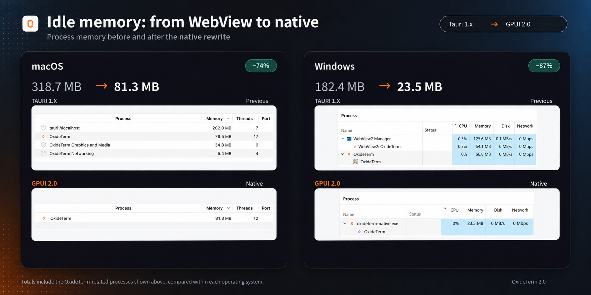
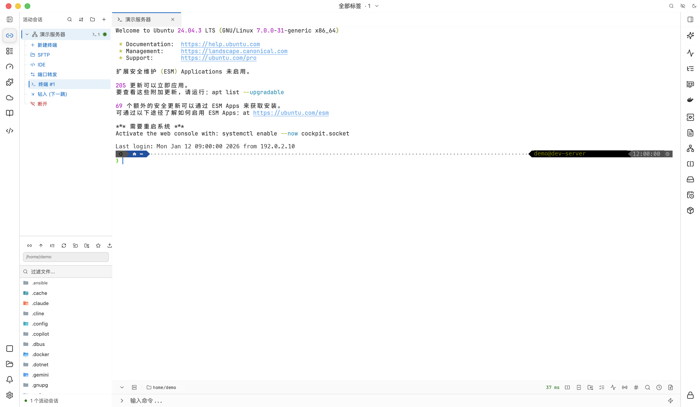
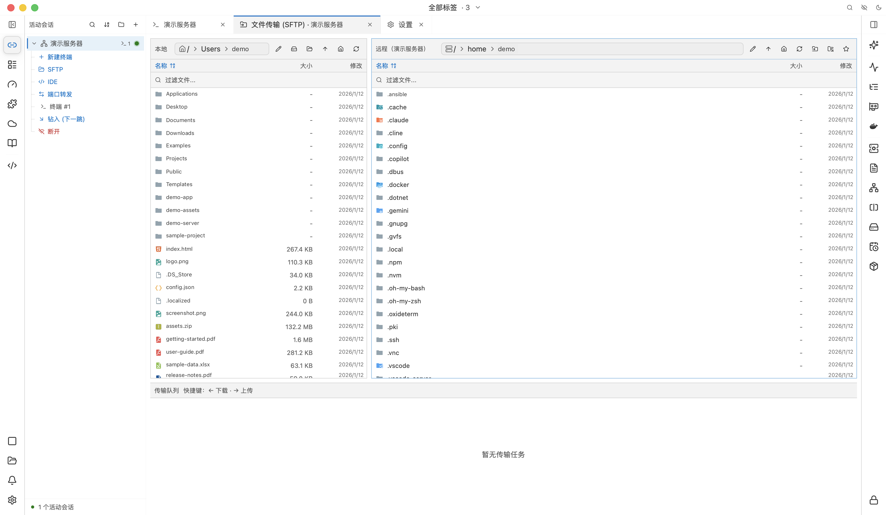
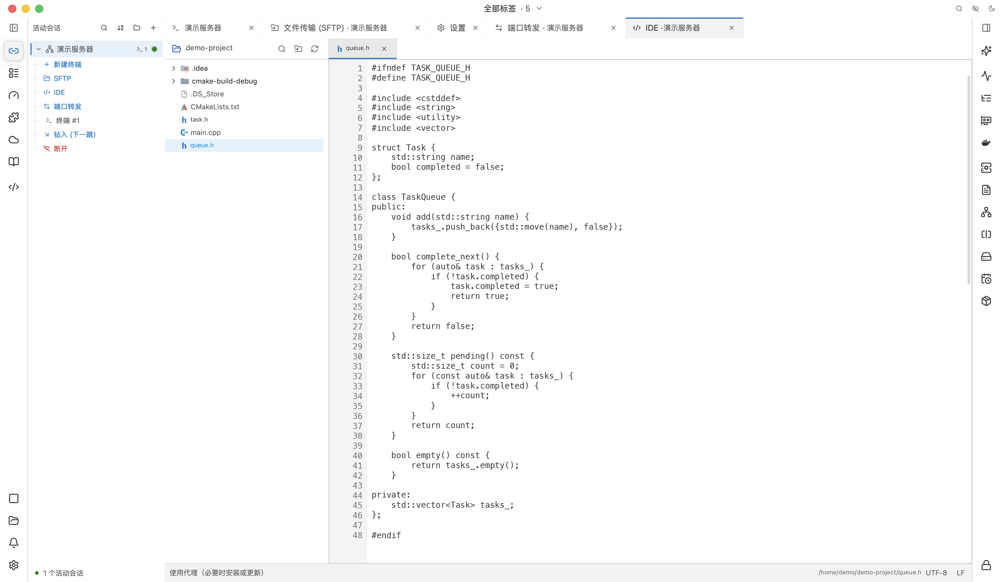
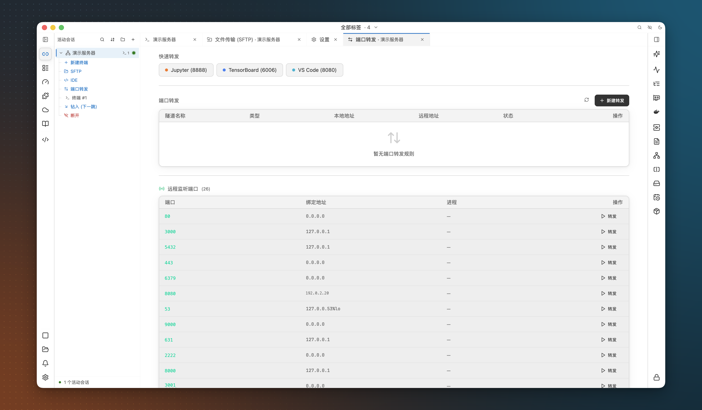
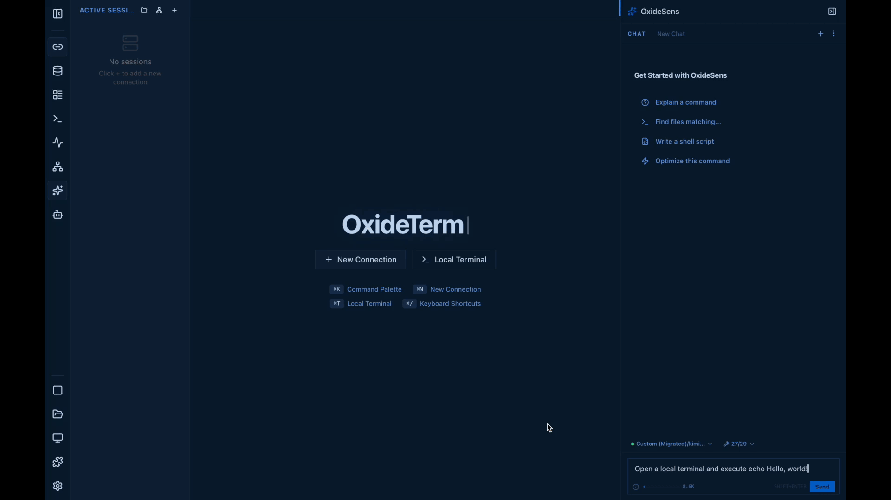

<div align="center">


# ⚡ OxideTerm

**Ein kostenloser, nativer SSH-Client für die Arbeit auf entfernten Servern.**

SSH · Mosh · Telnet · serielle Verbindungen · RDP/VNC · SFTP · Portweiterleitung · Code-Editor

Kein Konto. Kein Abo. Keine Telemetrie. Kein Electron.

[](https://github.com/AnalyseDeCircuit/oxideterm/releases/latest)
[](#install)
[](../../LICENSE)
[](https://github.com/AnalyseDeCircuit/oxideterm/stargazers)

[**Herunterladen**](https://github.com/AnalyseDeCircuit/oxideterm/releases/latest) ·
[**Dokumentation**](https://oxideterm.app) ·
[**Änderungsprotokoll**](../../.github/release-notes/stable-changelog.md) ·
[**Problem melden**](https://github.com/AnalyseDeCircuit/oxideterm/issues) ·
[**WeChat-Gruppe**](https://github.com/AnalyseDeCircuit/oxideterm/issues/752)

[English](../../README.md) | [简体中文](README.zh-Hans.md) | [繁體中文](README.zh-Hant.md) | [日本語](README.ja.md) | [한국어](README.ko.md) | [Français](README.fr.md) | [Deutsch](README.de.md) | [Español](README.es.md) | [Italiano](README.it.md) | [Português](README.pt-BR.md) | [Tiếng Việt](README.vi.md)

</div>

---

## Was ist OxideTerm?

OxideTerm ist ein SSH-Client für macOS, Windows und Linux. Jeder Server erhält seinen Arbeitsbereich in einem Fenster: Terminals, Dateimanager, Portweiterleitungen, Code-Editor, Überwachung und optionaler KI-Assistent. OxideTerm ist kostenlos und unter GPL-3.0 quelloffen.

## Warum OxideTerm

- **Einmal verbinden, alle Werkzeuge nutzen.** Terminals, SFTP, Weiterleitungen und Editor eines Servers teilen standardmäßig eine SSH-Verbindung, ohne erneute Anmeldung beim Werkzeugwechsel.
- **Übersteht kurze Netzausfälle.** Reagiert eine Verbindung nicht mehr, prüft OxideTerm sie 30 Sekunden vor dem Ersetzen weiter, damit vim, htop und andere Vollbildprogramme ihren Zustand fortsetzen können.
- **Geringer Speicherbedarf.** [GPUI](https://github.com/zed-industries/zed/tree/main/crates/gpui), das Framework des Zed-Editors, zeichnet die Oberfläche auf der GPU. Im Leerlauf benötigt sie etwa 81 MB auf macOS und 24 MB auf Windows.
- **Ihre eigene KI.** OxideSens nutzt Ihren gewählten Anbieter und API-Schlüssel. Kein OxideTerm-Guthaben erforderlich.
- **SSH vollständig in Rust.** Der SSH-Stack basiert auf russh und ring, ohne OpenSSL oder libssh2.

<details>
<summary><b>Speichervergleich mit OxideTerm 1.x</b></summary>

Leerlaufspeicher vor und nach dem Wechsel von Tauri (1.x) zu nativem GPUI (2.0). Die 1.x-Werte enthalten die WebView-Prozesse.

| Plattform | 1.x (Tauri) | 2.0 (nativ) | Rückgang |
|---|---:|---:|---:|
| macOS | 318.7 MB | 81.3 MB | 74% |
| Windows | 182.4 MB | 23.5 MB | 87% |



</details>

---

## Screenshots

### Terminal

Eine SSH-Sitzung. Die Seitenleiste zeigt die Werkzeuge dieses Servers: weitere Terminals, SFTP, IDE und Portweiterleitung.



### Dateien

Lokale und entfernte Ordner nebeneinander, darunter die Übertragungswarteschlange.



### IDE

Remote-Projekt öffnen und Dateien in Tabs bearbeiten.



### Portweiterleitung

OxideTerm zeigt die lauschenden Ports des Servers. Leiten Sie sie mit einem Klick weiter oder nutzen Sie eine Schnellweiterleitung für Werkzeuge wie Jupyter.



<details>
<summary><b>So öffnet OxideSens ein Terminal auf eine Anfrage in natürlicher Sprache</b></summary>

<a href="../../docs/media/ai-terminal-demo.mp4">
  
</a>

</details>

---

## Funktionen

Mit *(Plugin)* markierte Funktionen werden über den Plugin-Marktplatz der App installiert.

### Arbeitsbereich

- Sitzungsmanager mit Suche, Sortierung, Gruppen, Import/Export, verschachtelten Gruppen, Tags, Farben, Symbolen und Notizen
- Import aus `~/.ssh/config` mit `Match`-Blöcken, `ProxyJump`-Ketten und `RemoteCommand`; importierte Hosts bleiben aktuell
- Import aus SecureCRT, Xshell, Termius, MobaXterm, WindTerm, Electerm und FinalShell mit Vorschau vor dem Speichern
- Tab-Bereiche für alle Tabs, globale Seiten, lokale Terminals oder einen Server; ausgeblendete Sitzungen laufen weiter
- Bis zu 16 Bereiche pro Tab mit Terminals, SFTP, IDE, Weiterleitungen, Notizen, Einstellungen und Remote-Desktops
- Abgetrennte Fenster: Tabs ohne Sitzungsabbruch auslagern und zurückholen
- 2–16 offene Terminals ohne erneute Verbindung als Raster anordnen
- Befehlspalette für Aktionen und gespeicherte Verbindungen sowie Zen-Modus für eine einzelne Seite
- Lokale Terminalprofile mit eigener Shell, Startverzeichnis und Symbol
- Wiederherstellung von Arbeitsbereich, Fenstergröße, Vollbild und Bildschirmposition beim Start

### Terminal

- Automatische Erkennung lokaler Shells: Unix-Shells, Eingabeaufforderung, Windows PowerShell, PowerShell Core, Git Bash und Nushell
- Geteilte Bereiche mit verschiebbaren Trennlinien; neue lokale Bereiche übernehmen das Arbeitsverzeichnis
- Suche mit regulären Ausdrücken, Groß-/Kleinschreibung und mehrzeiligen Abfragen, getrennt je Bereich
- Shell-Integration für Bash, Zsh, Fish, Nushell und PowerShell: Arbeitsverzeichnisse, Exitcodes, Befehlsmarkierungen und Remote-Installation aus der App
- Abgeschlossene Befehlsausgaben einklappen und Exitstatus behalten
- Befehlsleiste mit mehrzeiliger Eingabe, Verlauf, Pfadvorschlägen, Vervollständigung und Schnellbefehlen
- Unscharfe Verlaufsvorschläge und optionaler, neustartfester Verlauf pro Verbindung
- Freier Eingabemodus zum Bearbeiten des aktuellen Befehls mit der Maus
- Mehrzeiliges Einfügen vor dem Senden bearbeiten, mit Rückgängig und Entfernen von Codeblock-Begrenzungen
- Auslöser für Text oder reguläre Ausdrücke: Eingaben senden, Schnellbefehle ausführen, Programme starten oder Treffer anklickbar machen
- Semantische Färbung unformatierter Ausgaben wie Fehler, Git-Zustände, Rechte, Adressen und Daten; Schlüsselwort- und Regex-Hervorhebung
- Anklickbare URLs und Dateipfade, Zeitstempel je Zeile mit Millisekunden und Markierungen ungelesener Tab-Ausgaben
- Sixel- und Kitty-Grafik einschließlich Kitty-Animationen
- Nativer `tmux -CC`-Steuerungsmodus mit Bereichsanordnung und verschiebbaren Trennlinien
- Synchronisierte Eingabegruppen und Befehlsversand als Text oder Hex mit Tempo, Intervallen und Wiederholungen
- Schnellbefehle mit Gruppen, Anheften, Text-, Auswahl- oder geheimen Parametern und Host-Anzeigeregeln
- Sitzungsprotokolle mit Namensvorlagen, Größen-/Aufbewahrungsgrenzen und optionalem ANSI; `.cast`-Aufzeichnungen mit integriertem Player
- Kopieren, Ausschneiden und Einfügen für Vim-, Neovim- und Emacs-Auswahlen, lokal und in unterstützten SSH-Sitzungen
- Backspace-/Delete-Sequenzen und Textkodierung pro Verbindung

### Verbindungen

- SSH-Anmeldung per Passwort, privatem Schlüssel, OpenSSH-Zertifikat, verwaltetem Schlüssel, SSH-Agent, interaktiver Tastaturabfrage oder Kerberos
- SSH-Agent-Erkennung oder eigener Endpunkt (`SSH_AUTH_SOCK` unter macOS/Linux, `\\.\pipe\openssh-ssh-agent` unter Windows) und Agent-Weiterleitung
- Ed25519-, RSA- und ECDSA-Schlüssel, ChaCha20-Poly1305 und AES-GCM, einstellbare Algorithmusreihenfolge und Kompatibilität für ältere Server
- TOTP-Codes bei passenden Abfragen automatisch erzeugen und einfügen, auf Server und Sprunghosts
- FIDO-Sicherheitsschlüssel (`ed25519-sk`, `ecdsa-sk`) mit PIN- und Berührungsabfrage *(Plugin)*
- Sprunghost-Ketten mit separater Anmeldung je Hop, HTTP-CONNECT-/SOCKS5-Proxys und ProxyCommand
- Grace-Period-Wiederverbindung mit Wiederherstellung von Weiterleitungen, Fortsetzung von Übertragungen und erneutem Öffnen der Editordateien
- Eine gemeinsame Verbindung pro Server oder getrennte Anmeldung für jedes neue Terminal
- Vertrauenswürdige oder nicht vertrauenswürdige X11-Weiterleitung
- Temporäre Verbindungen ohne Speichern sowie `ssh://`-, `telnet://`-, `mosh://`-, `rdp://`- und `vnc://`-Links zur App
- Mosh mit adaptiver lokaler Echo-Vorhersage *(Plugin)*
- Telnet mit Optionsaushandlung, Proxy-Routing und konfigurierbaren Zeilenenden
- Serielle Ports mit Baudrate, Datenbits, Parität, Stoppbits, Flusskontrolle, Hex-Ein-/Ausgabe sowie Break, DTR und RTS
- Bluetooth-LE-Terminals über Nordic UART Service oder eigene GATT-Charakteristiken

### Dateien und Übertragungen

- Lokaler/entfernter Dateimanager mit zwei Bereichen, Favoriten, Pfadvervollständigung und Listen-/Baumansicht
- Zusammengehörige lokale und entfernte Lesezeichen je Verbindung
- Parallele Übertragungen mit Tempolimit, Restzeit, Pause, Fortsetzung und Wiederholung; unterbrochene SFTP-Transfers erscheinen nach Neustart pausiert
- Konflikte durch Überschreiben, Überspringen oder Umbenennen behandeln, einzeln oder für alle Dateien
- SFTP mit automatischem SCP-Rückgriff bei fehlendem SFTP-Subsystem
- Eigenständige SFTP-Verbindungen und Server-zu-Server-Übertragungen über die App
- FTP und explizites FTPS
- Dateien auf ein SSH-Terminal ziehen, um sie ins aktuelle Verzeichnis hochzuladen
- `trz`/`tsz` (trzsz) und `rz`/`sz` (ZMODEM) in der Remote-Shell; XMODEM, YMODEM und ZMODEM seriell
- Vorschau für Text, Code, Markdown, Bilder, Audio, Video, Hex und Schriftarten
- PDF-, SQLite-, Zertifikat- und Binärbetrachter *(Plugin)*
- Vom Terminal ins gleiche SFTP-Verzeichnis wechseln und SFTP-Verzeichnisse ans Terminal übergeben

### Editor und IDE

- Remote-IDE über SFTP, einfache Shell-Befehle oder Remote-Agent mit Symbolindex, Vervollständigung und Dateiüberwachung
- Inaktives Terminal mit gleichem Benutzer, Container und Verzeichnis in eine IDE umwandeln
- Tabs, Projektbaum mit Mehrfachauswahl, Projektsuche und Ersetzen mit Regex und Erfassungsgruppen
- Dateien bis 100 MiB, unter Erhalt von Kodierung, BOM und Zeilenenden
- Sicheres Speichern mit Konfliktbehandlung und optionalem automatischem Speichern beim Tab-Wechsel
- Offene Dateien und ungespeicherte Änderungen nach Neustart wiederherstellen
- Git-Ansichten für Branches, Worktrees, Staging, Verlauf, voraus-/zurückliegende Commits sowie Merge-/Rebase-Zustände
- Projektaufgaben erkennen und ausführen
- Syntaxhervorhebung für 15 eingebaute und über 20 weitere Plugin-Sprachen *(Plugin)*
- Markdown-Vorschau mit Tabellen, Formeln und Fußnoten

### Portweiterleitung und Netzwerk

- Lokale, entfernte und dynamische SOCKS5-Weiterleitungen mit gespeicherten, beim Verbinden startbaren Regeln
- Lauschende Serverports erkennen und mit einem Klick weiterleiten
- Eigenständige SSH-Tunnel ohne Terminal, optional beim App-Start
- Weiterleitungen nach Wiederverbindung herstellen; manuell gestoppte Regeln bleiben gestoppt
- App-weiter Proxy und vertrauenswürdige Systemzertifikate einschließlich Unternehmens-CAs für Netzwerkanfragen
- Verbindungstopologie und gezieltes Socket-Debugging

### Remote-Desktop

- RDP und VNC mit Tastatur, Maus, Zwischenablage, Skalierung und Wiederverbindung *(Plugin)*
- RDP mit mehreren Monitoren und Netzwerkqualitätsprofilen *(Plugin)*
- VNC über VeNCrypt TLS *(Plugin)*
- RDP und VNC über SSH-Sprunghosts *(Plugin)*
- WSLg-Anwendungen im integrierten Betrachter (Windows)

### Host-Werkzeuge

- Für den lokalen Rechner und beliebige SSH-Server
- CPU, Speicher, Swap, Datenträger, Netzwerk, Last und Latenz mit Verlaufskurven
- Prozesse (Signale, Anhalten/Fortsetzen, nice), Dienste (systemd, launchd, BSD, Windows), geplante Aufgaben und Pakete; winget-Upgrades und Deinstallationen unter Windows
- Protokolle mit Vorlagen und Live-Verfolgung, lauschende Ports mit Expositionshinweisen und Dateisysteme mit Speicherplatzwarnungen
- Docker-Container: Status, Ports, Start, Stopp, Neustart und Protokolle
- GPU-/NPU-Überwachung für NVIDIA, AMD ROCm, Hygon DCU, Huawei Ascend, Intel XPU, Moore Threads MUSA und Cambricon
- tmux-, Zellij- und Herdr-Sitzungen: anhängen, erstellen, teilen und umbenennen
- Verbindungspool- und Verbindungsmatrix-Dashboards sowie SSH-Latenz in der Terminalleiste

### OxideSens-KI

- OpenAI (einschließlich Responses API), Anthropic, Gemini, DeepSeek, xAI Grok, Xiaomi MiMo, Ollama oder OpenAI-kompatible Endpunkte mit einstellbarem Denkaufwand
- Kontext aus ausgewählten Terminals, Dateien und Einstellungen; Werkzeuge für Befehle, interaktive Programme, Dateibearbeitung und Datentransfer
- Nur-Lesen-, Standard- oder freigabefreier Modus, Berechtigungen je Werkzeugkategorie, Befehlsregeln und zusätzliche Prüfung destruktiver oder zugangsdatenbezogener Befehle
- Bildanhänge, Gesprächsverzweigungen, bearbeitbare Nachrichten und wartende Folgefragen
- Parallele Unteragenten, Hintergrundaufgaben und Fortsetzung unterbrochener Aufgaben
- Codex und Claude Code über ACP sowie Starter für OpenCode, Antigravity, Cursor, Grok Build, GitHub Copilot CLI, Qwen Code und Kimi CLI *(Plugin)*
- MCP-Server über stdio, Streamable HTTP oder älteres SSE
- Externe MCP-Steuerung: Editoren und andere KI-Werkzeuge nutzen gespeicherte Verbindungen über OxideTerm mit widerrufbaren Rechten je Werkzeuggruppe
- [Agent Skills](../../docs/agent-skills.md) (`SKILL.md`) mit `/skill-name`-Vervollständigung
- Markdown-Wissensbasis mit BM25- und HNSW-Vektorsuche, CJK-Tokenisierung und Mermaid-Vorschau

### Sicherheit

- App-Sperre mit Touch ID (macOS) oder Windows Hello (Windows), während Verbindungen weiterlaufen
- Gespeicherte sudo-/su-Passwörter bei Abfragen anbieten, begrenzt auf lokalen Rechner, Verbindung oder Host-Muster; optionales TOTP für zweistufige Abfragen
- Aktionsaudit mit Filtern, Aufbewahrungsgrenzen und JSON-/CSV-Export
- Verschlüsselte Sitzungsaufzeichnung mit Wiedergabe, Positionssuche und Geschwindigkeitssteuerung
- Berechtigungen vor Plugin-Aktivierung prüfen

### Synchronisierung und Sicherung

- Cloud-Synchronisierung über WebDAV, S3-kompatible Speicher einschließlich Alibaba Cloud OSS, Git-Repository, GitHub Gist, Dropbox, OneDrive, Google Drive oder HTTP JSON
- Synchronisierte Daten wählen, Änderungen mehrerer Geräte zusammenführen und Konflikte einzeln lösen
- Wiederherstellbare Sicherungen und Wiederaufnahme unterbrochener Synchronisierungen
- Verschlüsselte `.oxide`-Pakete für Verbindungen, Weiterleitungen, Einstellungen, Schnellbefehle und Schlüssel; beim Import überspringen, umbenennen, ersetzen oder zusammenführen
- Portabler Betrieb aus einem Ordner mit eigenem verschlüsseltem Schlüsselspeicher
- App-interne Updates über Stable- oder Beta-Kanal

### Personalisierung

- Helles, dunkles oder Systemdesign mit getrennten App-/Terminal-Themes und Theme-Editor
- Hintergrundbilder, Animationen und Videos sowie erzeugter Nebel, Partikel, Meteore und Wasserkaustiken; zusätzliche Medienpakete *(Plugin)*
- Fenstertransparenz und Eckenstile
- Schriftstapel mit eigenen CJK-Schriften, Ligaturen und Gewichten sowie unabhängiger Editortypografie
- Oberflächenskalierung, Cursorstil, Innenabstände und Bewegungseinstellungen
- Eigene Tastenkürzel und durchsuchbare, neu anordenbare Einstellungen
- 11 Oberflächensprachen, IME-Eingabe und bidirektionaler Text

### Plugins

| Typ | Ausführung | Zugriff |
|---|---|---|
| **Manifest** | Deklarative Erweiterung | Keiner; kein Code wird ausgeführt |
| **WASM** | Wasmtime/WASI oder Hilfsprozess | Nur gewährte Host-Fähigkeiten |
| **Prozess** | Gewöhnlicher lokaler Prozess | Zugriff wie ein lokales Programm; keine Betriebssystem-Sandbox |

Prozess-Plugins nur aus vertrauenswürdigen Quellen installieren. Plugins für OxideTerm 1.x können noch erscheinen, werden von 2.x jedoch nicht ausgeführt.

### Kommandozeilenwerkzeug

Installieren Sie `oxideterm` unter **Einstellungen → Allgemein → CLI Companion**. Es teilt die App-Konfiguration für Prüfung, Skripte und Sicherung ohne Fenster oder öffnet neue Tabs aus einer Shell. Änderungen lassen sich mit `--dry-run` planen, gelten erst mit `--yes` und behalten eine Rückrollsicherung.

```bash
oxideterm terminal --cwd ~/project
oxideterm doctor --strict
oxideterm connections search prod
oxideterm forwards list --format json
oxideterm oxide export ./profile.oxide --connection prod --password-stdin
```

Shell-Vervollständigung für Bash, Zsh, Fish, PowerShell und Elvish. Alle Befehle stehen im [CLI-Handbuch (Englisch)](../../docs/user-guide/en/cli.md).

---

<a id="install"></a>

## Installation

Laden Sie OxideTerm aus der [neuesten Veröffentlichung](https://github.com/AnalyseDeCircuit/oxideterm/releases/latest) herunter.

| Betriebssystem | x64 | ARM64 |
|---|---|---|
| **macOS** | DMG (Intel) | DMG (Apple Silicon) |
| **Windows** | Installationsprogramm (`.exe`) | Installationsprogramm (`.exe`) |
| **Linux** | AppImage · `.deb` · `.rpm` | AppImage · `.deb` · `.rpm` |

Die Release-Seite enthält außerdem portable Archive, Signaturen und `sha256sums.txt` zur Downloadprüfung.

### macOS

Falls Gatekeeper die App blockiert, entfernen Sie das Quarantäneattribut:

```bash
xattr -cr /Applications/OxideTerm.app
```

### Windows

Wenn SmartScreen eine Warnung anzeigt, wählen Sie **Weitere Informationen → Trotzdem ausführen**.

### Linux

```bash
# AppImage
chmod +x OxideTerm_*_linux_*.AppImage && ./OxideTerm_*_linux_*.AppImage

# Debian / Ubuntu
sudo dpkg -i OxideTerm_*_linux_*.deb && sudo apt-get install -f

# Fedora / RHEL-compatible
sudo dnf install ./OxideTerm_*_linux_*.rpm

# Nix; updates are managed by Nix
nix run github:AnalyseDeCircuit/oxideterm
```

### Wenn das Fenster nicht gezeichnet wird

Setzen Sie `OXIDETERM_RENDER_PROFILE=compatibility` in der Umgebung und starten Sie OxideTerm neu.

### Erste Schritte

1. Öffnen Sie den **Sitzungsmanager** und fügen Sie einen Server hinzu oder importieren Sie Hosts aus `~/.ssh/config`.
2. Verbinden Sie sich, um ein Terminal zu öffnen.
3. Öffnen Sie vom selben Server aus SFTP, Weiterleitungen oder die IDE.
4. Für OxideSens fügen Sie in den **Einstellungen** einen KI-Anbieter hinzu.

Die [Dokumentation](https://oxideterm.app) erläutert weitere Funktionen. Zum Selbstbauen siehe [Aus dem Quellcode bauen](#build-from-source).

---

## Datenschutz und Sicherheit

- Passwörter und Schlüssel liegen im Systemschlüsselbund (macOS Keychain, Windows Credential Manager oder libsecret unter Linux). KI-Schlüssel werden nicht protokolliert.
- Geheimnisse im Speicher werden beim Freigeben mit zeroize gelöscht.
- Host-Schlüssel werden bei Erstkontakt vertraut und mit `~/.ssh/known_hosts` geprüft; geänderte Schlüssel werden abgelehnt.
- Text an KI-Anbieter durchläuft zuerst die Maskierung von Zugangsdaten.
- Sitzungsaufzeichnung ist standardmäßig aus, lokal verschlüsselt, nicht Teil der Cloud-Synchronisierung und erfasst keine Tastatureingaben.
- Benachrichtigungen und Audit sind standardmäßig aus. Nach Aktivierung bleiben Daten lokal, sensible Details verschlüsselt; erfasst werden nur Vorgänge innerhalb OxideTerms.
- `.oxide`-Pakete nutzen ChaCha20-Poly1305 mit Argon2id-Schlüsselableitung (256 MB Speicher, 4 Iterationen).

---

<a id="build-from-source"></a>

## Aus dem Quellcode bauen

Benötigt werden Rust (rustup installiert die in `rust-toolchain.toml` festgelegte Toolchain) und eine GPUI-fähige Desktop-Umgebung.

```bash
# Run the app
cargo run

# Build the oxideterm CLI
./scripts/build/build-cli.sh

# Build the optional Linux remote agent
./scripts/build/build-agent.sh
```

Mit Nix: `nix build .#oxideterm`, `nix run .#oxideterm` oder `nix develop`. Die CLI wird unter `crates/oxideterm-gpui-app/resources/cli-bin/<target-triple>/oxideterm` abgelegt.

### Aufbau

Oberfläche, Terminals und SSH laufen in einem Rust-Prozess. Optionaler Remote-Agent und Plattformhelfer sind eigene Prozesse. SSH-/PTY-Ausgabe geht direkt in `TerminalState`, das GPUI ohne WebView, JSON-Brücke oder xterm.js zeichnet.

`NodeRouter` verteilt Verbindungen aus dem DashMap-Pool `SshConnectionRegistry`. Terminalbereiche, SFTP, Weiterleitungen und Editor teilen eine Verbindung je Server, außer ein Terminal nutzt eine eigene. Die Zustände sind `connecting → active → idle → link_down → reconnecting`. Bei Sprunghost-Ausfall wechseln nachgelagerte Server zu `link_down`. Jede Weiterleitungsregel besitzt einen Listener. Nach Wiederverbindung werden SFTP-Sitzungen neu bezogen; Vorgänge der alten Verbindung werden nie stillschweigend übertragen.

```text
crates/
├── oxideterm-gpui-app/        # Desktop app: windows, workspace, settings
├── oxideterm-gpui-terminal/   # Terminal panes: input, selection, overlays
├── oxideterm-terminal/        # Terminal model and escape-sequence parsing
├── oxideterm-ssh/             # SSH connections, NodeRouter, jump hosts
├── oxideterm-sftp/            # SFTP sessions and transfers
├── oxideterm-forwarding/      # Port forwarding runtime
├── oxideterm-gpui-ide/        # Remote IDE
├── oxideterm-ai/              # OxideSens: providers, MCP, RAG
├── oxideterm-cli/             # The oxideterm command
├── oxideterm-i18n/            # Locale catalogs for the 11 interface languages
└── gpui-ce/                   # Patched copy of GPUI
```

Weiterlesen (Englisch): [Entwicklungsleitfaden](../../docs/development/README.md), [Crate-Übersicht](../../docs/development/crate-map.md) und [Architektur](../../docs/user-guide/en/architecture.md).

---

## Mitwirken

Beiträge zu Code, Dokumentation, Übersetzungen, Plugins, Tests und Fehlerreproduktionen sind willkommen. Größere Änderungen zuerst als Issue besprechen. [CONTRIBUTING.md](../../docs/CONTRIBUTING.md) erklärt Pull Requests.

Ein Diagnosepaket mit maskierten sensiblen Daten erleichtert die Fehlerbehebung:

```bash
oxideterm report --bundle ./oxideterm-report.zip
```

Aus dem Quellcode verwenden Sie stattdessen `cargo run -p oxideterm-cli -- report --bundle ./oxideterm-report.zip`.

### Mitwirkende

Vielen Dank an alle, die OxideTerm verbessern.

<p align="center">
  <a href="https://github.com/AnalyseDeCircuit/oxideterm/graphs/contributors">
    
  </a>
</p>

---

## Danksagungen

OxideTerm baut auf folgenden Open-Source-Projekten auf:

- [russh](https://github.com/warp-tech/russh) und [ring](https://github.com/briansmith/ring): SSH und Kryptografie
- [GPUI](https://github.com/zed-industries/zed/tree/main/crates/gpui): GPU-Oberflächenframework des Zed-Editors
- [alacritty_terminal](https://github.com/alacritty/alacritty): Terminalemulation (VT100–VT500)
- [portable-pty](https://github.com/wez/wezterm/tree/main/pty): lokale Shells, unter Windows mit ConPTY
- [Tokio](https://tokio.rs): asynchrone Laufzeit
- [Wasmtime](https://wasmtime.dev/): führt WASM-Plugins aus
- [tree-sitter](https://tree-sitter.github.io/): Syntaxhervorhebung im Editor

---

## Lizenz

OxideTerm steht unter [GPL-3.0-only](../../LICENSE), ohne zusätzliche Einschränkungen. Abhängigkeitshinweise: [THIRD_PARTY_NOTICES.md](../../THIRD_PARTY_NOTICES.md) und [NOTICE](../../NOTICE).

OxideTerm nur auf eigenen oder ausdrücklich freigegebenen Systemen verwenden. Der vollständige Rechtshinweis steht in [LEGAL.md](../../LEGAL.md).

## Star History

<a href="https://www.star-history.com/?repos=AnalyseDeCircuit%2Foxideterm&type=date&legend=top-left">
 <picture>
   <source media="(prefers-color-scheme: dark)" srcset="https://api.star-history.com/chart?repos=AnalyseDeCircuit/oxideterm&type=date&theme=dark&legend=top-left" />
   <source media="(prefers-color-scheme: light)" srcset="https://api.star-history.com/chart?repos=AnalyseDeCircuit/oxideterm&type=date&legend=top-left" />
   
 </picture>
</a>
