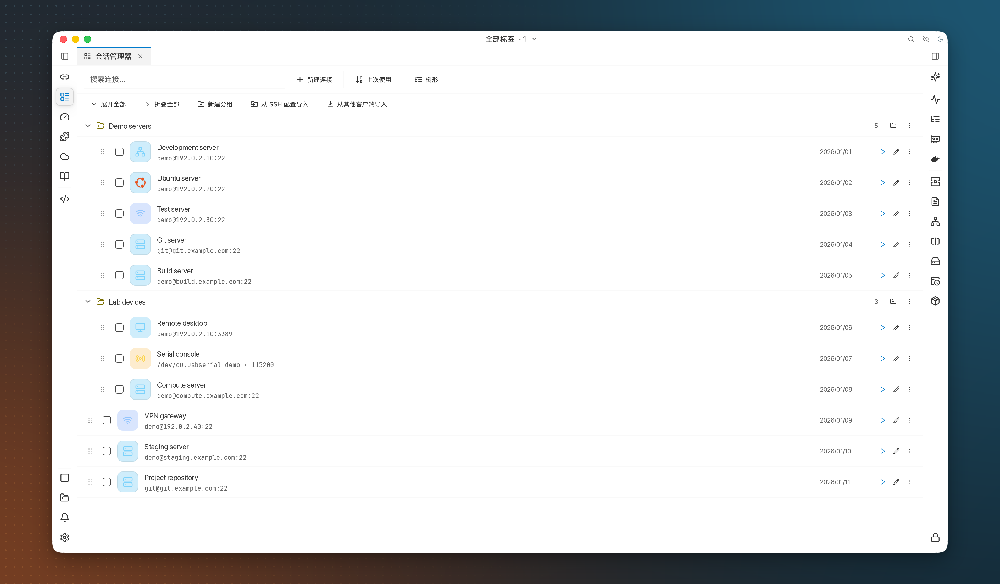
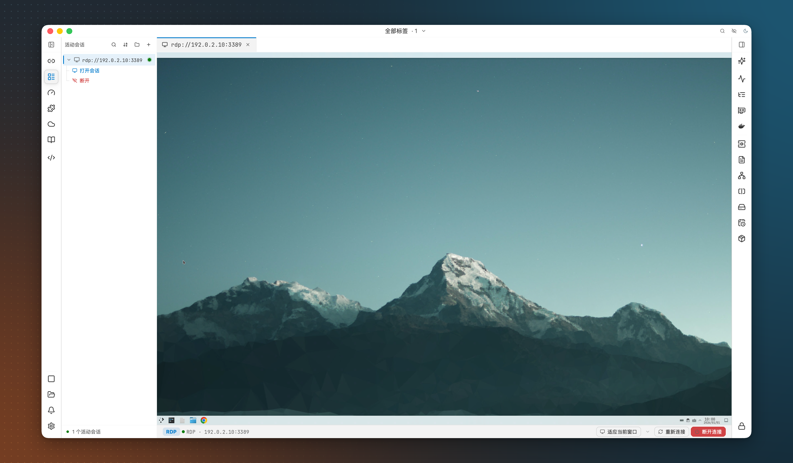

<div align="center">


# ⚡ OxideTerm

**Un client SSH nativo e gratuito per lavorare sui server remoti.**

SSH · Mosh · Telnet · seriale · RDP/VNC · SFTP · inoltro porte · editor di codice

Nessun account. Nessun abbonamento. Nessuna telemetria. Niente Electron.

[](https://github.com/AnalyseDeCircuit/oxideterm/releases/latest)
[](#install)
[](../../LICENSE)
[](https://github.com/AnalyseDeCircuit/oxideterm/stargazers)

[**Scarica**](https://github.com/AnalyseDeCircuit/oxideterm/releases/latest) ·
[**Documentazione**](https://oxideterm.app) ·
[**Registro delle modifiche**](../../.github/release-notes/stable-changelog.md) ·
[**Segnala un problema**](https://github.com/AnalyseDeCircuit/oxideterm/issues) ·
[**Gruppo WeChat**](https://github.com/AnalyseDeCircuit/oxideterm/issues/752)

[English](../../README.md) | [简体中文](README.zh-Hans.md) | [繁體中文](README.zh-Hant.md) | [日本語](README.ja.md) | [한국어](README.ko.md) | [Français](README.fr.md) | [Deutsch](README.de.md) | [Español](README.es.md) | [Italiano](README.it.md) | [Português](README.pt-BR.md) | [Tiếng Việt](README.vi.md)

</div>

---

## Che cos’è OxideTerm

OxideTerm è un client SSH per macOS, Windows e Linux. Ogni server ha il proprio spazio di lavoro in un’unica finestra: terminali, file, inoltri, editor di codice, monitoraggio e assistente IA opzionale. È gratuito e open source sotto GPL-3.0.

## Perché scegliere OxideTerm

- **Una connessione per tutti gli strumenti.** Terminali, SFTP, inoltri ed editor di un server condividono una connessione SSH per impostazione predefinita, senza nuovi accessi aprendo altri strumenti.
- **Resiste alle brevi interruzioni.** Prima di sostituire una connessione che non risponde, OxideTerm continua a verificarla per 30 secondi, permettendo a vim, htop e altri programmi a schermo intero di riprendere dallo stesso stato.
- **Consuma poca memoria.** L’interfaccia è disegnata sulla GPU con [GPUI](https://github.com/zed-industries/zed/tree/main/crates/gpui), il framework di Zed. A riposo usa circa 81 MB su macOS e 24 MB su Windows.
- **La tua IA.** OxideSens usa il fornitore e la chiave API scelti da te. Nessun credito OxideTerm da acquistare.
- **SSH interamente in Rust.** Basato su russh e ring, senza OpenSSL o libssh2.

<details>
<summary><b>Memoria a confronto con OxideTerm 1.x</b></summary>

Memoria a riposo prima e dopo il passaggio da Tauri (1.x) a GPUI nativo (2.0). I dati di 1.x includono i processi WebView.

| Piattaforma | 1.x (Tauri) | 2.0 (nativo) | Riduzione |
|---|---:|---:|---:|
| macOS | 318.7 MB | 81.3 MB | 74% |
| Windows | 182.4 MB | 23.5 MB | 87% |


</details>

---

## Schermate

### Area di lavoro mista

Un terminale SSH, un terminale locale, note Markdown e SFTP nella stessa scheda. Combina pagine di server diversi e del tuo computer in un massimo di 16 pannelli.


### Gestore delle sessioni

Organizza le connessioni salvate in gruppi e importale dalla configurazione SSH o da altri client.



### Terminale

Una sessione SSH. La barra laterale elenca gli strumenti del server: altri terminali, SFTP, IDE e inoltro porte.


### File

Cartelle locali e remote affiancate, con la coda dei trasferimenti sotto.


### IDE

Apri un progetto remoto e modificane i file nelle schede.


### Inoltro porte

OxideTerm elenca le porte in ascolto sul server. Inoltrale con un clic o usa un inoltro rapido per strumenti come Jupyter.


### Desktop remoto

Apri un desktop RDP in una scheda. I controlli in basso permettono di regolare le dimensioni dello schermo o riconnettersi.



<details>
<summary><b>Guarda OxideSens aprire un terminale da una richiesta in linguaggio naturale</b></summary>

<a href="../../docs/media/ai-terminal-demo.mp4">
  
</a>

</details>

---

## Funzionalità

Le voci segnate *(plugin)* si installano dal marketplace dei plugin nell’app.

### Spazio di lavoro

- Gestore sessioni con ricerca, ordinamento, gruppi, importazione/esportazione, gruppi annidati, etichette, colori, icone e note
- Importazione da `~/.ssh/config` con blocchi `Match`, catene `ProxyJump` e `RemoteCommand`; host importati mantenuti aggiornati
- Importazione da SecureCRT, Xshell, Termius, MobaXterm, WindTerm, Electerm e FinalShell, con anteprima prima del salvataggio
- Filtri delle schede: tutte, pagine globali, terminali locali o un server; le sessioni nascoste restano attive
- Fino a 16 pannelli per scheda combinando terminali, SFTP, IDE, inoltri, note, impostazioni e desktop remoti
- Finestre separate: sposta una scheda in una finestra propria e riportala indietro senza interrompere le sessioni
- Disponi 2–16 terminali aperti in una griglia senza riconnetterli
- Tavolozza comandi per azioni e connessioni salvate, e modalità Zen per concentrarsi su una pagina
- Profili di terminale locale con shell, cartella iniziale e icona proprie
- Ripristino di spazio di lavoro, dimensioni, schermo intero e posizione sui monitor all’avvio

### Terminale

- Rilevamento delle shell locali: Unix, Prompt dei comandi, Windows PowerShell, PowerShell Core, Git Bash e Nushell
- Pannelli con separatori trascinabili; quelli locali nuovi ereditano la cartella di lavoro
- Ricerca con regex, maiuscole/minuscole e query multilinea, indipendente per pannello
- Integrazione Bash, Zsh, Fish, Nushell e PowerShell: cartelle, codici di uscita e marcatori comandi, installabile sui server dall’app
- Comprimi l’output dei comandi terminati conservandone lo stato di uscita
- Barra comandi con input multilinea, cronologia, suggerimenti di percorsi, completamento e comandi rapidi
- Suggerimenti approssimati dalla cronologia e cronologia persistente per connessione opzionale
- Modalità di digitazione libera per modificare il comando attuale con il mouse
- Modifica gli incolli multilinea prima dell’invio, con annullamento e rimozione dei delimitatori dei blocchi di codice
- Trigger su testo o regex: invia input, esegui comandi rapidi, avvia programmi o crea azioni cliccabili dai risultati
- Colori semantici per output senza stile: errori, stati Git, permessi, indirizzi e date; evidenziazione per parole e regex
- URL e percorsi cliccabili, timestamp per riga al millisecondo e indicatori di output non letto nelle schede
- Grafica Sixel e Kitty, incluse animazioni Kitty
- Controllo nativo `tmux -CC` con disposizione dei pannelli e separatori trascinabili
- Gruppi di input sincronizzato e invio di testo o esadecimale con ritmo, intervalli e ripetizioni
- Comandi rapidi con gruppi, elementi fissati, parametri testuali, a scelta o segreti e regole di visibilità per host
- Log di sessione con modelli di nomi, limiti di dimensione e conservazione, ANSI opzionale; registrazioni `.cast` con lettore integrato
- Copia, taglia e incolla sulle selezioni di Vim, Neovim o Emacs, localmente e nelle sessioni SSH supportate
- Sequenze Backspace/Delete e codifiche del testo per connessione

### Connessioni

- Accesso SSH con password, chiavi private, certificati OpenSSH, chiavi gestite, agente SSH, richieste interattive da tastiera o Kerberos
- Agente SSH rilevato o endpoint personalizzato (`SSH_AUTH_SOCK` su macOS/Linux, `\\.\pipe\openssh-ssh-agent` su Windows), e inoltro agente
- Chiavi Ed25519, RSA ed ECDSA, cifratura ChaCha20-Poly1305 e AES-GCM, ordine algoritmi regolabile e compatibilità con server datati
- Codici TOTP generati e inseriti a richieste corrispondenti, sul server o su qualsiasi host di salto
- Chiavi FIDO (`ed25519-sk`, `ecdsa-sk`) con richieste di PIN e tocco *(plugin)*
- Catene di host di salto con accessi separati, proxy HTTP CONNECT/SOCKS5 e ProxyCommand
- Riconnessione con periodo di tolleranza: ripristina inoltri, riprende trasferimenti e riapre file dell’editor sulla nuova connessione
- Connessione condivisa per server o autenticazione separata per ogni nuovo terminale
- Inoltro X11 attendibile o non attendibile
- Connessioni temporanee senza salvataggio e link `ssh://`, `telnet://`, `mosh://`, `rdp://` e `vnc://` che aprono l’app
- Mosh con previsione adattiva dell’eco locale *(plugin)*
- Telnet con negoziazione opzioni, proxy e fine riga configurabile
- Seriale: baud, bit dati, parità, bit di stop, controllo flusso, input/output esadecimale e controlli Break, DTR e RTS
- Terminali Bluetooth LE tramite Nordic UART Service o caratteristiche GATT personalizzate

### File e trasferimenti

- Gestore locale/remoto a due pannelli con preferiti, completamento percorsi e viste elenco o albero
- Segnalibri abbinati locali/remoti per connessione
- Coda parallela con limiti di velocità, tempo residuo, pausa, ripresa e nuovi tentativi; SFTP interrotti ripristinati in pausa dopo riavvio
- Sovrascrivi, salta o rinomina nei conflitti, per un file o tutti
- SFTP con ripiego automatico su SCP se manca il sottosistema SFTP
- Connessioni SFTP autonome e trasferimenti server-server tramite l’app
- FTP e FTPS esplicito
- Trascina file nel terminale SSH per caricarli nella sua cartella corrente
- `trz`/`tsz` (trzsz) e `rz`/`sz` (ZMODEM) dalla shell remota; XMODEM, YMODEM e ZMODEM sulle connessioni seriali
- Anteprime di testo, codice, Markdown, immagini, audio, video, esadecimale e font
- Visualizzatori PDF, SQLite, certificati e binari *(plugin)*
- Dal terminale alla stessa cartella SFTP e invio della cartella SFTP al terminale

### Editor e IDE

- IDE remoto via SFTP, semplici comandi shell o agente remoto con indice simboli, completamento e controllo modifiche dei file
- Converti un terminale inattivo in IDE con lo stesso utente, contenitore e cartella
- Schede, albero con selezione multipla, ricerca nel progetto e sostituzione con regex e gruppi di cattura
- File fino a 100 MiB conservando codifica, BOM e fine riga
- Salvataggi sicuri con conflitti e salvataggio automatico opzionale al cambio scheda
- Ripristino dei file aperti e modifiche non salvate dopo riavvio
- Viste Git per rami, worktree, staging, cronologia, commit avanti/indietro e stati merge/rebase
- Rilevamento ed esecuzione delle attività del progetto
- Evidenziazione integrata per 15 linguaggi e oltre 20 aggiuntivi via plugin *(plugin)*
- Anteprima Markdown con tabelle, formule e note a piè di pagina

### Inoltro porte e rete

- Inoltri locali, remoti e dinamici SOCKS5, con regole salvate avviabili con la connessione
- Rilevamento delle porte in ascolto e inoltro con un clic
- Tunnel SSH autonomi senza terminale, avviabili anche con l’app
- Ripristino degli inoltri alla riconnessione; le regole fermate manualmente restano ferme
- Proxy globale e certificati fidati del sistema, incluse CA aziendali, per le richieste dell’app
- Topologia delle connessioni e debug occasionale dei socket

### Desktop remoto

- RDP e VNC con tastiera, mouse, appunti, scala e riconnessione *(plugin)*
- RDP su più monitor con profili di qualità rete *(plugin)*
- VNC tramite VeNCrypt TLS *(plugin)*
- RDP e VNC tramite host di salto SSH *(plugin)*
- Applicazioni WSLg nel visualizzatore integrato (Windows)

### Strumenti host

- Su macchina locale e qualsiasi server SSH
- CPU, memoria, swap, dischi, rete, carico e latenza con grafici storici
- Processi (segnali, pausa/ripresa, nice), servizi (systemd, launchd, BSD, Windows), attività pianificate e pacchetti; aggiornamenti e disinstallazioni winget su Windows
- Log con preset e monitoraggio continuo, porte in ascolto con avvisi di esposizione e filesystem con avvisi di spazio insufficiente
- Container Docker: stato, porte, avvio, arresto, riavvio e log
- Monitoraggio GPU/NPU per NVIDIA, AMD ROCm, Hygon DCU, Huawei Ascend, Intel XPU, Moore Threads MUSA e Cambricon
- Sessioni tmux, Zellij e Herdr: collega, crea, dividi e rinomina
- Dashboard del pool e della matrice connessioni; latenza SSH nella barra del terminale

### IA OxideSens

- OpenAI (Responses API inclusa), Anthropic, Gemini, DeepSeek, xAI Grok, Xiaomi MiMo, Ollama o endpoint compatibili OpenAI, con regolazione dello sforzo di ragionamento
- Contesto da terminali, file e impostazioni selezionati; strumenti per comandi, programmi interattivi, modifica file e trasferimento dati
- Modalità sola lettura, predefinita o senza approvazione, permessi per categoria, politiche comandi e revisione aggiuntiva per azioni distruttive o credenziali
- Immagini allegate, ramificazioni delle conversazioni, modifica messaggi e richieste successive in coda
- Sottoagenti paralleli, attività in background e ripresa dopo interruzioni
- Codex e Claude Code via ACP; avvio di OpenCode, Antigravity, Cursor, Grok Build, GitHub Copilot CLI, Qwen Code e Kimi CLI *(plugin)*
- Server MCP via stdio, Streamable HTTP o SSE precedente
- Controllo MCP esterno per usare connessioni salvate da editor e altri strumenti IA, con permessi revocabili per gruppo
- [Agent Skills](../../docs/agent-skills.md) (`SKILL.md`) con completamento `/skill-name`
- Note Markdown con ricerca BM25 e vettoriale HNSW, tokenizzazione CJK e diagrammi Mermaid nelle anteprime

### Sicurezza

- Blocco con Touch ID (macOS) o Windows Hello (Windows), mantenendo le connessioni attive
- Password sudo/su salvate proposte alle richieste, limitate a macchina locale, connessione o schema host; TOTP opzionale per richieste in due passaggi
- Audit con filtri, conservazione ed esportazione JSON o CSV
- Registrazioni cifrate con riproduzione, ricerca temporale e velocità regolabile
- Revisione dei permessi prima di attivare ogni plugin

### Sincronizzazione e backup

- WebDAV, archiviazione compatibile S3 (Alibaba Cloud OSS incluso), repository Git, GitHub Gist, Dropbox, OneDrive, Google Drive o HTTP JSON
- Scegli cosa sincronizzare, unisci modifiche tra dispositivi e risolvi ogni conflitto
- Backup per ripristino e recupero da sincronizzazioni interrotte
- Pacchetti `.oxide` cifrati per connessioni, inoltri, impostazioni, comandi rapidi e chiavi; salta, rinomina, sostituisci o unisci all’importazione
- Modalità portatile da una cartella con archivio chiavi cifrato proprio
- Aggiornamenti nell’app tramite canali stabile o beta

### Personalizzazione

- Aspetto chiaro, scuro o di sistema, temi separati per app e terminale ed editor di temi
- Sfondi con immagini, animazioni e video; effetti di nebbia, particelle, meteore e caustiche acquatiche e pacchetti multimediali aggiuntivi *(plugin)*
- Opacità e stili degli angoli delle finestre
- Liste di font con caratteri CJK dedicati, legature e pesi, e tipografia separata per l’editor
- Scala interfaccia, stile cursore, spazi interni e animazioni
- Scorciatoie personalizzate e impostazioni ricercabili e riordinabili
- 11 lingue di interfaccia, input IME e testo bidirezionale

### Plugin

| Tipo | Esecuzione | Accesso |
|---|---|---|
| **Manifesto** | Estensione dichiarativa | Nessuno; non esegue codice |
| **WASM** | Wasmtime/WASI o processo ausiliario | Solo capacità autorizzate dall’host |
| **Processo** | Normale programma locale | Accesso di un programma locale; nessuna sandbox del sistema operativo |

Installa plugin di processo solo da fonti fidate. Quelli per OxideTerm 1.x possono comparire nell’elenco, ma 2.x non li esegue.

### Strumento a riga di comando

Installa `oxideterm` da **Impostazioni → Generale → CLI Companion**. Condivide la configurazione dell’app per verifiche, script e backup senza finestra, o per aprire schede da una shell. Le modifiche si pianificano con `--dry-run`, si applicano solo con `--yes` e conservano un backup reversibile.

```bash
oxideterm terminal --cwd ~/project
oxideterm doctor --strict
oxideterm connections search prod
oxideterm forwards list --format json
oxideterm oxide export ./profile.oxide --connection prod --password-stdin
```

Completamento per Bash, Zsh, Fish, PowerShell ed Elvish. La [guida CLI (inglese)](../../docs/user-guide/en/cli.md) elenca tutti i comandi.

---

<a id="install"></a>

## Installazione

Scarica OxideTerm dall’[ultima versione](https://github.com/AnalyseDeCircuit/oxideterm/releases/latest).

| Sistema operativo | x64 | ARM64 |
|---|---|---|
| **macOS** | DMG (Intel) | DMG (Apple Silicon) |
| **Windows** | Programma di installazione (`.exe`) | Programma di installazione (`.exe`) |
| **Linux** | AppImage · `.deb` · `.rpm` | AppImage · `.deb` · `.rpm` |

La pagina della versione include archivi portatili, firme e `sha256sums.txt` per verificare il download.

### macOS

Se Gatekeeper blocca l'app, rimuovi il flag di quarantena:

```bash
xattr -cr /Applications/OxideTerm.app
```

### Windows

Se SmartScreen mostra un avviso, scegli **Ulteriori informazioni → Esegui comunque**.

### Linux

```bash
# AppImage
chmod +x OxideTerm_*_linux_*.AppImage && ./OxideTerm_*_linux_*.AppImage

# Debian / Ubuntu
sudo dpkg -i OxideTerm_*_linux_*.deb && sudo apt-get install -f

# Fedora / RHEL-compatible
sudo dnf install ./OxideTerm_*_linux_*.rpm

# Nix; updates are managed by Nix
nix run github:AnalyseDeCircuit/oxideterm
```

### Se la finestra non viene disegnata

Imposta `OXIDETERM_RENDER_PROFILE=compatibility` nell’ambiente e riavvia OxideTerm.

### Primi passi

1. Apri il **gestore sessioni** e aggiungi un server, o importa host da `~/.ssh/config`.
2. Connettiti per aprire un terminale.
3. Dallo stesso server, apri SFTP, inoltri o IDE.
4. Per OxideSens, aggiungi un fornitore IA nelle **Impostazioni**.

La [documentazione](https://oxideterm.app) descrive il resto. Per compilare, vedi [Compilare dai sorgenti](#build-from-source).

---

## Privacy e sicurezza

- Password e chiavi salvate nel portachiavi di sistema (macOS Keychain, Windows Credential Manager o libsecret su Linux). Le chiavi IA non entrano nei log.
- I segreti in memoria vengono azzerati con zeroize al rilascio.
- Chiavi host accettate al primo uso e confrontate con `~/.ssh/known_hosts`; i cambiamenti vengono rifiutati.
- Il testo per i fornitori IA passa prima attraverso il mascheramento delle credenziali.
- Registrazione disattivata per default, cifrata sul dispositivo, esclusa dal cloud e senza acquisizione di ciò che digiti.
- Notifiche e audit disattivati per default. Attivandoli, i dati restano sul dispositivo con dettagli sensibili cifrati e coprono solo operazioni interne a OxideTerm.
- Pacchetti `.oxide` cifrati con ChaCha20-Poly1305 e chiave Argon2id (256 MB di memoria, 4 iterazioni).

---

<a id="build-from-source"></a>

## Compilare dai sorgenti

Servono Rust (rustup installa la toolchain fissata in `rust-toolchain.toml`) e un desktop capace di eseguire GPUI.

```bash
# Run the app
cargo run

# Build the oxideterm CLI
./scripts/build/build-cli.sh

# Build the optional Linux remote agent
./scripts/build/build-agent.sh
```

Con Nix: `nix build .#oxideterm`, `nix run .#oxideterm` o `nix develop`. La CLI viene preparata in `crates/oxideterm-gpui-app/resources/cli-bin/<target-triple>/oxideterm`.

### Architettura

Interfaccia, terminali e SSH condividono un processo Rust. Agente remoto opzionale e ausiliari di piattaforma sono separati. L’output SSH o PTY locale entra in `TerminalState`, disegnato da GPUI senza WebView, ponte JSON o xterm.js.

`NodeRouter` distribuisce connessioni dal pool DashMap `SshConnectionRegistry`. Terminali, SFTP, inoltri ed editor condividono una connessione per server salvo un terminale configurato per usarne una propria. Stati: `connecting → active → idle → link_down → reconnecting`. Se un host di salto fallisce, i server a valle passano a `link_down`. Ogni regola di inoltro ha il proprio listener. Dopo la riconnessione, le sessioni SFTP vengono riacquisite; le operazioni della vecchia connessione non vengono trasferite silenziosamente.

```text
crates/
├── oxideterm-gpui-app/        # Desktop app: windows, workspace, settings
├── oxideterm-gpui-terminal/   # Terminal panes: input, selection, overlays
├── oxideterm-terminal/        # Terminal model and escape-sequence parsing
├── oxideterm-ssh/             # SSH connections, NodeRouter, jump hosts
├── oxideterm-sftp/            # SFTP sessions and transfers
├── oxideterm-forwarding/      # Port forwarding runtime
├── oxideterm-gpui-ide/        # Remote IDE
├── oxideterm-ai/              # OxideSens: providers, MCP, RAG
├── oxideterm-cli/             # The oxideterm command
├── oxideterm-i18n/            # Locale catalogs for the 11 interface languages
└── gpui-ce/                   # Patched copy of GPUI
```

Approfondimenti (inglese): [sviluppo](../../docs/development/README.md), [mappa dei crate](../../docs/development/crate-map.md) e [architettura](../../docs/user-guide/en/architecture.md).

---

## Contribuire

Sono benvenuti codice, documentazione, traduzioni, plugin, test e riproduzioni di bug. Per modifiche grandi, apri prima una issue. [CONTRIBUTING.md](../../docs/CONTRIBUTING.md) spiega come preparare un PR.

Un pacchetto diagnostico con dati sensibili mascherati facilita le correzioni:

```bash
oxideterm report --bundle ./oxideterm-report.zip
```

Dai sorgenti, usa invece `cargo run -p oxideterm-cli -- report --bundle ./oxideterm-report.zip`.

### Collaboratori

Grazie a tutte le persone che contribuiscono a migliorare OxideTerm.

<p align="center">
  <a href="https://github.com/AnalyseDeCircuit/oxideterm/graphs/contributors">
    
  </a>
</p>

---

## Ringraziamenti

OxideTerm si basa su questi progetti open source:

- [russh](https://github.com/warp-tech/russh) e [ring](https://github.com/briansmith/ring): SSH e crittografia
- [GPUI](https://github.com/zed-industries/zed/tree/main/crates/gpui): framework grafico GPU di Zed
- [alacritty_terminal](https://github.com/alacritty/alacritty): emulazione terminale (VT100–VT500)
- [portable-pty](https://github.com/wez/wezterm/tree/main/pty): shell locali con ConPTY su Windows
- [Tokio](https://tokio.rs): runtime asincrono
- [Wasmtime](https://wasmtime.dev/): esecuzione di plugin WASM
- [tree-sitter](https://tree-sitter.github.io/): evidenziazione sintattica dell’editor

---

## Licenza

OxideTerm usa [GPL-3.0-only](../../LICENSE), senza restrizioni aggiuntive. Gli avvisi dipendenze sono in [THIRD_PARTY_NOTICES.md](../../THIRD_PARTY_NOTICES.md) e [NOTICE](../../NOTICE).

Usa OxideTerm solo su sistemi tuoi o con accesso autorizzato. [LEGAL.md](../../LEGAL.md) contiene l’avviso legale completo.

## Star History

<a href="https://www.star-history.com/?repos=AnalyseDeCircuit%2Foxideterm&type=date&legend=top-left">
 <picture>
   <source media="(prefers-color-scheme: dark)" srcset="https://api.star-history.com/chart?repos=AnalyseDeCircuit/oxideterm&type=date&theme=dark&legend=top-left" />
   <source media="(prefers-color-scheme: light)" srcset="https://api.star-history.com/chart?repos=AnalyseDeCircuit/oxideterm&type=date&legend=top-left" />
   
 </picture>
</a>
