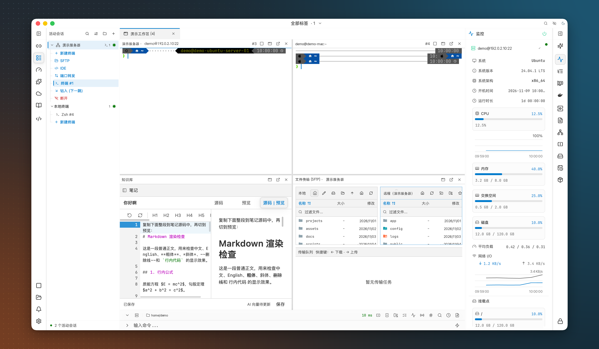

<div align="center">


# ⚡ OxideTerm

**免費、原生的 SSH 用戶端，專為遠端伺服器工作打造。**

SSH · Mosh · Telnet · 序列埠 · RDP/VNC · SFTP · 連接埠轉發 · 程式碼編輯器

無需帳號。無需訂閱。沒有遙測。沒有 Electron。

[](https://github.com/AnalyseDeCircuit/oxideterm/releases/latest)
[](#install)
[](../../LICENSE)
[](https://github.com/AnalyseDeCircuit/oxideterm/stargazers)

[**下載**](https://github.com/AnalyseDeCircuit/oxideterm/releases/latest) ·
[**文件**](https://oxideterm.app) ·
[**更新紀錄**](../../.github/release-notes/stable-changelog.md) ·
[**報告問題**](https://github.com/AnalyseDeCircuit/oxideterm/issues) ·
[**微信交流群**](https://github.com/AnalyseDeCircuit/oxideterm/issues/752)

[English](../../README.md) | [简体中文](README.zh-Hans.md) | [繁體中文](README.zh-Hant.md) | [日本語](README.ja.md) | [한국어](README.ko.md) | [Français](README.fr.md) | [Deutsch](README.de.md) | [Español](README.es.md) | [Italiano](README.it.md) | [Português](README.pt-BR.md) | [Tiếng Việt](README.vi.md)

</div>

---

## OxideTerm 是什麼

OxideTerm 是一款適用於 macOS、Windows 和 Linux 的 SSH 用戶端。你連線的每台伺服器都有自己的工作區：終端機、檔案管理器、連接埠轉發、程式碼編輯器、主機監控和選用的 AI 助理，都在同一個視窗裡。OxideTerm 免費且開放原始碼，採用 GPL-3.0 授權條款。

## 為什麼選擇 OxideTerm

- **連線一次，處處可用。** 同一台伺服器的終端機、SFTP、連接埠轉發和編輯器預設共用一條 SSH 連線，開啟其他工具時不必再登入一次。
- **撐得過短暫斷線。** 連線失去回應時，OxideTerm 會先持續探測原連線 30 秒，再決定是否替換，vim、htop 等全螢幕程式因此能接續原本的狀態執行。
- **記憶體占用低。** 介面由 [GPUI](https://github.com/zed-industries/zed/tree/main/crates/gpui)（Zed 編輯器背後的介面框架）直接在 GPU 上繪製。閒置時在 macOS 上約占 81 MB 記憶體，在 Windows 上約占 24 MB。
- **AI 用你自己的。** OxideSens 助理使用你選擇的服務供應商和 API 金鑰，沒有需要另外購買的 OxideTerm 額度。
- **純 Rust SSH。** SSH 協定堆疊以 russh 和 ring 為基礎，不依賴 OpenSSL 或 libssh2。

<details>
<summary><b>與 OxideTerm 1.x 的記憶體比較</b></summary>

從 Tauri（1.x）遷移到原生 GPUI（2.0）前後的閒置記憶體。1.x 的數值包含其 WebView 處理程序。

| 平台 | 1.x（Tauri） | 2.0（原生） | 降幅 |
|---|---:|---:|---:|
| macOS | 318.7 MB | 81.3 MB | 74% |
| Windows | 182.4 MB | 23.5 MB | 87% |


</details>

---

## 截圖

### 終端機

一個 SSH 工作階段。側邊欄列出了這台伺服器上可以開啟的內容：更多終端機、SFTP、IDE 和連接埠轉發。


### 混合工作區

將 SSH 終端機、本機終端機、Markdown 筆記和 SFTP 放進同一個分頁。本機與不同伺服器的頁面可以自由組合，最多支援 16 個窗格。



### 檔案

本機和遠端資料夾左右並排，傳輸佇列在下方。


### IDE

開啟遠端專案，在分頁中編輯檔案。


### 連接埠轉發

OxideTerm 會列出伺服器上正在監聽的連接埠。點一下就能轉發其中任何一個，也可以用快速轉發開啟 Jupyter 這類常用工具。


<details>
<summary><b>觀看 OxideSens 根據一句自然語言開啟終端機</b></summary>

<a href="../../docs/media/ai-terminal-demo.mp4">
  
</a>

</details>

---

## 功能

標有 *（外掛）* 的功能需要在應用程式內的外掛市集安裝。

### 工作區

- 工作階段管理器：搜尋、排序、分組、匯入和匯出已儲存的連線，支援巢狀群組、標籤、顏色、圖示和備註
- 從 `~/.ssh/config` 匯入，支援 `Match` 區塊、`ProxyJump` 鏈和 `RemoteCommand`，匯入的主機會隨設定檔保持更新
- 從 SecureCRT、Xshell、Termius、MobaXterm、WindTerm、Electerm 和 FinalShell 匯入，儲存前可以先預覽
- 分頁範圍：只顯示全部分頁、全域頁面、本機終端機或某一台伺服器，隱藏的工作階段照常執行
- 一個分頁最多容納 16 個窗格，終端機、SFTP、IDE、連接埠轉發、筆記、設定和遠端桌面可以混合排列
- 分離視窗：把分頁移到獨立視窗再移回來，工作階段不會中斷
- 把 2–16 個已開啟的終端機平鋪成網格，無需重新連線
- 命令面板可尋找操作和已儲存的連線；禪模式只保留目前頁面，方便專注
- 已儲存的本機終端機設定檔，各自帶有 Shell、起始目錄和圖示
- 啟動時還原工作區、視窗大小、全螢幕狀態和所在的顯示器

### 終端機

- 自動偵測本機 Shell：常見的 Unix Shell、命令提示字元、Windows PowerShell、PowerShell Core、Git Bash 和 Nushell
- 分割窗格附可拖曳的分隔線，新的本機分割窗格會沿用原窗格的工作目錄
- 搜尋支援正規表示式、大小寫比對和多行查詢，每個窗格各自保留搜尋狀態
- Shell 整合支援 Bash、Zsh、Fish、Nushell 和 PowerShell，記錄工作目錄、結束代碼和命令標記，並可從應用程式內安裝到遠端伺服器
- 命令摺疊：收合已執行完畢的命令輸出，同時保留其結束狀態
- 底部命令列支援多行輸入、歷史紀錄、路徑提示、自動完成和快捷命令
- 模糊比對的歷史建議，以及可選的依連線儲存、重新啟動後仍保留的歷史紀錄
- 自由輸入模式：用滑鼠編輯目前的命令
- 多行貼上在送出前可以先編輯，支援復原和移除程式碼圍欄
- 終端觸發器：輸出中比對到文字或正規表示式後，送出輸入、執行快捷命令、啟動程式，或把比對內容變成可點擊的操作
- 語義著色會為沒有顏色的輸出上色，例如錯誤、Git 狀態、權限、位址和日期；另有關鍵字與正規表示式醒目提示
- 可點擊的 URL 和檔案路徑、精確到毫秒的逐行時間戳記，以及分頁上的未讀輸出標記
- Sixel 和 Kitty 圖形，包括 Kitty 動畫
- 原生 `tmux -CC` 控制模式，支援窗格版面配置和可拖曳的分隔線
- 同步群組可以把你的輸入同時送到多個終端機；命令傳送器能依節奏、間隔和重複次數傳送文字或十六進位資料
- 快捷命令支援分組、釘選、文字/選項/保密參數，以及控制在哪些主機上顯示的規則
- 工作階段日誌支援檔名範本、大小和保留期限以及可選的 ANSI 控制碼；另有 `.cast` 錄製和內建播放器
- 複製、剪下和貼上可以直接作用於 Vim、Neovim 或 Emacs 中的選取範圍，本機和受支援的 SSH 工作階段都能使用
- 依連線設定 Backspace 和 Delete 鍵送出的序列以及文字編碼

### 連線

- SSH 登入方式：密碼、私密金鑰、OpenSSH 憑證、受管理的金鑰、SSH Agent、鍵盤互動式驗證或 Kerberos
- SSH Agent 支援自動探索或自訂端點（macOS 和 Linux 上為 `SSH_AUTH_SOCK`，Windows 上為 `\\.\pipe\openssh-ssh-agent`），也支援 Agent 轉發
- 支援 Ed25519、RSA 和 ECDSA 金鑰以及 ChaCha20-Poly1305 和 AES-GCM 加密演算法，可以調整演算法順序，並提供舊版伺服器相容選項
- 出現符合的驗證提示時，自動產生並填入 TOTP 驗證碼，伺服器和每台跳板主機都適用
- FIDO 安全金鑰（`ed25519-sk`、`ecdsa-sk`），附 PIN 和觸碰提示 *（外掛）*
- 多層跳板主機鏈路，每一跳各自驗證；支援 HTTP CONNECT 和 SOCKS5 上游代理伺服器以及 ProxyCommand
- 寬限期重新連線：在新連線上還原連接埠轉發、繼續傳輸並重新開啟編輯器中的檔案
- 每台伺服器共用一條連線，或讓每個新終端機各自驗證
- X11 轉發，可選信任或不信任模式
- 不儲存也能臨時連線；`ssh://`、`telnet://`、`mosh://`、`rdp://` 和 `vnc://` 連結可以直接在應用程式中開啟
- Mosh，支援自適應的本機回顯預測 *（外掛）*
- Telnet，支援選項協商、代理路由和可設定的換行字元
- 序列埠：可設定鮑率、資料位元、同位位元、停止位元和流量控制，支援十六進位收發以及 Break、DTR 和 RTS 控制
- 藍牙 BLE 終端機，透過 Nordic UART Service 或自訂 GATT 特徵值通訊

### 檔案與傳輸

- 本機與遠端雙欄檔案管理器，附我的最愛、路徑自動完成，以及清單或樹狀檢視
- 依連線儲存成對的本機與遠端路徑書籤
- 傳輸佇列支援平行傳輸、速度限制、剩餘時間、暫停、繼續和重試；中斷的 SFTP 傳輸在重新啟動後會以暫停狀態恢復
- 遇到衝突時可以選擇覆寫、略過或重新命名，既可只套用到一個檔案，也可套用到全部
- 主機缺少 SFTP 子系統時，SFTP 會自動改用 SCP
- 獨立的 SFTP 連線，以及經由應用程式中轉的伺服器間傳輸
- FTP 和明確式 FTPS
- 把檔案拖到 SSH 終端機上，即可上傳到該終端機的目前目錄
- 在遠端 Shell 中使用 `trz`/`tsz`（trzsz）和 `rz`/`sz`（ZMODEM）；序列埠連線支援 XMODEM、YMODEM 和 ZMODEM
- 預覽文字、程式碼、Markdown、圖片、音訊、影片、十六進位資料和字型
- PDF、SQLite、憑證和二進位檔案檢視器 *（外掛）*
- 從終端機跳到 SFTP 中的同一個目錄，也能把 SFTP 目錄傳回終端機

### 編輯器與 IDE

- 透過 SFTP、純 Shell 命令或遠端 Agent 開啟遠端 IDE，遠端 Agent 還提供符號索引、自動完成和檔案監看
- 把閒置的終端機轉換成 IDE，沿用相同的使用者、容器和目錄
- 多分頁、支援多選的專案檔案樹、專案搜尋，以及支援正規表示式和擷取群組的尋找與取代
- 可編輯最大 100 MiB 的檔案，並保留編碼、BOM 和換行字元
- 安全儲存與衝突處理，可選在切換分頁時自動儲存
- 重新啟動後還原已開啟的檔案和未儲存的修改
- Git 檢視：分支、工作樹、暫存、歷史、領先/落後提交數，以及合併或 rebase 狀態
- 偵測並執行專案工作
- 內建 15 種語言的語法高亮，另有 20 多種語言可透過外掛加入 *（外掛）*
- Markdown 預覽，支援表格、公式和註腳

### 連接埠轉發與網路

- 本機、遠端和動態（SOCKS5）轉發，規則可以儲存，並能隨連線自動啟動
- 自動偵測伺服器上正在監聽的連接埠，一鍵轉發
- 獨立的 SSH 通道，無需開啟終端機就能執行，也可以隨應用程式啟動
- 重新連線後自動還原連接埠轉發，手動停止的規則維持停止
- 應用程式層級的代理伺服器設定；應用程式的網路請求使用系統信任的憑證（包括企業 CA）
- 連線拓撲檢視和臨時 Socket 偵錯

### 遠端桌面

- RDP 和 VNC，支援鍵盤、滑鼠、剪貼簿、縮放和重新連線 *（外掛）*
- RDP 多螢幕版面配置和網路品質設定檔 *（外掛）*
- 透過 VeNCrypt TLS 加密的 VNC *（外掛）*
- 經由 SSH 跳板主機連線 RDP 和 VNC *（外掛）*
- 用內建檢視器執行 WSLg 圖形應用程式（Windows）

### 主機工具

- 適用於本機和任何 SSH 伺服器
- CPU、記憶體、置換空間、磁碟、網路、負載和延遲，附趨勢圖
- 處理程序（傳送訊號、暫停與繼續、調整 nice 值）、服務（systemd、launchd、BSD 和 Windows 服務）、排程工作和套件；Windows 上還可以用 winget 升級和解除安裝
- 支援預設查詢和追蹤模式的日誌、附公開暴露提示的監聽連接埠，以及附空間不足警告的檔案系統
- Docker 容器：狀態、連接埠、啟動、停止、重新啟動和日誌
- GPU 和 NPU 監控，支援 NVIDIA、AMD ROCm、海光 DCU、華為昇騰、Intel XPU、摩爾線程 MUSA 和寒武紀
- tmux、Zellij 和 Herdr 工作階段：附加、建立、分割和重新命名
- 連線池和連線矩陣面板，以及終端機工具列中的 SSH 延遲顯示

### OxideSens AI

- 支援 OpenAI（包括 Responses API）、Anthropic、Gemini、DeepSeek、xAI Grok、小米 MiMo、Ollama 以及任何相容 OpenAI 的端點，並可調整思考強度
- 讀取你選定的終端機、檔案和設定作為上下文，並透過工具執行命令、操作互動式程式、編輯檔案和傳輸資料
- 唯讀、預設和免核准三種模式，可依類別設定工具權限和命令原則規則，破壞性或涉及憑證的命令會額外審查
- 圖片附件、對話分支、訊息編輯和排隊追問
- 平行運作的子代理、背景工作，以及中斷後能繼續執行的工作
- 透過 ACP 接入 Codex 和 Claude Code，並提供 OpenCode、Antigravity、Cursor、Grok Build、GitHub Copilot CLI、Qwen Code 和 Kimi CLI 的啟動器 *（外掛）*
- 透過 stdio、Streamable HTTP 或舊版 SSE 連線 MCP 伺服器
- 外部 MCP 控制：讓編輯器和其他 AI 工具透過 OxideTerm 使用你儲存的連線，權限依工具群組授予，隨時可以撤銷
- [Agent Skills](../../docs/agent-skills.md)（`SKILL.md`），支援 `/skill-name` 自動完成
- Markdown 筆記知識庫，結合 BM25 關鍵字檢索和 HNSW 向量檢索，支援中日韓斷詞，預覽中可顯示 Mermaid 圖表

### 安全性

- 應用程式鎖定，支援 Touch ID（macOS）或 Windows Hello（Windows），鎖定期間連線照常運作
- 提權憑證：出現 sudo 或 su 提示時提供已儲存的密碼，可限定到本機、單一連線或主機比對規則，兩步驟驗證提示還可附帶 TOTP
- 操作稽核，支援篩選、保留期限，以及匯出為 JSON 或 CSV
- 加密的工作階段錄製，支援播放、拖曳進度和調整播放速度
- 外掛啟用前需要先檢查其權限

### 同步與備份

- 雲端同步支援 WebDAV、S3 相容儲存空間（包括阿里雲 OSS）、Git 存放庫、GitHub Gist、Dropbox、OneDrive、Google Drive 或 HTTP JSON
- 自選同步內容，合併多台裝置上的修改，並逐一處理衝突
- 復原備份，以及從中斷的同步中恢復
- 加密的 `.oxide` 檔案，可搬移連線、連接埠轉發、設定、快捷命令和金鑰，匯入時可以選擇略過、重新命名、取代或合併
- 可攜模式：直接從資料夾執行，附獨立的加密金鑰庫
- 應用程式內更新，可選穩定版或 Beta 通道

### 個人化

- 淺色、深色或跟隨系統的外觀，應用程式主題和終端機主題分開設定，並附主題編輯器
- 背景支援圖片、動態圖片和影片，可以疊加霧光、粒子、流星、水面焦散等生成特效，另有額外的素材包 *（外掛）*
- 視窗透明度和圓角樣式
- 字型堆疊，支援獨立的中日韓字型、連字和字重；編輯器排版可以單獨設定
- 介面縮放、游標樣式、內距和動態效果設定
- 自訂快捷鍵；設定項目可以搜尋，頁面版面可以重新排列
- 11 種介面語言，支援輸入法和雙向文字

### 外掛

| 類型 | 執行方式 | 可存取的範圍 |
|---|---|---|
| **資訊清單** | 宣告式擴充 | 無；不執行任何程式碼 |
| **WASM** | Wasmtime/WASI 或獨立輔助處理程序 | 僅限被授予的主機功能 |
| **處理程序** | 一般本機處理程序 | 與本機程式相同，不受作業系統沙箱限制 |

請只安裝來自可信任來源的處理程序外掛。為 OxideTerm 1.x 撰寫的外掛可能仍會出現在清單中，但 2.x 不會執行它們。

### 命令列工具

在 **設定 → 一般 → CLI 伴侶工具** 中安裝 `oxideterm` 命令。它和應用程式共用同一份設定，不開啟視窗也能檢查、撰寫腳本和備份你的設定，還能從任何 Shell 開啟新的分頁。會修改內容的命令可以先用 `--dry-run` 檢視計畫，加上 `--yes` 才會真正執行，並保留可復原的備份。

```bash
oxideterm terminal --cwd ~/project
oxideterm doctor --strict
oxideterm connections search prod
oxideterm forwards list --format json
oxideterm oxide export ./profile.oxide --connection prod --password-stdin
```

提供 Bash、Zsh、Fish、PowerShell 和 Elvish 的 Shell 自動完成。完整命令請見 [CLI 指南（英文）](../../docs/user-guide/en/cli.md)。

---

<a id="install"></a>

## 安裝

從[最新版本](https://github.com/AnalyseDeCircuit/oxideterm/releases/latest)下載 OxideTerm。

| 作業系統 | x64 | ARM64 |
|---|---|---|
| **macOS** | DMG（Intel） | DMG（Apple Silicon） |
| **Windows** | 安裝程式（`.exe`） | 安裝程式（`.exe`） |
| **Linux** | AppImage · `.deb` · `.rpm` | AppImage · `.deb` · `.rpm` |

發行頁面還提供可攜版壓縮檔、簽章，以及用來驗證下載內容的 `sha256sums.txt` 檔案。

### macOS

如果 Gatekeeper 阻擋開啟應用程式，請移除隔離屬性：

```bash
xattr -cr /Applications/OxideTerm.app
```

### Windows

如果 SmartScreen 顯示警告，請選擇 **其他資訊 → 仍要執行**。

### Linux

```bash
# AppImage
chmod +x OxideTerm_*_linux_*.AppImage && ./OxideTerm_*_linux_*.AppImage

# Debian / Ubuntu
sudo dpkg -i OxideTerm_*_linux_*.deb && sudo apt-get install -f

# Fedora / RHEL-compatible
sudo dnf install ./OxideTerm_*_linux_*.rpm

# Nix; updates are managed by Nix
nix run github:AnalyseDeCircuit/oxideterm
```

### 視窗無法正常繪製時

在環境變數中設定 `OXIDETERM_RENDER_PROFILE=compatibility`，然後重新啟動 OxideTerm。

### 快速入門

1. 開啟 **工作階段管理器** 新增伺服器，或從 `~/.ssh/config` 匯入主機。
2. 連線到伺服器，開啟終端機。
3. 在同一台伺服器上開啟 SFTP、連接埠轉發或 IDE。
4. 如需使用 OxideSens，請在 **設定** 中新增 AI 服務供應商。

[文件](https://oxideterm.app)介紹了應用程式的其餘功能。想自行建置 OxideTerm，請參閱[從原始碼建置](#build-from-source)。

---

## 隱私與安全性

- 儲存的密碼和金鑰存放在系統鑰匙圈中（macOS 鑰匙圈、Windows 認證管理員，或 Linux 上的 libsecret）。AI 服務供應商的金鑰不會寫入應用程式日誌。
- 記憶體中的機密資料在釋放時會被清除歸零（zeroize）。
- 主機金鑰在首次連線時信任，之後都與 `~/.ssh/known_hosts` 核對；金鑰發生變化時會拒絕連線。
- 傳送給 AI 服務供應商的文字會先經過憑證遮蔽處理。
- 工作階段錄製預設關閉。錄製內容加密保存在你的裝置上，不參與雲端同步，也不會記錄你的鍵盤輸入。
- 通知與稽核預設關閉。開啟後，資料保存在你的裝置上，敏感細節會加密，而且只記錄 OxideTerm 內部發生的操作。
- `.oxide` 檔案使用 ChaCha20-Poly1305 加密，金鑰由 Argon2id 衍生（256 MB 記憶體，4 次迭代）。

---

<a id="build-from-source"></a>

## 從原始碼建置

需要 Rust（rustup 會自動安裝 `rust-toolchain.toml` 中固定的工具鏈版本）和能執行 GPUI 的桌面環境。

```bash
# Run the app
cargo run

# Build the oxideterm CLI
./scripts/build/build-cli.sh

# Build the optional Linux remote agent
./scripts/build/build-agent.sh
```

使用 Nix 時，可以執行 `nix build .#oxideterm`、`nix run .#oxideterm` 或 `nix develop`。CLI 的建置產出位於 `crates/oxideterm-gpui-app/resources/cli-bin/<target-triple>/oxideterm`。

### 整體架構

介面、終端機和 SSH 在同一個 Rust 處理程序中執行，選用的遠端 Agent 和平台輔助程式則以獨立處理程序執行。終端機輸出從 SSH 通道或本機 PTY 直接寫入 `TerminalState`，再由 GPUI 繪製，中間沒有 WebView、JSON 橋接或 xterm.js。

`NodeRouter` 從以 DashMap 為基礎的連線池 `SshConnectionRegistry` 中分配連線，因此終端機窗格、SFTP、連接埠轉發和編輯器會共用每台伺服器的一條 SSH 連線，除非某個終端機設定為使用獨立連線。每條連線都會經歷 `connecting → active → idle → link_down → reconnecting` 這些狀態。跳板主機發生故障時，其後方的伺服器會進入 `link_down`。每條轉發規則都有自己的監聽器。重新連線後，SFTP 工作階段會在新連線上重新取得，而在舊連線上發起的操作絕不會被悄悄轉移到新連線。

```text
crates/
├── oxideterm-gpui-app/        # Desktop app: windows, workspace, settings
├── oxideterm-gpui-terminal/   # Terminal panes: input, selection, overlays
├── oxideterm-terminal/        # Terminal model and escape-sequence parsing
├── oxideterm-ssh/             # SSH connections, NodeRouter, jump hosts
├── oxideterm-sftp/            # SFTP sessions and transfers
├── oxideterm-forwarding/      # Port forwarding runtime
├── oxideterm-gpui-ide/        # Remote IDE
├── oxideterm-ai/              # OxideSens: providers, MCP, RAG
├── oxideterm-cli/             # The oxideterm command
├── oxideterm-i18n/            # Locale catalogs for the 11 interface languages
└── gpui-ce/                   # Patched copy of GPUI
```

延伸閱讀（英文）：[開發指南](../../docs/development/README.md)、[crate 地圖](../../docs/development/crate-map.md)和[架構概覽](../../docs/user-guide/en/architecture.md)。

---

## 參與貢獻

歡迎貢獻程式碼、文件、翻譯、外掛、測試和問題重現。較大的變更請先開 issue 討論。[CONTRIBUTING.md](../../docs/CONTRIBUTING.md) 說明了如何準備 Pull Request。

附上已遮蔽敏感資訊的診斷包，問題能更快獲得修正：

```bash
oxideterm report --bundle ./oxideterm-report.zip
```

如果是從原始碼執行，請改用 `cargo run -p oxideterm-cli -- report --bundle ./oxideterm-report.zip`。

### 貢獻者

感謝每一位讓 OxideTerm 變得更好的貢獻者。

<p align="center">
  <a href="https://github.com/AnalyseDeCircuit/oxideterm/graphs/contributors">
    
  </a>
</p>

---

## 致謝

OxideTerm 以下列開放原始碼專案為基礎：

- [russh](https://github.com/warp-tech/russh) 和 [ring](https://github.com/briansmith/ring)：SSH 協定與加密
- [GPUI](https://github.com/zed-industries/zed/tree/main/crates/gpui)：來自 Zed 編輯器的 GPU 加速介面框架
- [alacritty_terminal](https://github.com/alacritty/alacritty)：終端機模擬（VT100–VT500）
- [portable-pty](https://github.com/wez/wezterm/tree/main/pty)：本機 Shell，在 Windows 上使用 ConPTY
- [Tokio](https://tokio.rs)：非同步執行環境
- [Wasmtime](https://wasmtime.dev/)：執行 WASM 外掛
- [tree-sitter](https://tree-sitter.github.io/)：編輯器的語法高亮

---

## 授權條款

OxideTerm 採用 [GPL-3.0-only](../../LICENSE) 授權條款，沒有附加限制。相依套件的聲明見 [THIRD_PARTY_NOTICES.md](../../THIRD_PARTY_NOTICES.md) 和 [NOTICE](../../NOTICE)。

請只在你擁有或已獲授權存取的系統上使用 OxideTerm。完整的法律聲明見 [LEGAL.md](../../LEGAL.md)。

## Star History

<a href="https://www.star-history.com/?repos=AnalyseDeCircuit%2Foxideterm&type=date&legend=top-left">
 <picture>
   <source media="(prefers-color-scheme: dark)" srcset="https://api.star-history.com/chart?repos=AnalyseDeCircuit/oxideterm&type=date&theme=dark&legend=top-left" />
   <source media="(prefers-color-scheme: light)" srcset="https://api.star-history.com/chart?repos=AnalyseDeCircuit/oxideterm&type=date&legend=top-left" />
   
 </picture>
</a>
