# OxideTerm Native Architecture

> **Version**: Native desktop architecture
> **Source of truth**: the current Rust/GPUI workspace; see [Cargo.toml](../../../Cargo.toml) for its version and [development guides](../../development/README.md) for contributor workflows.

This document describes the native system's components, data and control paths, and lifecycle ownership. For daily navigation, start with [Workspace Navigation](workspace.md).

## Contents

1. [Design Principles](#design-principles)
2. [Architecture Overview](#architecture-overview)
3. [Two-Plane Architecture](#two-plane-architecture)
4. [Native Workspace Layers](#native-workspace-layers)
5. [Node-First Runtime Model](#node-first-runtime-model)
6. [Desktop Workspace Architecture](#desktop-workspace-architecture)
7. [Terminal Architecture](#terminal-architecture)
8. [SSH Connection Registry and Runtime](#ssh-connection-registry-and-runtime)
9. [SFTP Architecture](#sftp-architecture)
10. [IDE Architecture](#ide-architecture)
11. [Port Forwarding Architecture](#port-forwarding-architecture)
12. [Graphics And VNC Sessions](#graphics-and-vnc-sessions)
13. [Reconnect And Recovery](#reconnect-and-recovery)
14. [Settings And Persistence](#settings-and-persistence)
15. [Cloud Sync, Backups, And Portable Bundles](#cloud-sync-backups-and-portable-bundles)
16. [OxideSens AI Architecture](#oxidesens-ai-architecture)
17. [Plugin Architecture](#plugin-architecture)
18. [CLI Companion Boundary](#cli-companion-boundary)
19. [Security Design](#security-design)
20. [Performance Design](#performance-design)
21. [Detailed Module Structure](#detailed-module-structure)
22. [Data Flow Walkthroughs](#data-flow-walkthroughs)
23. [State Machines And Lifecycles](#state-machines-and-lifecycles)
24. [Ownership And Persistence Matrix](#ownership-and-persistence-matrix)
25. [Event And Notification Model](#event-and-notification-model)
26. [Failure Model](#failure-model)
27. [Native Crate Map](#native-crate-map)

---

## Design Principles

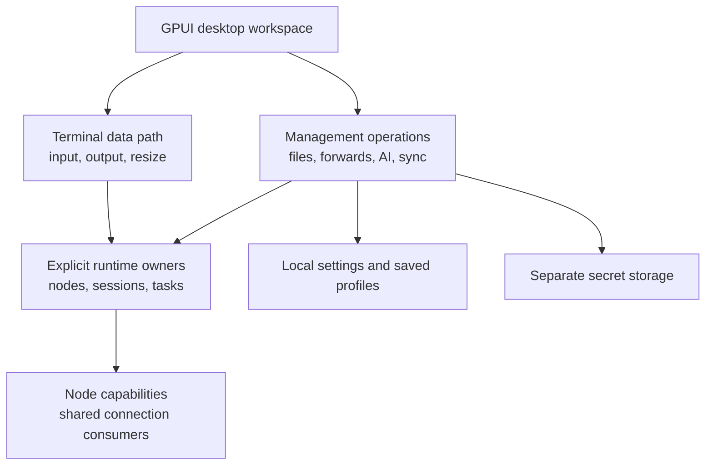

### Core Principles

1. **Desktop app first** - The GPUI desktop app is the primary user surface. The CLI is a companion for automation and diagnostics.
2. **Terminal responsiveness** - Terminal input, output, resize, and rendering are latency-sensitive hot-path work.
3. **Node-first remote workspace** - Remote workflows are anchored by a stable SSH node, not by a transient terminal pane.
4. **Default shared connection** - Terminal, SFTP, forwarding, and IDE can share a node's registry connection; AI and plugins use validated capability handles, snapshots, or hooks rather than becoming physical connection consumers.
5. **Explicit lifecycle ownership** - Saved profiles, live nodes, terminal sessions, SFTP sessions, forwards, editor buffers, and tabs have different owners.
6. **Local-first state** - SSH, SFTP, local terminal, settings, plugins, and AI provider configuration work without an OxideTerm cloud account.
7. **Secret separation** - Navigation metadata, settings, AI prompts, logs, support bundles, and plugin labels are not secret storage.
8. **Minimum visible coupling** - User-facing surfaces should not require users to reason about internal transport handles.

### Why Rust + GPUI

| Concern | Native Rust/GPUI Direction |
|---|---|
| User experience | One desktop workspace for terminal, files, forwarding, IDE, AI, settings, and plugins |
| Backend ownership | Core rules and models live in Rust domain crates; `oxideterm-gpui-app` owns coordinating Entities, subscriptions, and final runtime shutdown instead of treating them as ad hoc view state |
| Terminal path | Terminal input/output stays isolated from heavy management work |
| Safety | SSH, SFTP, forwarding, persistence, secrets, and AI boundaries are explicit Rust domains |
| Portability | Desktop package can include app resources, agent binaries, icons, and CLI companion |
| Maintainability | Crates split by responsibility rather than by screen or file size |

---

## Architecture Overview

The overview separates application coordination, reusable runtime domains, durable state and external resources. Thick arrows mean lifecycle ownership or a retained handle, solid arrows mean calls or data flow, and dotted arrows mean scoped access or metadata delivery. A retained handle can refer to a shared resource; it does not imply exclusive ownership.

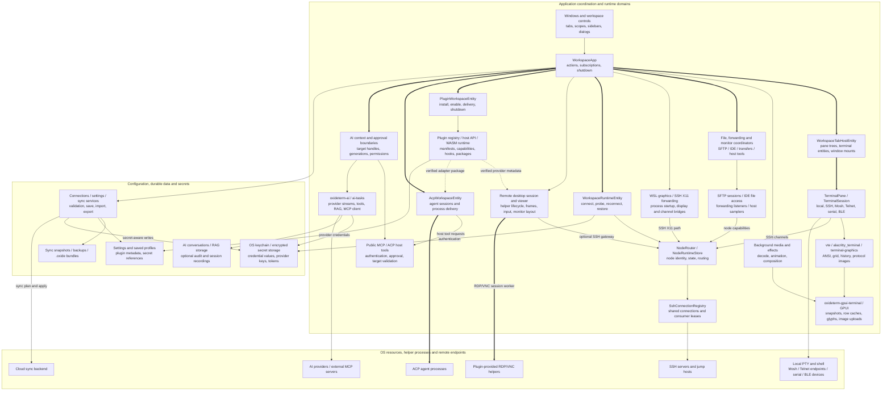

### System Context

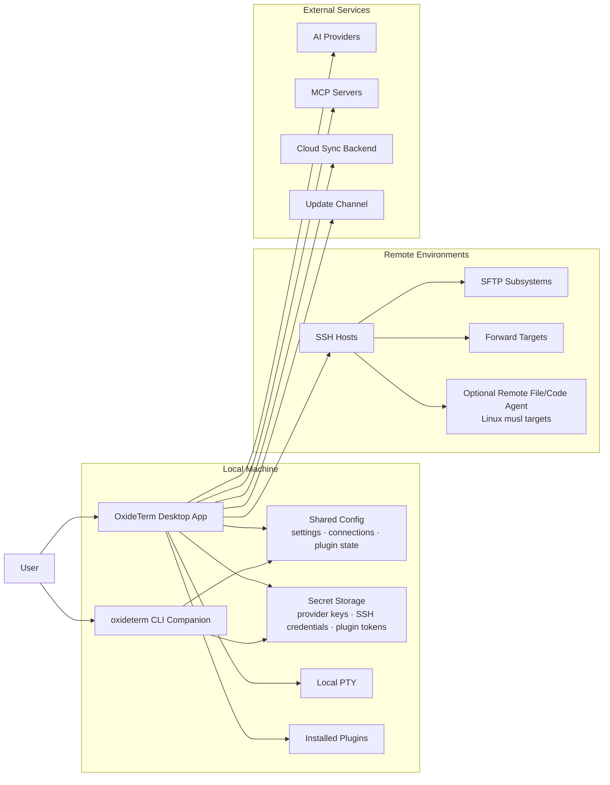

### User-Facing Summary

The app is a workspace shell around stable remote nodes. Tabs and panes are views. Saved connections are profiles. SSH nodes are live or reconnecting runtime objects. Terminal sessions, SFTP sessions, IDE workspaces, and forwards consume node capabilities directly; AI targets and plugin surfaces use validated capability handles, host snapshots, or terminal hooks.

That separation explains common behavior:

- Closing a terminal tab does not delete the saved connection.
- A node may remain visible in Connection Monitor after a pane closes.
- SFTP and IDE can recover after a reconnect because they are tied to the node, not only to a terminal pane.
- AI tools must select explicit targets before they run commands or read files.
- The CLI companion can inspect the same state, but it is not the main interactive surface.

---

## Two-Plane Architecture

The native application separates the terminal data path from structured control operations even though both live in the same Rust process.

### Data Plane

The data plane handles high-frequency terminal activity:

```text
terminal input
  -> terminal runtime
  -> local PTY or SSH shell channel
  -> terminal output
  -> terminal renderer
```

Properties:

- Low latency.
- High event volume.
- No dependence on cloud sync or backups.
- No user-visible confirmation flow for ordinary input.
- Rendering and input focus stay local to the terminal surface.

### Control Plane

The control plane handles structured management operations:

```text
user action or AI-approved tool
  -> workspace command
  -> domain runtime
  -> persistence / connection / file / sync action
  -> result, notification, or recovery hint
```

Examples:

- Create a saved connection.
- Open an SSH node.
- Start SFTP.
- Create a forward.
- Inspect host tools such as processes, Docker, services, tmux, packages, logs, ports, and filesystems.
- Open an IDE workspace.
- Open a graphics/VNC session.
- Confirm a terminal file-transfer prompt.
- Change a setting.
- Manage privilege credentials.
- Run a cloud-sync action.
- Execute an approved AI tool.
- Generate a support bundle.

### Persistence Plane

The persistence plane stores durable state:

- Settings.
- Saved connections.
- Forward rules.
- Plugin state.
- Privilege credential metadata.
- AI conversations and summaries.
- Cloud sync snapshots.
- Backups.
- Portable runtime metadata.

Secret-bearing data must cross into secret-aware storage rather than ordinary JSON/text fields. For privilege helpers, durable scope metadata can live with settings or saved connections, but the secret value belongs to the secret store.

### Plane Interaction

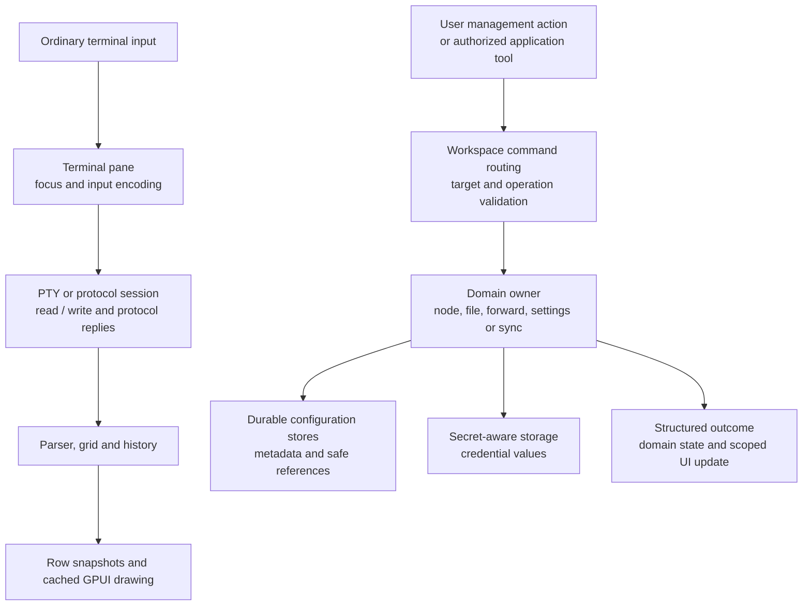

The two input paths are separate: ordinary typing does not pass through management approval. Management outcomes update their owning surface; they are not all terminal output. Persistence is a durable boundary used by control operations, not a stage in every terminal frame.

Implementation: [workspace](../../../crates/oxideterm-gpui-app/src/workspace.rs), [terminal_entity](../../../crates/oxideterm-gpui-app/src/workspace/terminal_entity.rs).

---

## Native Workspace Layers

### Layer 1: GPUI Application Shell

Owned mainly by `oxideterm-gpui-app`, which is both the GPUI surface layer and
the coordinator for long-lived application entities.

Responsibilities:

- Create the desktop window.
- Render the activity bar, tabs, pane tree, dialogs, and settings surfaces.
- Route user actions to domain crates.
- Keep UI state separate from durable domain state while holding runtime entity
  handles, subscriptions, task delivery, and final shutdown ownership.
- Provide app-level notifications and command palette actions.

Representative modules:

```text
crates/oxideterm-gpui-app/src/workspace.rs
crates/oxideterm-gpui-app/src/workspace/tabs/
crates/oxideterm-gpui-app/src/workspace/pane_tree.rs
crates/oxideterm-gpui-app/src/workspace/sidebar/
crates/oxideterm-gpui-app/src/workspace/settings/
crates/oxideterm-gpui-app/src/workspace/knowledge.rs
```

### Layer Dependency Shape

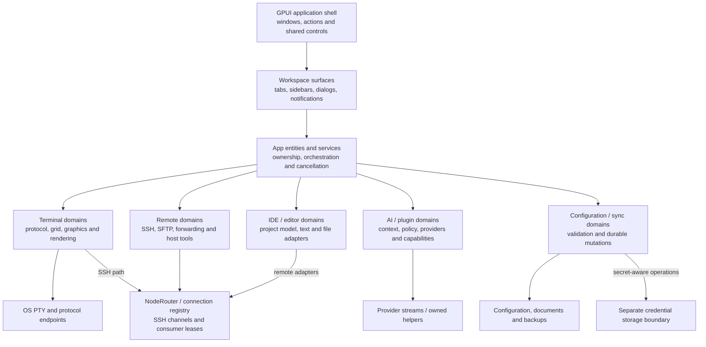

This is a responsibility-layer map, not an exhaustive Cargo dependency graph. App owners connect the views to domain APIs; reusable text/project models remain transport-free. Forward listeners, graphics helpers and samplers have concrete runtime owners described in their chapters. Saved connection files belong to the connections store rather than the SSH transport crate.

Implementation: [workspace](../../../crates/oxideterm-gpui-app/src/workspace.rs), [lib](../../../crates/oxideterm-ide-core/src/lib.rs), [lib](../../../crates/oxideterm-connections/src/lib.rs).

### Layer 2: Domain Crates

Domain crates own reusable business logic and protocol models.

Examples:

- `oxideterm-ssh`: SSH configuration, connection registry, node routing, reconnect model.
- `oxideterm-sftp`: SFTP protocol/session and transfer semantics.
- `oxideterm-connections`: saved connection storage and validation.
- `oxideterm-forwarding`: forward rule model.
- `oxideterm-ai`: AI providers, context window logic, RAG, MCP, orchestrator tool definitions, policy.
- `oxideterm-settings`: settings load/save/mutation logic.
- `oxideterm-cloud-sync`: sync and backup logic.
- `oxideterm-plugin-*`: plugin manifest, protocol, registry, and host API types.

### Layer 3: Runtime Integrations

Runtime integrations bridge UI requests to active resources:

- Local terminal process.
- SSH shell channel.
- SFTP channel.
- Forward listener or remote forward.
- IDE file system access.
- Plugin host lifecycle.
- Cloud sync backend.
- AI provider requests.

The important rule is ownership: a runtime object should have one clear owner.
The app layer may own the coordinating Entity and its lifecycle while reusable
rules remain in domain crates; UI views consume runtime state through explicit
handles, subscriptions, or snapshots.

### Layer 4: Persistence And Secret Storage

Persistent state is shared by the desktop app and CLI companion. Secret values must not be serialized into ordinary settings, support bundles, AI context, or plugin labels.

---

## Node-First Runtime Model

### Problem Avoided

SFTP, IDE, and forwarding must not depend on transient terminal session IDs. A terminal session can be recreated; the remote node is the stable unit of work.

Native keeps the same user-facing model.

### Current Topology

```text
saved connection
  -> node identity
       -> node runtime (`NodeRuntimeStore` + `NodeRouter`)
            -> shared or dedicated SSH connection handle
       -> terminal session(s)
       -> SFTP session
       -> forward rules
       -> IDE workspace
       -> AI capability handles
       -> plugin host snapshots and hooks
```

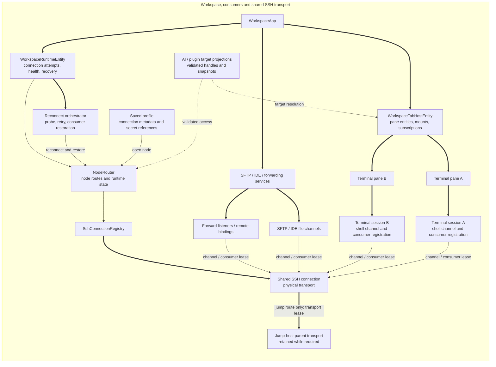

The thick arrows identify lifecycle holders; channel and consumer-lease arrows identify use of the shared connection. Closing one pane removes that terminal consumer. SFTP, IDE and forwarding retain their own consumers. Reconnect work belongs to the workspace runtime, and jump-host routes retain the parent transport while it is needed. AI and plugin target projections provide validated access without becoming owners of the physical SSH connection.

### Stable And Transient Objects

| Object | Stable Role | Transient Implementation Detail |
|---|---|---|
| Saved connection | User profile | Current transport state |
| Node | Remote workspace identity | Current connection handle |
| Terminal tab | Visible shell view | Current PTY/channel instance |
| SFTP view | File workflow for node | Current SFTP channel |
| IDE workspace | Project/editing context | Current file operation channel |
| Forward rule | Desired tunnel | Current listener/task |
| AI target | Tool-facing snapshot | Current target state |

### User Rule

When something remote fails, check the node first. Do not assume the focused tab is the owner of the whole runtime.

### Jump-Host Ownership

Jump-host routing has two related ownership layers:

- `NodeRuntimeStore` records the logical parent/child node tree.
- `ConnectionRegistry` records the physical parent connection relationship and
  retains a parent consumer while a child connection depends on it.
- A child connection must not infer its parent from a matching hostname; it uses
  the exact node and connection identities.
- Explicit disconnect releases the child subtree before releasing the parent
  connection, so a child terminal cannot silently tear down a still-used hop.

---

## Desktop Workspace Architecture

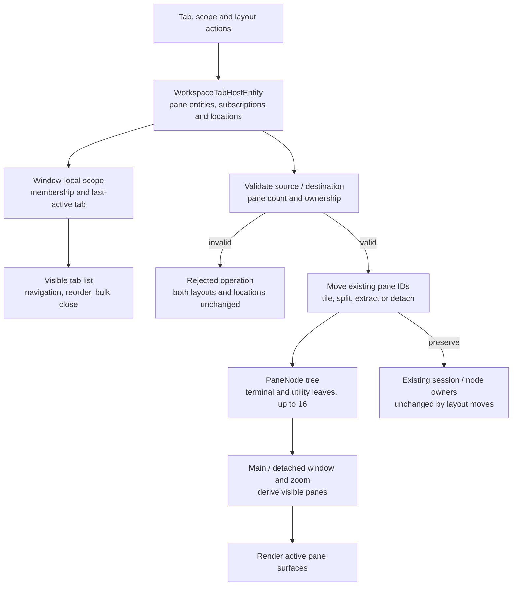

Scope filtering changes presentation, while layout operations move existing resources after validation. Neither is an implicit reconnect. Mixed tabs retain all pane memberships instead of being split by a filter.

Implementation: [entity](../../../crates/oxideterm-gpui-app/src/workspace/tabs/entity.rs), [scope](../../../crates/oxideterm-gpui-app/src/workspace/tabs/scope.rs), [split_drop](../../../crates/oxideterm-gpui-app/src/workspace/tabs/split_drop.rs).

### Workspace Shell

The workspace shell owns visible layout:

- Tabs.
- Pane tree.
- Activity bar.
- Sidebar.
- Command palette.
- Dialog stack.
- Notifications.

It should not own low-level SSH transport or secret material.

### Tabs

Tabs are visible surfaces. A tab can represent:

- Local terminal.
- SSH terminal.
- SFTP.
- IDE workspace.
- Settings.
- File manager.
- Plugin manager.
- Connection monitor.
- Cloud sync.
- Knowledge workspace.

Tabs are closeable views. They are not the durable source of truth for saved connections or secrets.

Tab scopes are window-local filters: all tabs, global pages, local terminals, or a specific connection. Mixed layouts combine their panes' memberships and stay intact in every matching scope. Scope selection and last-active-tab memory affect presentation, not runtime ownership, and are not persisted across restart. Rendering, keyboard navigation, reordering, bulk closing, and scroll positioning share the visible tab list and content-based widths.

`PaneNode` represents terminal leaves, utility-page leaves and nested groups. A tab can contain up to 16 panes, as defined by `MAX_PANES_PER_TAB`. Splitting and combining tabs use this same limit. The host validates the source and destination before changing their layouts; a rejected drop leaves both trees and their session locations unchanged.

`WorkspaceTabHostEntity` owns terminal entities, subscriptions, window mounts and session-to-pane locations. Tiling moves 2 to 16 existing terminal panes into one layout while preserving their pane IDs, sessions and runtime consumers. Pane zoom changes which pane is visible without replacing the underlying pane tree. Extraction moves an existing pane into another tab. These operations do not reconnect the terminal transport.

See the [pane model](../../../crates/oxideterm-workspace/src/lib.rs) and [tab host](../../../crates/oxideterm-gpui-app/src/workspace/tabs/entity.rs) for layout limits, validation and ownership transitions.

### Activity Bar

The left activity bar opens connection management and global pages. The right bar opens OxideSens and individual Host Tools, with overflow only when height is insufficient. The top bar owns scope selection, command-palette access, Zen mode, theme switching, and background-task summary. It remains visible in full screen and hides in Zen mode.

### Knowledge Workspace

Knowledge is a first-class central tab with its own internal split layout. Its left navigator owns collection and document browsing; its right pane owns Markdown editing. It is not a global companion-sidebar panel and it is not implemented as a stack of Settings cards.

The workspace keeps one canonical Markdown draft for Source and read-only Preview. `TextEditorView` owns source editing and undo history, `oxideterm-gpui-markdown` owns native preview rendering, and the RAG store remains the durable owner of collections, document revisions, chunks, and search indexes. The app entity coordinates selection, asynchronous loads, autosave, conflict detection, dirty-document leave guards, and background index refresh without moving persistence into the GPUI render tree.

Knowledge settings remain a configuration surface for embedding and retrieval behavior. They do not own the primary document browser or editor.

### Notifications

Notifications turn asynchronous domain events into user-visible messages. They should help users decide what to inspect next: connection monitor, settings, SFTP, cloud sync, plugin manager, or support bundle.

### Knowledge Draft And Storage

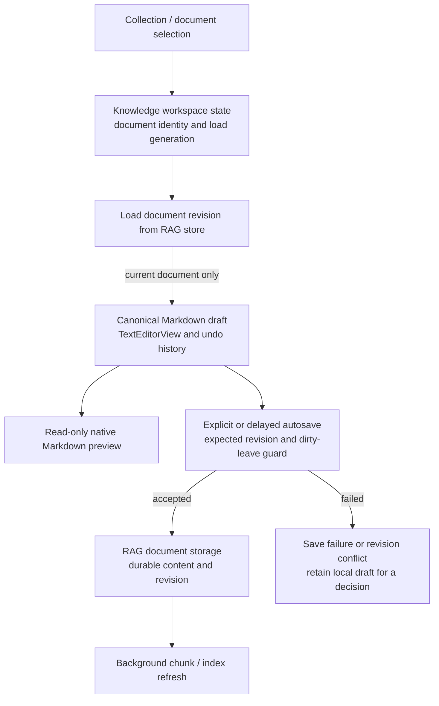

Source and Preview use the same draft. A preview switch does not create another editable copy; indexing is derived work after document storage, and an old load must not replace a newly selected document.

Implementation: [knowledge](../../../crates/oxideterm-gpui-app/src/workspace/knowledge.rs), [operations](../../../crates/oxideterm-gpui-app/src/workspace/knowledge/operations.rs).


---

## Terminal Architecture

### Local Terminal

Local terminal tabs run on the local machine. They validate renderer, keyboard input, shell startup, font configuration, and terminal settings before any remote host is involved.

Local terminal responsibilities:

- Start the configured local shell.
- Render output.
- Accept keyboard input.
- Handle resize.
- Apply terminal appearance settings.
- Apply terminal background and graphics settings without making them part of the terminal buffer.
- Detect terminal-native file-transfer prompts and privilege prompts without logging secrets.
- Keep local command state separate from remote SSH node state.

### SSH Terminal

SSH terminal tabs attach to a live node. They are consumers of an SSH connection, not the connection profile itself.

SSH terminal responsibilities:

- Present a shell channel.
- Maintain visible screen and scrollback context.
- Send input.
- Render output.
- Expose terminal observations to AI tools when approved.
- Report readiness and waiting-for-input hints.
- Reuse the node-owned SSH transport while keeping shell-channel state pane-local.
- Resolve privilege credential scope through the active terminal's owning node, not through host/title/prompt heuristics.

The terminal session interface also has Telnet, Mosh, serial and BLE backends. They adapt their transport to terminal input, output, resize and lifecycle operations. BLE uses a GATT notification/write stream and shares serial send/display options; it does not acquire an SSH node merely to display terminal text. Transport-specific state lives in `oxideterm-terminal/src/session/` and the corresponding protocol crates.

### Terminal Rendering And Graphics

The terminal renderer combines several layers:

- The emulator text grid and scrollback.
- Cursor, selection, command marks, and inline hints.
- Terminal image protocols such as Kitty/Sixel/iTerm2.
- App-level background images, video, generated effects, opacity, and blur.
- Native whole-window opacity, applied separately from background-image opacity.
- Context-menu and command-bar overlays.

The emulator owns the text grid and scrollback. `oxideterm-terminal-graphics` tracks protocol images and their placements alongside grid events. Background media and application overlays belong to presentation state.

Kitty resources and placements are scoped to the normal or alternate screen. Entering the alternate screen clears its previous Kitty resources while retaining normal-screen images. Screen selection, erasure, scrolling, history trimming and reset update the corresponding graphics state. Sixel placements also follow grid changes and cell geometry. The renderer displays placements for the active screen; an ordinary screen switch is not a request to discard every protocol image.

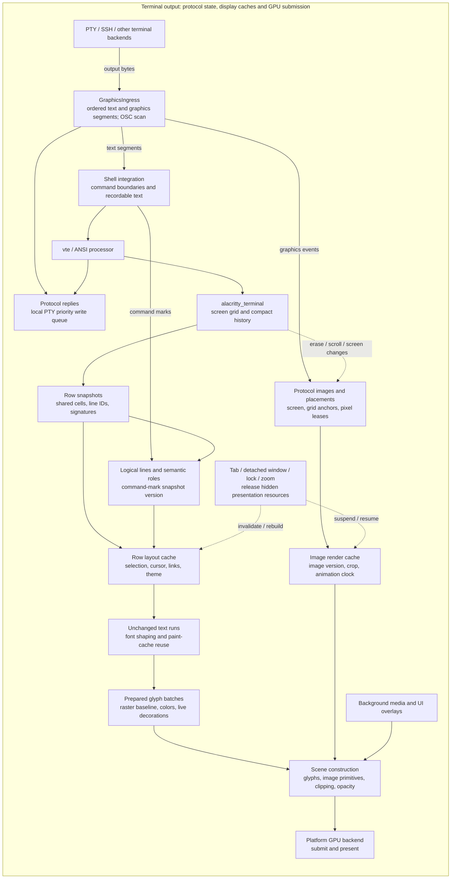

Terminal drawing passes through these boundaries:

| Stage | Owner | Reuse and invalidation |
|---|---|---|
| Transport output and protocol parsing | `oxideterm-terminal`, `oxideterm-terminal-graphics`, `vte` and `alacritty_terminal` | Ordered graphics/control parsing feeds the text grid and graphics events. OSC payload scanning stops at BEL or ESC and preserves the storage limit and partial-input state. |
| Grid and history | `alacritty_terminal` | Writable rows use dense cells. History can use repeated-tail or packed storage when beneficial; read-only iteration does not expand compact rows. |
| Display snapshots | `oxideterm-terminal-model` and the terminal runtime | Rows share cell data through `Arc`, with stable line identities and paint-relevant signatures. |
| Row layout and text shaping | `TerminalLayoutCache` in `oxideterm-gpui-terminal` | Row keys include content, selection, cursor, theme and highlight state. When a row changes, unchanged text runs can retain shaping and paint caches if text, column, cell count and complete style match. Font size, cell width and line height changes invalidate run reuse. |
| Semantic roles | Terminal logical-line layout | Classification uses absolute logical-line ranges, active-input state and the immutable command-mark snapshot. A weak snapshot reference detects replacement without retaining command text. |
| Glyph batches and decorations | GPUI `LinePaintCache` | Prepared glyph data is reused while layout, colors, scale and renderer resources remain valid. Uniform full-run underlines and strikethroughs reuse glyphs and draw their strokes with current styles. Partial decorations use the general painter. |
| Protocol image display | Terminal image cache and GPUI image resources | Image identity, version and source crop determine cache reuse. Shared pixel leases track decoded memory; bounded display caches and visibility control renderer-resource retention. |

For glyphs that share a baseline and use integer vertical rasterization, the batch anchor is the rounded device baseline. Vertical scrolling can then translate the batch without repeating glyph preparation or changing rasterized positions. Glyphs with additional vertical shaping offsets retain device-phase invalidation. Prepared colors normalize hue once, while each draw applies current opacity. Blank cells avoid unused foreground conversion, and theme-default backgrounds reuse the converted background color.

The [row layout](../../../crates/oxideterm-gpui-terminal/src/terminal_view/element.rs), [GPUI glyph painter](../../../crates/gpui-ce/gpui/src/text_system/line.rs), [image cache](../../../crates/oxideterm-gpui-terminal/src/app/image_cache.rs) and [graphics/grid synchronization](../../../crates/oxideterm-terminal-graphics/src/graphics/grid.rs) own these boundaries.

### Privilege And File-Transfer Helpers

Privilege prompts and modem transfers are terminal-adjacent helpers, not ordinary typed text:

- Prompt detection watches the active terminal output.
- Secret submission uses a dedicated secret path and must not pass through plugins, AI context, logs, recordings, or shell history.
- Local privilege credentials are scoped to local terminal use; SSH privilege credentials are scoped through active terminal -> node -> saved owner.
- X/Y/ZMODEM byte-level state lives in `oxideterm-modem-transfer`; GPUI only asks for files/directories, displays progress, and writes protocol responses back to the current PTY/channel.
- Detection must stay conservative so normal command output and full-screen TUI redraws are replayed as terminal text unless protocol context is proven.

### Command Bar And Context Actions

The command bar and terminal context menu are workspace controls. They may send text, paste, select, search, trigger transfers, or route commands, but their state should not be inferred from the terminal title or prompt text. Selection actions operate on the terminal snapshot and renderer coordinates, while mutating actions route through explicit terminal/session APIs.

### Terminal Ownership Rule

Closing a terminal pane closes that pane. It should not be interpreted as deleting the saved connection profile. Depending on runtime state, other consumers such as SFTP, forwards, or IDE may still need the node or may need reconnect.

---

## SSH Connection Registry And Runtime

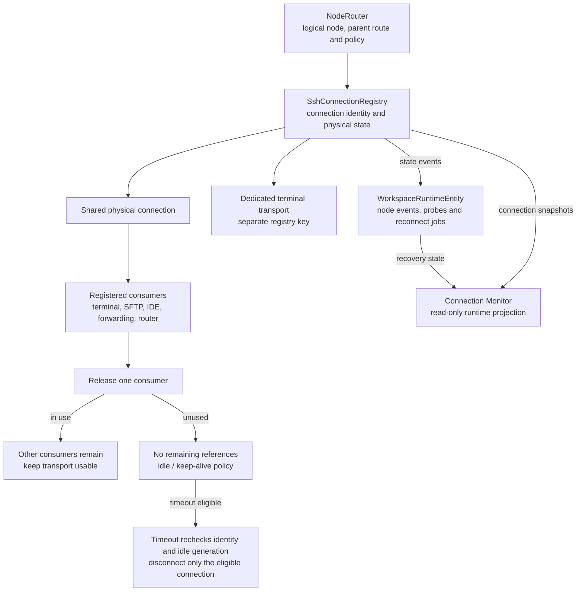

The release path is based on registered consumers and connection identity, not foreground-tab visibility. A jump child retains its parent route while it needs that transport. AI and plugin handles are not additional ConnectionConsumer enum variants.

Implementation: [connection_registry](../../../crates/oxideterm-ssh/src/connection_registry.rs), [runtime_entity](../../../crates/oxideterm-gpui-app/src/workspace/runtime_entity.rs).

The SSH connection pool keeps remote runtime state separate from UI tabs.

### Responsibilities

- Track active, idle, stale, reconnecting, and failed connections.
- Share one connection across multiple consumers where possible, or create a dedicated terminal connection when configured.
- Own physical connection state, registry consumers, health probes, and idle reclamation.
- Expose connection snapshots to the workspace runtime and monitor surfaces.
- Keep reconnect scheduling in `WorkspaceRuntimeEntity`, not in the monitor surface.

### Consumer Model

```text
Shared SSH connection
  |-- terminal consumer
  |-- SFTP consumer
  |-- forwarding consumer
  |-- IDE consumer
  `-- NodeRouter consumer

Dedicated terminal connection
  `-- terminal consumer with its own registry key and physical transport

AI and plugins use capability handles, host snapshots, or terminal hooks. They
are not `ConnectionConsumer` variants and are not physical connection owners.
```

### Monitor Model

Connection Monitor reads registry and workspace-runtime state to answer:

- Which nodes are active?
- Which are reconnecting?
- Which have failed?
- Which registry consumers are attached?
- Which forwards or transfers need attention?

### Host Tools Model

Connection Monitor also hosts resource-oriented tools for a connected node. These tools are node-level views, not terminal commands pasted into a pane.

Host Tools cover:

- Process lists and process actions.
- Docker containers and logs.
- Services.
- tmux sessions, windows, and panes.
- Package inventory.
- System logs.
- Listening ports and exposure hints.
- Filesystem and disk usage.
- Scheduled tasks.
- CPU, memory, disk, GPU, and network metrics.

Architecture rules:

- `oxideterm-connection-monitor` owns sampler commands, parser logic, row signatures, filters, action command construction, and domain DTOs.
- `oxideterm-gpui-app` renders the monitor, confirms user actions, and dispatches commands through the owning node/runtime boundary.
- Resource snapshots are runtime observations. They can refresh, become stale, or fail without mutating saved connection profiles.
- `ConnectionRegistry` owns physical SSH state, health probes, consumer bookkeeping, and idle cleanup.
- `WorkspaceRuntimeEntity` schedules active probes, handles node events, and starts or cancels reconnect jobs.
- `ForwardingRuntimeService` owns forwarding listeners and bridge tasks.
- The monitor surface owns neither SSH transport nor reconnect lifecycle.
- Heavy or repeated host sampling must not block terminal input or become the source of truth for SSH connection ownership.

### Host Tools Sampling And Actions

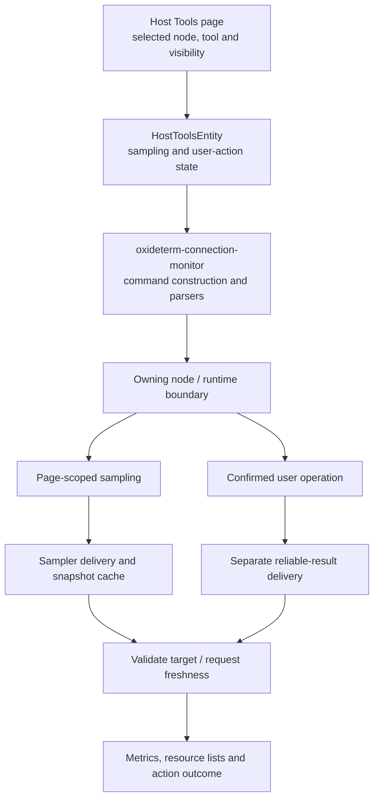

The paths distinguish periodic observations from user-requested results. Sampling traffic must not delay an operation result. Hiding a page changes sampling activity; it does not transfer SSH ownership to the page.

Implementation: [entity](../../../crates/oxideterm-gpui-app/src/workspace/connection_monitor/entity.rs), [lib](../../../crates/oxideterm-connection-monitor/src/lib.rs).


---

## SFTP Architecture

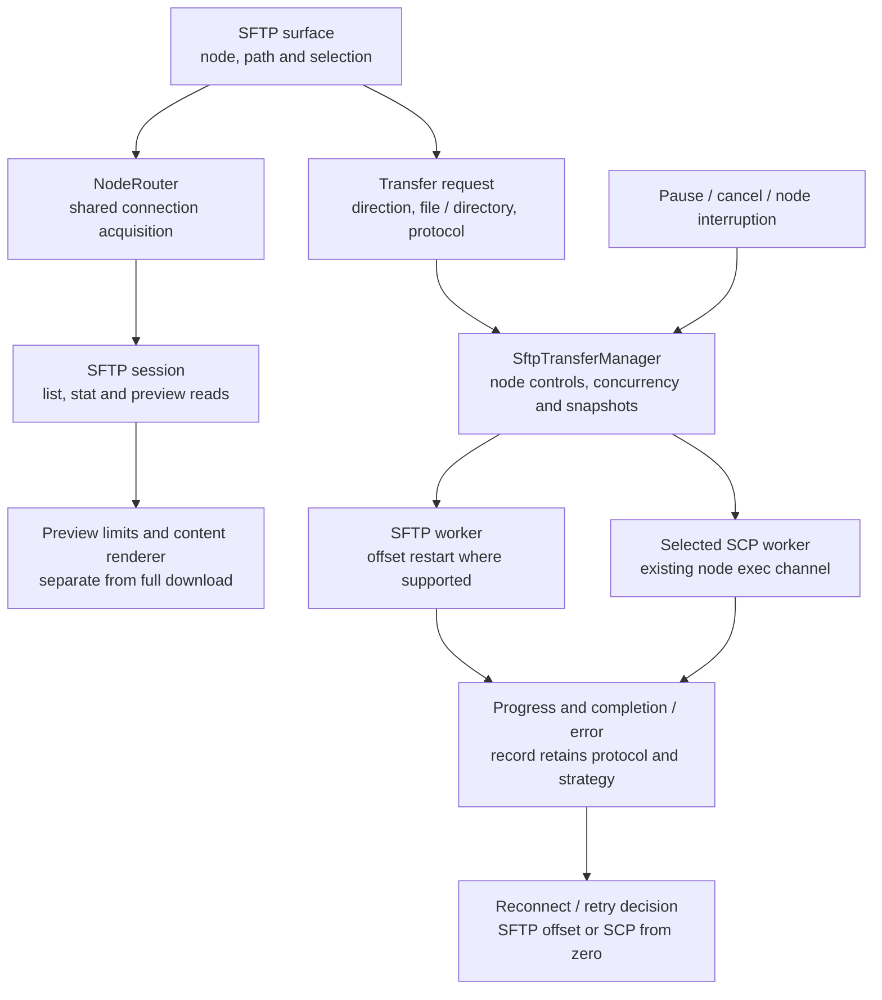

Browsing and preview use SFTP; selecting SCP for a transfer does not create an SFTP implementation or a second SSH transport. Transfer controls and records belong to the manager, not the currently displayed progress row.

Implementation: [transfer_manager](../../../crates/oxideterm-sftp/src/transfer_manager.rs), [preview](../../../crates/oxideterm-sftp/src/session/preview.rs), [scp](../../../crates/oxideterm-sftp/src/scp.rs).

Remote file transfer is a node-level capability. SFTP remains the structured browsing and preferred transfer protocol; legacy SCP is a compatibility transport for connected POSIX hosts whose SFTP subsystem is unavailable. Neither protocol should be treated as a terminal-pane feature.

### Responsibilities

- Acquire SFTP access for a connected node.
- List directories.
- Preview files.
- Upload and download files.
- Write file content when explicitly requested.
- Manage transfer progress.
- Retry or reacquire transport after reconnect when supported.

SCP opens an exec channel from the existing `NodeRouter` connection handle. It never creates an independent SSH transport, follows node disconnect/cancel ownership, rejects unsafe control-record names, contains downloads under the chosen local target, and uses generated temporary siblings for single-file replacement. Capability probes are cached only for one live connection generation, including negative results.

### Directory Transfers

Directory transfers use a different execution path than single-file transfers. The app must distinguish:

- Single file upload.
- Single file download.
- Directory upload.
- Directory download.
- Background transfer state.

The transfer record stores the selected protocol. SFTP may restart from a saved byte offset. SCP can pause and resume only while the live channel remains open; after channel loss its persisted failed record is retryable from byte zero, not resumable from the recorded byte count.

### Safety Model

Remote file writes are real writes on the target host. Before overwriting important files, users should verify path, target, and backup state. AI and plugins should use explicit targets and approvals for file writes.

### Directory Strategy And Path Boundaries

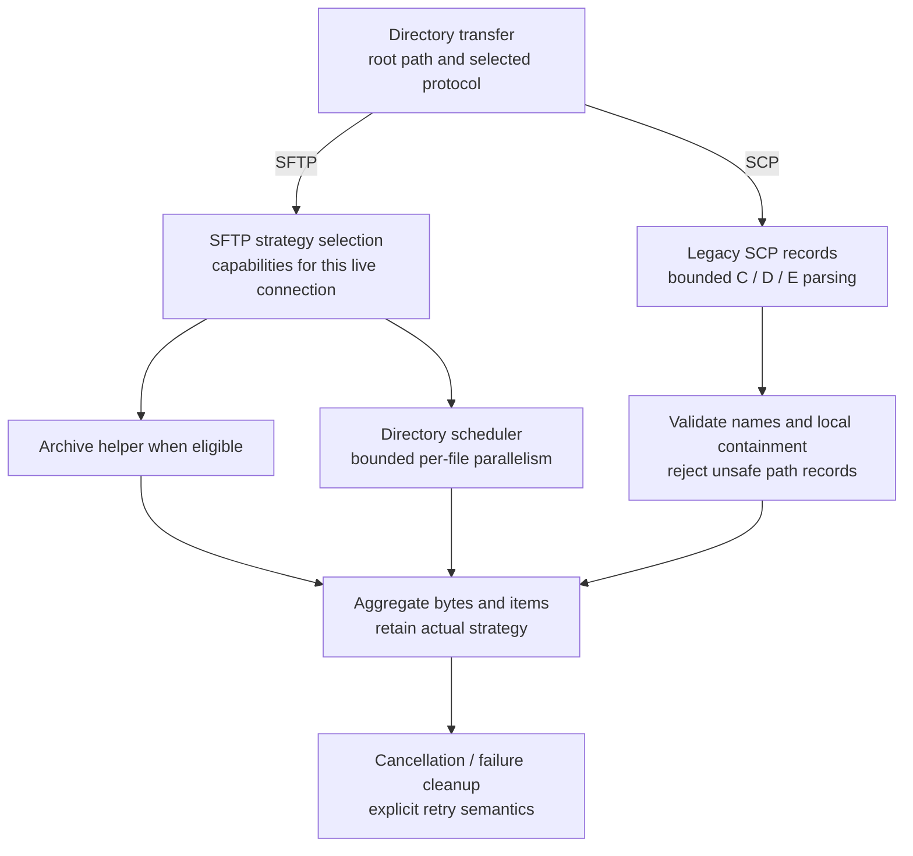

Directory strategies are not interchangeable with single-file streaming. Capability caches are connection-scoped. SCP validates protocol names and destination containment before writes, and never interprets a persisted byte count as a resume offset.

Implementation: [directory_scheduler](../../../crates/oxideterm-sftp/src/session/directory_scheduler.rs), [tar_transfer](../../../crates/oxideterm-sftp/src/tar_transfer.rs), [paths](../../../crates/oxideterm-sftp/src/scp/paths.rs).


---

## IDE Architecture

The IDE has separate owners for project state, text editing, syntax analysis and file access. A project can be opened from an SSH node or by converting a terminal's current Shell environment. These entry points share the editor surface but have different transport and recovery lifetimes.

### Responsibilities

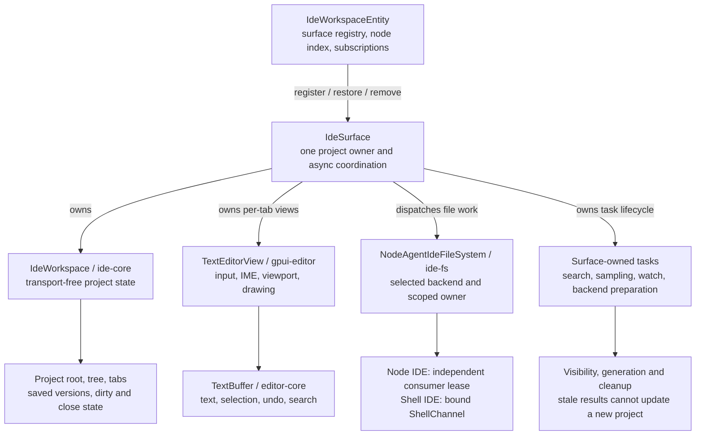

| Layer | Owned state and boundary |
|-------|--------------------------|
| `IdeWorkspaceEntity` in the app | Registers project surfaces by tab and node, retains subscriptions and close history, and coordinates reconnect. It does not own the SSH transport. |
| `IdeSurface` in `oxideterm-gpui-ide` | Owns one project's core model, editor views, file backend, search state, Markdown previews and background task handles. It applies asynchronous results to the current project. |
| `IdeWorkspace` in `oxideterm-ide-core` | Owns the root, file tree, editor-tab metadata, buffer snapshots, saved versions and dirty-close decisions. It has no GPUI, SSH or SFTP dependency. |
| `TextEditorView` and `oxideterm-editor-core` | Own interactive text, cursor and selection, undo/redo, find/replace, IME handling and viewport drawing. The surface synchronizes live text into the project model before save, close and snapshot operations. |
| `oxideterm-editor-syntax` | Computes syntax metadata from text snapshots. It neither paints GPUI elements nor changes editor text. |
| `oxideterm-ide-fs` | Implements file operations and owns scoped backend resources. Node-based IDE consumers share the connection through `NodeRouter`; terminal-bound IDEs use their selected Shell channel. |

### Editor And Syntax Pipeline

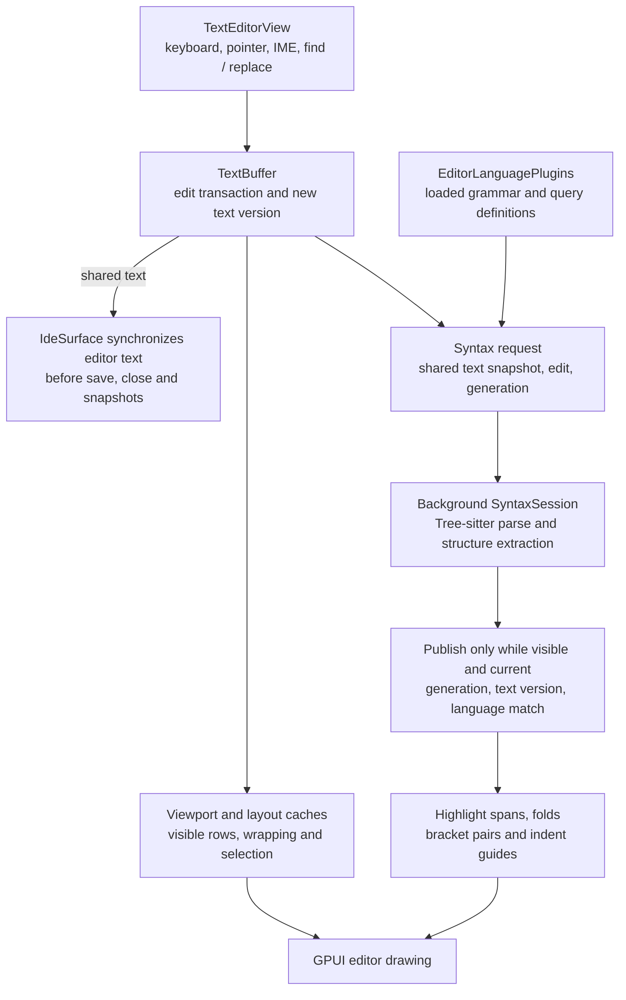

`TextBuffer` supplies versioned text snapshots. The editor schedules Tree-sitter work on a background executor, using grammar and query definitions from the language-plugin registry. Highlighting, folding, bracket matching and indent guides return as byte-range metadata. The foreground applies a result only when its generation, text version and language still match and the editor's render cache is active.

While syntax work is running, the editor retains the latest pending request instead of starting overlapping parsers. Hiding the editor invalidates pending syntax work and releases derived syntax/layout caches while retaining the buffer. Showing it schedules fresh syntax work. Large-file and missing-grammar paths can continue displaying text without syntax metadata.

IDE and SFTP editors share the search bar and search model. Search supports case sensitivity, regular expressions, multiline input, and capture-group replacement; terminal search uses the same matching capability with a single-line default. Text-input viewports keep caret, selection, and IME coordinates aligned, and editing histories belong to individual inputs. Markdown previews are owned by the project surface and rendered through the native Markdown renderer.

### Relationship To SFTP

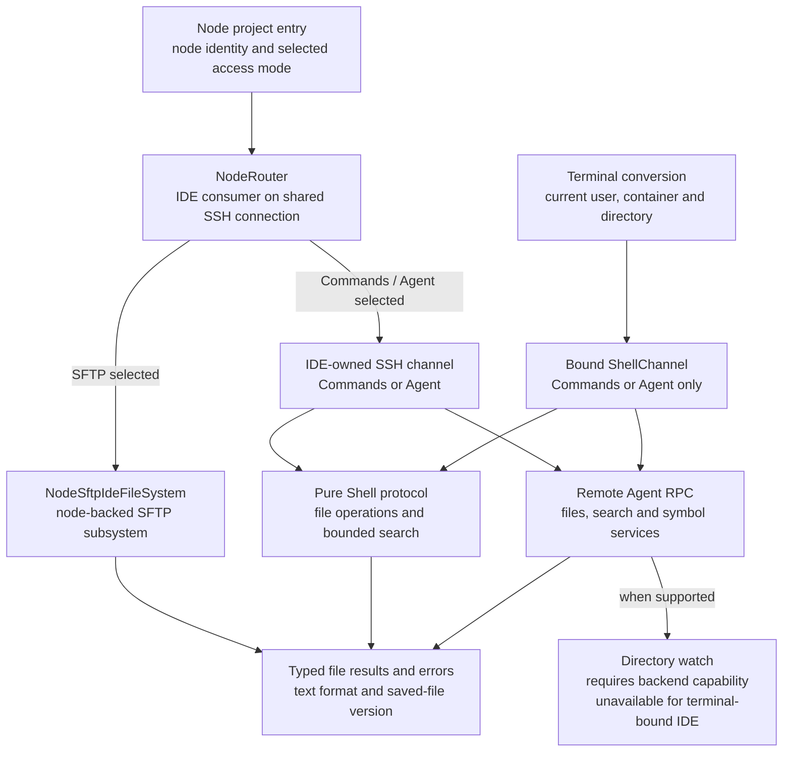

The diagram shows explicitly selected file backends. SFTP is one implementation of file access; project state and editor buffers remain in the IDE owners. The core defines synchronous and asynchronous file-system contracts for reads, directory listings, version checks and writes. `LocalIdeFileSystem` also implements the local-disk contract, but the project surface shown here is wired through `NodeAgentIdeFileSystem`.

| Access path | Environment and capabilities |
|-------------|------------------------------|
| Node + SFTP | Acquires the node's SFTP subsystem and an independent IDE consumer. Closing an unrelated terminal does not release this consumer. |
| Node + Commands or Agent | Opens an IDE-owned channel through the node. Commands provide Shell-based file operations; Agent provides RPC file operations and symbol services. |
| Terminal + Commands or Agent | Binds to the current Shell, retaining its user, container and working directory. It cannot substitute the node's SFTP or default exec environment. |

Pure Shell operations have bounded search execution and result sizes; writes retain version-conflict checks and restricted temporary-file permissions. Agent symbol-definition requests can locate and open a file at the returned line and column. Directory watching additionally depends on backend capability and is disabled for terminal-bound IDEs. Tree-sitter syntax metadata and Agent symbol lookup are separate paths; they do not constitute a general LSP client.

### Save, Close, And Recovery

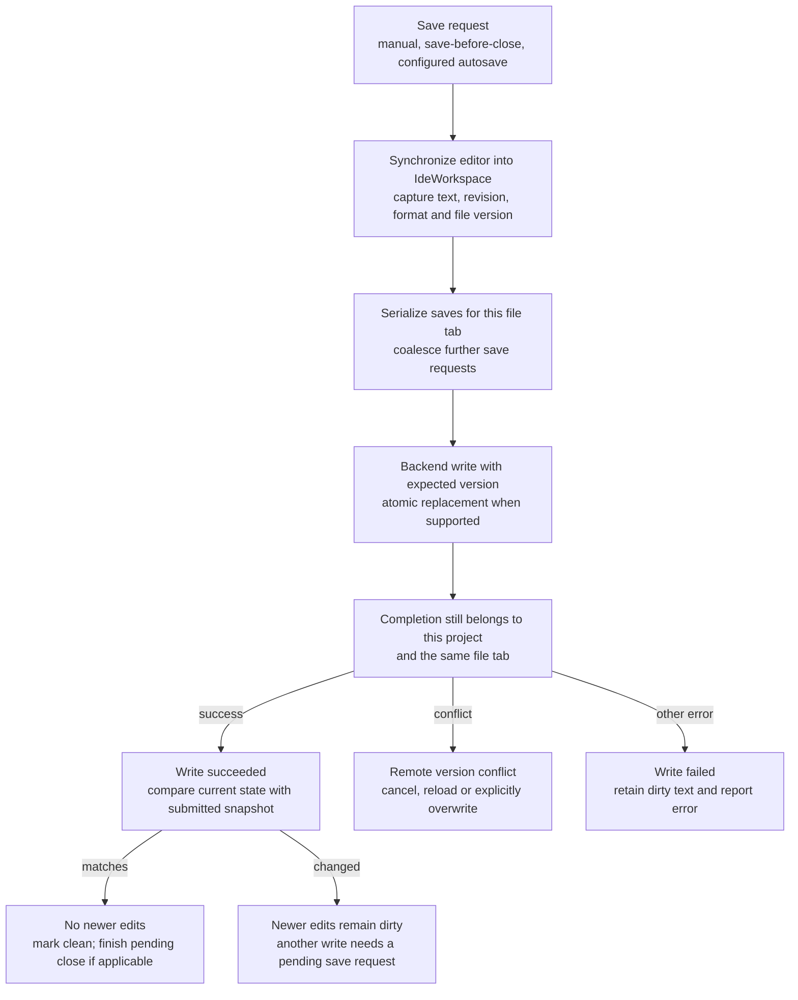

File contents travel with their encoding, BOM and line-ending format, plus a saved-file version used for conflict checks. The surface selects atomic replacement only when the backend reports support. A successful write records the submitted text and revision; edits made during that write remain dirty. Repeated save requests are serialized and coalesced rather than issuing concurrent writes for the same tab. Configured autosave currently saves a dirty editor when switching away from its tab.

| Lifecycle event | State and cleanup rule |
|-----------------|------------------------|
| Close a dirty file or leave a project | The owner requests save, discard or cancel. A failed save or newer edits cannot silently complete a pending close. |
| Hide an IDE surface | Stop page sampling and directory watching; suspend hidden editor caches. Retain buffers and the node consumer. Visibility does not cancel user-requested file operations. |
| Node connection interrupted | Stop sampling/watch work, invalidate search results, mark the project disconnected and release its old backend consumer. The reconnect snapshot carries project path, open files, dirty text and file formats. |
| Restore a node IDE | Rebind the selected backend and restore the same project. An already-open different project or a project closed after the snapshot is not replaced. Snapshot dirty text is applied only to clean buffers, so newer local edits win. |
| Terminal-bound IDE | It is excluded from the node IDE reconnect snapshot. Its binding belongs to the source Shell; returning to the terminal follows the dirty-buffer decision path. |
| Release a surface | Cancel backend preparation and owned sampling/watch tasks; complete watch cleanup and release only this owner's resources. Other IDE or AI consumers keep their own leases. |

Reconnect snapshots are runtime recovery state, not proof that unsaved text has been written to disk. Generation checks prevent stale project/search/syntax completions from being applied to a replacement owner or newer request.

Implementation references: [app registry and reconnect](../../../crates/oxideterm-gpui-app/src/workspace/ide.rs), [surface lifecycle](../../../crates/oxideterm-gpui-ide/src/surface/lifecycle.rs), [editor actions and save completion](../../../crates/oxideterm-gpui-ide/src/surface/editor_actions.rs), [syntax scheduling](../../../crates/oxideterm-gpui-editor/src/surface/syntax_task.rs), [file-system contract](../../../crates/oxideterm-ide-core/src/filesystem.rs), and [backend binding](../../../crates/oxideterm-ide-fs/src/agent/binding.rs).

### User Rule

Before closing an IDE tab or reconnecting an unstable host, check unsaved buffers. Recovery can restore access and in-memory project state; saving or discarding edits remains a separate decision.

---

## Port Forwarding Architecture

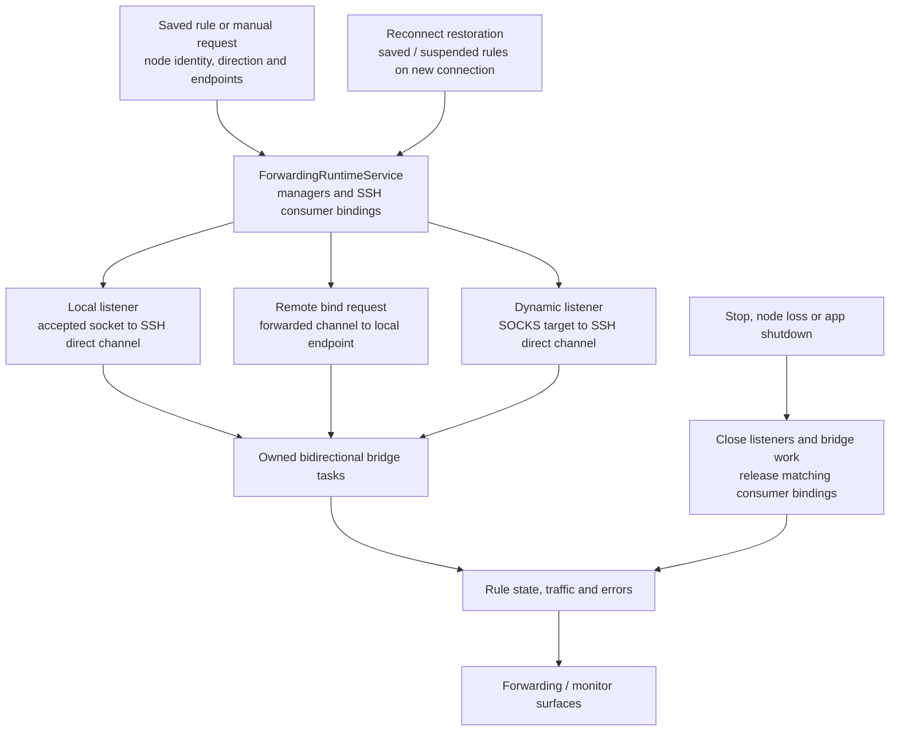

The service owns live listeners independently of UI mounts. Closing a terminal or hiding the forwarding page does not stop a rule. Stopping a saved rule does not connect its host just to perform cleanup; reconnect restoration must use the new connection identity.

Implementation: [runtime_service](../../../crates/oxideterm-gpui-app/src/workspace/forwards/runtime_service.rs), [reconnect](../../../crates/oxideterm-gpui-app/src/workspace/forwards/reconnect.rs).

Port forwarding is a connection-level capability.

### Forward Types

- **Local**: local port to remote target.
- **Remote**: remote port to local target.
- **Dynamic**: SOCKS-style dynamic forwarding.

### Runtime Responsibilities

- Create listeners or remote forward requests.
- Track running, failed, stopped, or suspended state.
- Attach forwards to an owning node.
- Restore saved or suspended forwards when reconnect succeeds.
- Show actionable errors when ports conflict or connections fail.

### Auto-Start Rule

Use auto-start only for forwards that should start whenever the owning connection opens. Otherwise, start forwards manually from the forwarding surface.

---

## Graphics And VNC Sessions

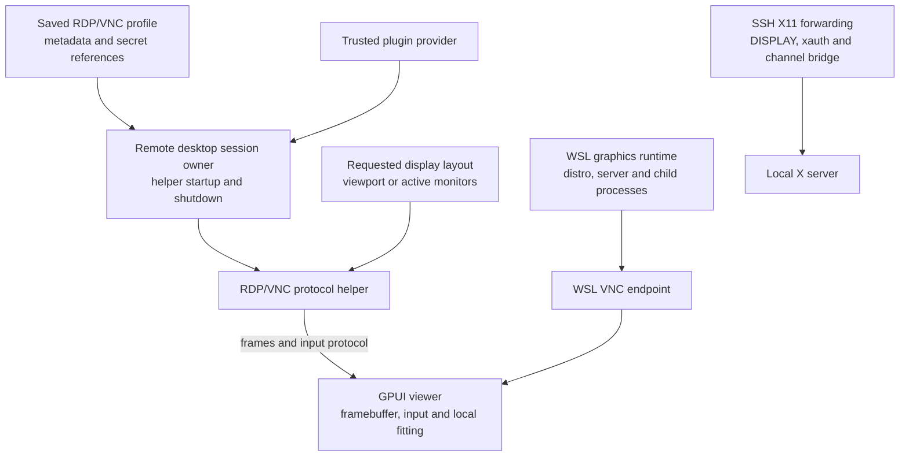

Graphics sessions are visual runtime surfaces. They are separate from terminal buffers even when a terminal or command launches the remote visual program.

Visual remoting has three related but separate ownership paths:

- **WSL Graphics**: `oxideterm-wsl-graphics` owns WSL distro probing, VNC server startup, desktop/app child processes, and cleanup.
- **Remote Desktop**: `oxideterm-remote-desktop` and `oxideterm-gpui-remote-desktop` own the shared model, viewer state and binary transport. Protocol engines are independent `plugins/rdp` and `plugins/vnc` packages in the marketplace repository, discovered through the trusted plugin registry and launched by the session owner. Connection forms indicate whether the required plugin is available. Saved profiles, credentials, SSH gateways and the native viewer retain their existing behavior.
- **SSH X11 forwarding**: `oxideterm-x11-forwarding` owns DISPLAY, xauth, fake-cookie, setup rewrite, and SSH X11 channel bridge semantics; it is not a full desktop viewer.

### Responsibilities

- Track graphics sessions separately from terminal tabs.
- Start or reconnect the backing graphics session through the graphics runtime.
- Connect the GPUI viewer to the backing framebuffer source.
- Route keyboard, pointer, and scroll input to the viewer worker.
- Keep rendered frames as viewer state, not terminal output or scrollback.

### Ownership Rule

The graphics runtime owns the server/session process lifecycle. The GPUI viewer owns the client connection, current framebuffer, pointer geometry, and input dispatch. Closing the viewer should stop or detach the graphics session according to the chosen action, but it should not rewrite saved SSH connection profiles.

For RDP/VNC sessions, `oxideterm-connections` owns saved profile metadata and secret references, while the app tab/session owns the helper process lifecycle and the GPUI viewer owns framebuffer and input state. RDP/VNC protocol code lives in helper binaries or protocol-specific crates, not in `oxideterm-gpui-app`; an SSH node supplies tunnel or node context only when the session is launched through that node.

Display layout and viewer fitting are separate. Single-monitor mode may request a resolution from the viewport. All-monitor mode uses active physical monitor topology; window resize changes local fitting rather than replacing that topology. Display changes and reconnect must refresh the session layout, including external-monitor and closed-laptop-screen cases.

### Frame Delivery And Helper Lifetime

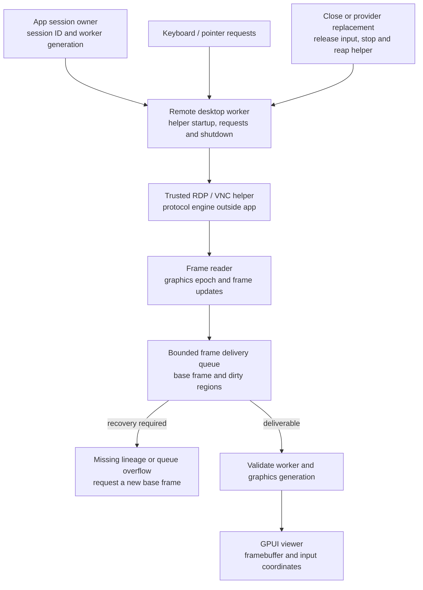

Input dispatch and frame delivery have separate paths. A new graphics epoch waits for a base frame rather than applying old-size deltas to a new framebuffer. Worker identity prevents a retired session from updating the current viewer. Helper retirement finishes before its executable is replaced.

Implementation: [worker](../../../crates/oxideterm-remote-desktop/src/worker.rs), [frame_queue](../../../crates/oxideterm-remote-desktop/src/frame_queue.rs), [remote_desktop](../../../crates/oxideterm-gpui-app/src/workspace/remote_desktop.rs).

### Remote Layout Versus Local Fitting

```mermaid
%%{init: {"layout": "dagre", "flowchart": {"nodeSpacing": 45, "rankSpacing": 75, "curve": "basis"}}}%%
flowchart TB
    Change["Connect / reconnect / display change"]
    Mode["Session display mode"]
    Single["Single monitor<br/>viewport-derived remote size"]
    Multi["All local monitors<br/>active physical topology"]
    Validate["Validate layout and negotiated capability"]
    Send["Deduplicate / schedule session resize request"]
    Remote["Helper / remote server<br/>new desktop layout"]
    Window["Window size change"]
    Fit["Local viewer fitting and input mapping"]

    Change --> Mode
    Mode -->|single| Single
    Mode -->|multi| Multi
    Single --> Validate
    Multi --> Validate
    Validate --> Send
    Send --> Remote
    Window --> Fit
    Window -->|single mode only| Single
```

All-monitor topology is not overwritten by a later viewport-size request. Window fitting remains local in that mode; active-display changes use the topology path again. These controls are distinct from graphics-epoch validation in frame delivery.

Implementation: [remote_desktop](../../../crates/oxideterm-gpui-app/src/workspace/remote_desktop.rs), [model](../../../crates/oxideterm-remote-desktop/src/model.rs).


---

## Reconnect And Recovery

```mermaid
%%{init: {"layout": "dagre", "flowchart": {"nodeSpacing": 45, "rankSpacing": 75, "curve": "basis"}}}%%
flowchart TB
    Detect["Node health / transport event"]
    Owner["WorkspaceRuntimeEntity<br/>one owned reconnect job per affected node"]
    Snapshot["Snapshot affected consumers<br/>terminals, forwards, transfers, IDE"]
    Grace["Grace probe where applicable"]
    Recovered["Existing transport recovered<br/>refresh observed state"]
    Connect["Rebuild transport / parent route<br/>bounded retry policy"]
    Identity["Check active job and connection identity"]
    Restore["Restore consumer resources<br/>terminal, forwards, transfer retry, IDE"]
    Report["Stage results and remaining failures<br/>monitor and targeted notifications"]
    Cancel["User disconnect / removal / shutdown"]
    Stop["Cancel owned attempts and probes<br/>reject late completions"]
    Capability["AI / plugin resource generations<br/>refresh or reacquire on later use"]

    Detect --> Owner
    Owner --> Snapshot
    Snapshot --> Grace
    Grace -->|alive| Recovered
    Grace -->|expired / lost| Connect
    Connect -->|connected| Identity
    Connect -->|exhausted / failed| Report
    Identity --> Restore
    Recovered --> Report
    Restore --> Report
    Cancel --> Stop
    Identity --> Capability
```

Recovery is coordinated by the runtime, not a monitor-page timer. A connected transport does not prove every consumer restored successfully. Cancellation and job identity gate late work; AI and plugin capabilities are refreshed through their own runtime boundaries, not as an unconditional reconnect stage.

Implementation: [runtime_entity](../../../crates/oxideterm-gpui-app/src/workspace/runtime_entity.rs), [nodes_reconnect_helpers](../../../crates/oxideterm-gpui-app/src/workspace/tabs/nodes_reconnect_helpers.rs).

Reconnect is a workflow across several subsystems, not a terminal-only event.

### Recovery Inputs

A recovery attempt may need:

- Node state.
- Connection status.
- Terminal panes.
- SFTP transfers.
- Forward rules.
- IDE workspaces.
- Notifications and errors.

### Conceptual Pipeline

```text
detect stale state
  -> snapshot affected consumers
  -> attempt reconnect
  -> recreate or refresh terminal access
  -> restore forwards
  -> resume or retry transfers
  -> reopen or refresh IDE state
  -> update monitor and notifications

AI and plugin capability handles are not direct reconnect stages. They observe
node or connection generation changes through their runtime boundary and must
invalidate, refresh, or reacquire resources on a later call.
```

### User Workflow

1. Open Connection Monitor.
2. Identify the affected node.
3. Reconnect or wait for reconnect.
4. Refresh SFTP, IDE, forwarding, or AI target state.
5. Verify any write, transfer, or command result.

---

## Settings And Persistence

```mermaid
%%{init: {"layout": "dagre", "flowchart": {"nodeSpacing": 45, "rankSpacing": 75, "curve": "basis"}}}%%
flowchart TB
    Ui["Desktop settings draft"]
    Cli["CLI settings mutation"]
    Model["Shared PersistedSettings model"]
    Validate["Sanitize / normalize<br/>validation warnings and changed sections"]
    Metadata["Configuration values and secret references"]
    Write["SettingsStore / shared save path<br/>durable atomic file replacement"]
    File["Settings envelope on disk"]
    Apply["Desktop applies loaded changes<br/>theme, terminals and domain owners"]
    Secret["Explicit secret input"]
    Store["Secret-aware write boundary<br/>keychain or encrypted storage"]
    Error["Validation / persistence failure<br/>report the actual outcome"]

    Ui --> Model
    Cli --> Model
    Model --> Validate
    Validate --> Metadata
    Metadata --> Write
    Write -->|saved| File
    Write -->|failed| Error
    File -->|desktop reload / apply| Apply
    Secret --> Store
    Store -->|reference only| Metadata
```

Shared persistence does not mean an external CLI mutation immediately changes every mounted view. The desktop must load and apply the new state. Secret values use their own store; settings retain only the safe metadata or reference.

Implementation: [store](../../../crates/oxideterm-settings/src/store.rs), [normalize](../../../crates/oxideterm-settings/src/normalize.rs), [settings](../../../crates/oxideterm-gpui-app/src/workspace/settings.rs).

Settings are durable application state. The desktop Settings surface is the primary way to edit them interactively.

### Settings Domains

- General app behavior.
- Appearance and theme.
- Terminal behavior.
- Local terminal behavior.
- Terminal graphics, background images, and transfer helpers.
- SSH behavior.
- Privilege credentials.
- SFTP behavior.
- IDE behavior.
- AI providers and model settings.
- AI memory, tool use, and Knowledge embedding or retrieval settings.
- Plugins.
- Cloud sync.
- Portable runtime.
- Keybindings.
- Help and update channel.

### Persistence Rule

Settings should store configuration, not secret values. Secret fields should write to secret-aware storage.

Privilege credential entries are split: labels, prompt matchers, enabled state, and saved-node scope are configuration; passwords or equivalent secret values must be stored only through the secret-aware boundary.

### CLI Relationship

The CLI companion is the script and maintenance entry point for the shared
persistent model. It covers settings, connections, forwards, plugins, quick
commands, secrets, portable bundles, diagnostics, reports, batch plans,
backups, and cloud sync. Except for temporary GUI SSH launch, it does not own
live nodes or terminal runtime inside the desktop process. Mutating commands
normally use dry-run plans and `--yes` confirmation. For exploratory or visual
configuration, use the desktop Settings surface.

---

## Cloud Sync, Backups, And Portable Bundles

```mermaid
%%{init: {"layout": "dagre", "flowchart": {"nodeSpacing": 45, "rankSpacing": 75, "curve": "basis"}}}%%
flowchart TB
    Start["Manual or configured automatic sync<br/>selected scope and direction"]
    Recover["Recover pending local journal<br/>through live configuration owners"]
    Prepare["CloudSyncOperationService<br/>operation permit and PreparedSync"]
    Replica["Local replica plus remote publications<br/>causal field history"]
    Plan["Plan summary and conflict candidates"]
    Review["Direction / candidate selection<br/>first sync and conflicts require review"]
    Apply["PreparedSync.apply<br/>re-read live owners before merging"]
    Journal["Recovery journal and durable local changes"]
    Refresh["Refresh affected runtime projections"]
    Publish["AppliedSync.publish<br/>publish when direction requires it"]
    Outcome["Applied / published / pending / conflicts<br/>distinct outcome fields"]

    Start --> Recover
    Recover --> Prepare
    Prepare --> Replica
    Replica --> Plan
    Plan --> Review
    Review -->|accepted choices| Apply
    Plan -->|eligible automatic sync| Apply
    Apply --> Journal
    Journal --> Refresh
    Journal --> Publish
    Publish --> Outcome
```

This is the current causal sync path. Applying local values and publishing remote data are separate steps. The apply step rereads live owners so edits made during network work participate in the merge. Automatic execution requires the configured conditions and no unresolved preview conflicts; pending publication or cleanup is not reported as complete success.

Implementation: [synchronize](../../../crates/oxideterm-cloud-sync/src/operation/synchronize.rs), [recovery](../../../crates/oxideterm-cloud-sync/src/sync_v3/recovery.rs), [causal](../../../crates/oxideterm-gpui-app/src/workspace/cloud_sync/causal.rs).

Cloud sync, backups, and `.oxide` bundles operate on persisted state, not on live terminal bytes.

### Cloud Sync

Cloud sync aligns selected local state with a configured remote backend. The
current model supports WebDAV, HTTP JSON, Dropbox, OneDrive, Google Drive,
GitHub Gist, S3, and Git backends, with selectable sync partitions. Automatic
upload, conflict blocking, sync history, and up to five local rollback backups
are local state-machine behavior. UI and CLI use the same structured sync
model; live nodes and terminal buffers are not sync objects. It should be
inspectable before direction-changing actions such as push, pull, apply, or
conflict resolution.

### Backups

Backups protect users before high-impact changes:

- Bulk imports.
- Sync apply.
- Restore.
- Plugin migration.
- Settings migration.
- Portable bundle import.

### Portable Bundles

`.oxide` bundles are encrypted portable exports. They can contain connections, forwards, settings, plugin settings, quick commands, and optional portable secrets.

### Review Rule

Every import, restore, or sync apply should be previewable. Support bundles should be reviewed before sharing.

### Portable Import And Rollback

```mermaid
%%{init: {"layout": "dagre", "flowchart": {"nodeSpacing": 45, "rankSpacing": 75, "curve": "basis"}}}%%
flowchart TB
    State["Selected durable domains<br/>connections, settings, forwards, plugin settings"]
    Export["Export selection and secret inclusion policy"]
    Bundle["Encrypted .oxide bundle"]
    Backup["Local rollback backup"]
    Import["Read / decrypt / validate input"]
    Preview["Import or restore preview<br/>selected mutations and conflicts"]
    Confirm["Confirm selected apply"]
    Safety["Create safety backup when required"]
    Owner["Apply through owning stores<br/>ordinary state and secret boundaries"]
    Result["Report applied / skipped / failed items"]

    State --> Export
    Export --> Bundle
    State --> Backup
    Bundle --> Import
    Backup --> Import
    Import --> Preview
    Preview --> Confirm
    Confirm --> Safety
    Safety --> Owner
    Owner --> Result
```

Portable import and rollback restore are reviewable mutations of durable state. Their backup files are distinct from the causal synchronization recovery journal. Neither export includes live terminal byte streams or recreates a running SSH transport.

Implementation: [local_file](../../../crates/oxideterm-cloud-sync/src/operation/local_file.rs), [apply](../../../crates/oxideterm-cloud-sync/src/operation/apply.rs).


---

## OxideSens AI Architecture

```mermaid
%%{init: {"layout": "dagre", "flowchart": {"nodeSpacing": 45, "rankSpacing": 75, "curve": "basis"}}}%%
flowchart TB
    Turn["Conversation and user request"]
    Context["Context assembly<br/>history, selected resources, RAG, redaction"]
    Skills["Skill catalog / on-demand resources<br/>instructions grant no capabilities"]
    Native["Native provider request<br/>model protocol and supported reasoning fields"]
    Acp["AcpWorkspaceEntity<br/>agent process, session and configuration"]
    Stream["Native stream and tool rounds"]
    Events["ACP session events and host requests"]
    Delivery["Conversation / turn route validation"]
    Transcript["Assistant text, usage and tool results"]
    Tools["Application tool boundary<br/>policy, approval and live target validation"]
    Cancel["Cancel / session shutdown<br/>owned stream or ACP process lifecycle"]

    Turn --> Context
    Skills --> Context
    Context --> Native
    Context --> Acp
    Native --> Stream
    Acp --> Events
    Stream --> Delivery
    Events --> Delivery
    Delivery --> Transcript
    Stream --> Tools
    Events --> Tools
    Cancel --> Native
    Cancel --> Acp
```

Native provider requests and ACP sessions share UI and application-tool boundaries, not a single protocol or process owner. ACP reasoning options remain session configuration. Delivery must still match the conversation and turn; a response arriving after cancellation is not authority to execute an action.

Implementation: [acp_workspace](../../../crates/oxideterm-gpui-app/src/workspace/acp_workspace.rs), [core](../../../crates/oxideterm-gpui-app/src/workspace/sidebar/ai/actions/stream/core.rs).

OxideSens is a workspace-aware assistant. It uses configured providers and local app context; it does not require an OxideTerm account.

Agent Skills are a bounded instruction layer for repeatable workflows. The AI runtime discovers `SKILL.md` catalogs, loads full instructions and resources only on demand, and records the loaded skill hash in conversation metadata. Loading a skill does not grant runtime authority; terminal, file, credential, network, and other actions still require the existing capability and approval checks.

The chat surface also resolves a provider-aware reasoning level for the selected model. Known models are normalized against capability data; an unknown model with a known provider uses that provider's request format, while an unknown provider is treated as unsupported.

OxideSens has two execution backends. The native provider backend streams the
configured model protocol directly; the ACP backend uses an independent agent
process, ACP session, model selection, and session configuration. They share
the application context, policy, and UI, but their transport, tool injection,
reasoning configuration, and lifecycle are different. ACP does not use the
native provider's `reasoning_effort` field; its options belong to the ACP
session configuration.

### Context Sources

- Conversation history.
- Current terminal context.
- Saved connections.
- Live nodes.
- Terminal sessions.
- SFTP targets.
- IDE workspaces.
- Settings summaries.
- RAG knowledge collections.
- MCP resources and tools.
- Previous tool results.

### Orchestrator Tool Model

The AI tool layer exposes high-level app tools rather than arbitrary internal APIs. Examples include:

- Target discovery and selection.
- Connect target.
- Run command.
- Observe terminal.
- Send terminal input.
- Read resource.
- Write resource.
- Transfer resource.
- Open app surface.
- Get state.
- Recall or remember preferences.

### Approval Model

AI actions are classified by risk:

- Read-only.
- Interactive.
- Execute.
- Write.
- Destructive.

Writes, terminal input, command execution, file changes, and destructive operations should be explicit and reviewable. Secrets should never be pasted into prompts.

### Tool Authority And Result Flow

```mermaid
%%{init: {"layout": "dagre", "flowchart": {"nodeSpacing": 45, "rankSpacing": 75, "curve": "basis"}}}%%
flowchart TB
    Proposal["Parsed application tool proposal"]
    Policy["Tool policy<br/>operation class, arguments and intent"]
    Approval["Required approval<br/>specific operation and target"]
    Resolve["Resolve live resource reference<br/>owner, generation and capability"]
    Reject["Deny / cancel / stale target<br/>no domain side effect"]
    Owner["Dispatch to real domain owner<br/>terminal, node, file, IDE or settings"]
    Result["Structured result and safe error"]
    Record["Transcript / audit evidence<br/>record outcome, not secret payload"]

    Proposal --> Policy
    Policy -->|denied| Reject
    Policy -->|approval needed| Approval
    Policy -->|allowed without prompt| Resolve
    Approval -->|not approved| Reject
    Approval -->|approved| Resolve
    Resolve -->|invalid / stale| Reject
    Resolve -->|valid| Owner
    Owner --> Result
    Result --> Record
    Reject --> Record
```

Approval and capability validation answer different questions. Permission to attempt an action does not make an old target reference current. A denial or stale reference terminates the execution branch; the transcript can still record that outcome.

Implementation: [policy](../../../crates/oxideterm-ai/src/policy.rs), [registry](../../../crates/oxideterm-ai/src/runtime_context/registry.rs), [capability](../../../crates/oxideterm-ai/src/runtime_context/capability.rs).


---

## Plugin Architecture

```mermaid
%%{init: {"layout": "dagre", "flowchart": {"nodeSpacing": 45, "rankSpacing": 75, "curve": "basis"}}}%%
flowchart TB
    Package["Installed package and manifest"]
    Registry["Plugin registry<br/>host / platform compatibility and trust"]
    Gate["Enabled and compatible capability"]
    Blocked["Activation blocked<br/>retain files, settings and enable preference"]
    Runtime["Ordinary plugin runtime<br/>scoped host API and UI contributions"]
    Grammar["Language package<br/>grammar / queries and editor refresh"]
    Helper["Helper provider resolution"]
    Desktop["Remote desktop session owner<br/>RDP / VNC binary protocol"]
    Mosh["Mosh session owner<br/>terminal-transport protocol"]
    Acp["ACP workspace owner<br/>direct ACP stdio session"]
    Retire["Disable / update / remove<br/>retire runtime and reap helpers before replacement"]

    Package --> Registry
    Registry -->|incompatible / untrusted| Blocked
    Registry -->|activation allowed| Gate
    Gate --> Runtime
    Gate --> Grammar
    Gate --> Helper
    Helper --> Desktop
    Helper --> Mosh
    Helper --> Acp
    Runtime --> Retire
    Helper --> Retire
```

These branches describe execution ownership, not three aliases for the ordinary plugin supervisor. Language resources are consumed by editors; protocol helpers are launched and retired by their domain owners. Compatibility checks run for installed packages as well as marketplace version selection.

Implementation: [compatibility](../../../crates/oxideterm-plugin-registry/src/compatibility.rs), [plugin_entity](../../../crates/oxideterm-gpui-app/src/workspace/plugin_entity.rs), [plugin](../../../crates/oxideterm-editor-syntax/src/plugin.rs).

Plugins extend the app through manifest-declared capabilities and host-provided surfaces.

### Components

- Plugin manifest.
- Plugin registry.
- Plugin host API.
- Plugin settings.
- Plugin secrets.
- Plugin UI surfaces.
- Plugin lifecycle events.

### Boundary Rules

- Plugin settings are not plugin secrets.
- Plugin UI should use the host-provided API.
- Plugin errors should be isolated from the main workspace.
- Plugin permissions should be reviewed before enabling a plugin.
- A plugin should not receive unrelated app internals by default.

### Host Calls And Activation Lifetime

```mermaid
%%{init: {"layout": "dagre", "flowchart": {"nodeSpacing": 45, "rankSpacing": 75, "curve": "basis"}}}%%
flowchart TB
    Instance["Plugin runtime instance<br/>plugin ID and activation generation"]
    Call["Host API request / subscription"]
    Gate["Declared capability and current instance checks"]
    Denied["Denied or retired request<br/>scoped error only"]
    Snapshot["Read scoped host snapshot"]
    Mutation["Mutation request<br/>target checks and confirmation where required"]
    Owner["Application domain owner"]
    Delivery["Generation-tagged result delivery"]
    Ui["Plugin surface / action result"]
    Storage["Plugin settings metadata"]
    Secrets["Separate plugin secret boundary"]

    Instance --> Call
    Call --> Gate
    Gate -->|invalid| Denied
    Gate -->|read| Snapshot
    Gate -->|change| Mutation
    Mutation --> Owner
    Owner --> Delivery
    Snapshot --> Delivery
    Delivery -->|current generation| Ui
    Owner --> Storage
    Owner --> Secrets
```

Host snapshots do not grant unrestricted access to the app. Calls are capability-scoped, late results from retired instances are rejected, and settings remain separate from secrets. A visible plugin panel is not an SSH transport owner.

Implementation: [host_api_snapshot](../../../crates/oxideterm-gpui-app/src/workspace/plugin_lifecycle/host_api_snapshot.rs), [plugin_entity](../../../crates/oxideterm-gpui-app/src/workspace/plugin_entity.rs), [lib](../../../crates/oxideterm-plugin-host-api/src/lib.rs).


---

## CLI Companion Boundary

```mermaid
%%{init: {"layout": "dagre", "flowchart": {"nodeSpacing": 45, "rankSpacing": 75, "curve": "basis"}}}%%
flowchart TB
    Cli["oxideterm CLI<br/>parsed command and structured arguments"]
    Manage["Persistent-state management"]
    Plan["Validation / dry-run plan<br/>confirmation where required"]
    Store["Shared domain stores<br/>settings, profiles, backups and sync"]
    Secrets["Secret input / resolution<br/>secret-aware storage only"]
    Open["connections open / ssh<br/>saved or temporary GUI launch"]
    Desktop["Desktop launch / runtime owner<br/>authentication and session lifecycle"]
    Bridge["mcp bridge<br/>stdio to authenticated loopback endpoint"]
    Policy["App MCP policy<br/>client tool scope, approval and target"]
    Result["Structured output / exit status<br/>no raw secret values"]

    Cli --> Manage
    Manage --> Plan
    Plan --> Store
    Secrets --> Store
    Cli --> Open
    Open --> Desktop
    Cli --> Bridge
    Bridge --> Policy
    Policy --> Desktop
    Store --> Result
    Desktop --> Result
```

Management commands operate on persisted stores; GUI launches and MCP calls reach desktop-owned live resources through explicit boundaries. A successful CLI store write is not evidence that a remote session is connected. Secret input and diagnostic output have different disclosure rules.

Implementation: [main](../../../crates/oxideterm-cli/src/main.rs), [public_mcp](../../../crates/oxideterm-gpui-app/src/workspace/public_mcp.rs).

The `oxideterm` CLI companion shares configuration and data paths with the desktop app, but it is not the primary interactive interface.

Use the CLI for:

- Headless diagnostics.
- CI validation.
- Scripted settings changes.
- Connection export or validation.
- Backup and restore automation.
- Cloud sync automation.
- Support bundle generation.
- Portable bundle validation.

Most management commands operate directly on persisted stores. `connections open` resolves a saved SSH profile and opens it through the desktop; `ssh` opens a temporary GUI terminal. `mcp bridge` connects a stdio client to the running app's authenticated loopback MCP endpoint. These entry points preserve the desktop's runtime and credential owners; they are not independent SSH session registries.

---

## Security Design

```mermaid
%%{init: {"layout": "dagre", "flowchart": {"nodeSpacing": 45, "rankSpacing": 75, "curve": "basis"}}}%%
flowchart TB
    Input["Credential input<br/>passwords, keys, tokens"]
    SecretBoundary["Secret-aware handling<br/>bounded lifetime and controlled access"]
    Use["Authorized authentication or protocol use"]
    Vault["Keychain or encrypted secret store"]
    Metadata["Ordinary settings<br/>metadata and secret references"]
    Output["Outgoing context and diagnostics"]
    Redact["Redaction and scope checks"]
    Dest["AI prompts, logs, support bundles<br/>plugin messages, CLI JSON, sync snapshots"]

    Input --> SecretBoundary
    SecretBoundary --> Use
    SecretBoundary --> Vault
    Metadata -->|resolve reference when needed| SecretBoundary
    Output --> Redact
    Redact --> Dest
```

### Secret Categories

- SSH passwords.
- Private key passphrases.
- Cloud sync tokens.
- AI provider keys.
- Plugin tokens.
- Portable bundle passwords.
- Environment-derived credentials.

### Storage Rules

- Navigation metadata is not secret storage.
- Secret fields should use keychain-backed or secret-aware storage.
- CLI secret writes should prefer stdin or environment variables.
- Support bundles should contain hints and status, not raw values.
- AI context should be redacted before leaving the app boundary.

### Output Boundaries

Treat these as output boundaries:

- AI prompts.
- Tool-call payloads.
- Logs.
- Support bundles.
- Plugin messages.
- Cloud sync snapshots.
- CLI JSON output.

---

## Performance Design

```mermaid
%%{init: {"layout": "dagre", "flowchart": {"nodeSpacing": 45, "rankSpacing": 75, "curve": "basis"}}}%%
flowchart TB
    Session["Protocol runtime<br/>parse and maintain current terminal state"]
    Visibility["Host-derived visibility<br/>tab, window, lock and pane zoom"]
    Hidden["Hidden presentation<br/>release row, glyph and display-image caches"]
    Retained["Retain session, protocol image pixels<br/>and animation clocks"]
    Snapshot["Visible snapshot<br/>shared row content and changed state"]
    Layout["Row / style / metric cache keys"]
    Reuse["Reuse valid layout and glyph batches<br/>including decoration metadata"]
    Rebuild["Rebuild invalidated rows / runs"]
    Scene["Build scene and submit GPU drawing"]
    Background["Unrelated domain work<br/>I/O, sync, AI and sampling"]
    Budget["Owned workers and bounded UI delivery"]

    Session --> Snapshot
    Visibility -->|hidden| Hidden
    Hidden --> Retained
    Visibility -->|visible| Snapshot
    Snapshot --> Layout
    Layout -->|cache hit| Reuse
    Layout -->|invalidated| Rebuild
    Reuse --> Scene
    Rebuild --> Scene
    Background --> Budget
```

These are separate cost centers: parsing, snapshot generation, layout, scene construction and presentation. Cache reuse depends on content, style and metrics; visibility controls presentation resources rather than transport ownership. CPU microbenchmarks cannot establish whole-window latency or cross-platform gains.

Implementation: [lib](../../../crates/oxideterm-gpui-terminal/src/lib.rs), [delivery](../../../crates/oxideterm-gpui-app/src/workspace/delivery.rs), [performance-and-benchmarking](../../../docs/development/performance-and-benchmarking.md).

### Terminal Responsiveness

Terminal hot-path work should avoid:

- Blocking disk I/O.
- Cloud sync work.
- Backup generation.
- Large plugin scans.
- Long AI summarization.
- Heavy settings serialization.

The tab host derives render-cache visibility from the active tab, detached windows, workspace lock and pane zoom. A hidden terminal releases row layouts, retained glyph batches and prepared display images; its terminal session, protocol pixels and animation clocks remain owned by the runtime/pane. Showing it again rebuilds presentation resources from current state. Hiding a pane does not disconnect its shared SSH node.

The rendering path above is shared across supported platforms. Measurements distinguish parsing, snapshot generation, row layout, scene construction and GPU presentation. CPU benchmark results alone do not establish input-to-display latency or performance on another platform. See [Performance and Benchmarking](../../development/performance-and-benchmarking.md) for paired workloads, results and retained or rejected experiments.

### Virtualized Views

Large lists such as files, transfers, connections, plugin entries, or logs should use stable row dimensions and virtualization where appropriate.

### Background Work

Long-running operations should show progress and avoid blocking the main workspace:

- SFTP transfers.
- X/Y/ZMODEM transfers.
- Host resource sampling.
- Graphics/VNC frame updates.
- Cloud sync.
- Backups.
- AI provider calls.
- Plugin loading.
- Remote file previews.

---

## Detailed Module Structure

This section maps the user-visible architecture to the native module layout. The purpose is not to document every file, but to make ownership clear enough that a user or contributor can understand where a behavior belongs.

```mermaid
%%{init: {"layout": "dagre", "flowchart": {"nodeSpacing": 45, "rankSpacing": 75, "curve": "basis"}}}%%
flowchart TB
    App["workspace.rs<br/>app composition and action routing"]
    Layout["tabs / pane_tree / window registry<br/>view locations and layout ownership"]
    Runtime["runtime_entity / node flows<br/>connect, probes and reconnect"]
    Remote["sftp / ide / forwards / connection_monitor<br/>domain-specific UI and coordination"]
    Extension["AI / ACP / public MCP / plugin entities<br/>scoped requests and owned delivery"]
    Persist["settings / cloud_sync / knowledge<br/>configuration and document coordination"]
    Term["terminal_entity / terminal panes<br/>terminal and modem-transfer crates"]
    Graphics["graphics / remote_desktop<br/>session helper and viewer owners"]
    Core["Domain crates<br/>ssh, sftp, forwarding, ide-core / ide-fs"]
    Capability["Host API / runtime capability validation"]
    Stores["Owning stores<br/>connections, settings, RAG, sync, secrets"]

    App --> Layout
    App --> Runtime
    App --> Remote
    App --> Extension
    App --> Persist
    Layout --> Term
    Layout --> Graphics
    Runtime --> Core
    Remote --> Core
    Extension --> Capability
    Persist --> Stores
```

This map locates implementation responsibilities. The tables below identify the concrete files; the subsystem diagrams explain channel acquisition, mutation and cleanup. A line to a domain family is not permission for every UI module to open a transport directly.

Implementation: [workspace](../../../crates/oxideterm-gpui-app/src/workspace.rs), [runtime_entity](../../../crates/oxideterm-gpui-app/src/workspace/runtime_entity.rs), [entity](../../../crates/oxideterm-gpui-app/src/workspace/tabs/entity.rs).

### GPUI Workspace Modules

| Module | Responsibility | User-Visible Result |
|---|---|---|
| `workspace.rs` and `workspace/root/*` | Compose the top-level workspace and construct app services; long-lived node/reconnect ownership lives in `workspace/runtime_entity.rs` and domain crates | The app opens into one coherent desktop workspace without making the root view the owner of every transport |
| `workspace/tabs/*` | Create, select, render, and reconnect tab-bound views | Terminal, SFTP, IDE, and utility pages can be opened, closed, and restored independently |
| `workspace/pane_tree.rs` | Hold split-pane layout state | Users can arrange work without changing the underlying node or session ownership |
| `workspace/sidebar/*` | Render activity navigation, saved sessions, AI sidebar, and sidebar state | Navigation stays stable while the active work surface changes |
| `workspace/session_manager/*` | Manage saved connections, import/export dialogs, and connection tree/table views | Users can create, edit, import, export, and organize connection records |
| `workspace/new_connection/*` | Own the connection form, SSH connection flow, host-key dialog, and keyboard-interactive dialog | First connection setup is a guided desktop workflow, not a CLI-only path |
| `workspace/connection_monitor/*` | Track pool state, node health, topology, resource metrics, host tools, and lifecycle actions | Users can see connected nodes, resource status, host entities, reconnect state, and actionable failures |
| `workspace/sftp/*` | Render remote file browsing, dialogs, previews, conflicts, and transfer actions | SFTP is a node-level file manager, not a terminal add-on |
| `workspace/file_manager/*` | Render local file browsing, bookmarks, preview dialogs, and external open actions | Local file workflows use the same desktop patterns as remote files |
| `workspace/graphics.rs` and `workspace/graphics_vnc.rs` | Render graphics sessions, connect the VNC viewer, and route pointer/keyboard input | Visual remote workflows are separate app surfaces, not terminal scrollback |
| `workspace/remote_desktop/*` | Resolve remote desktop targets, open viewer tabs, and bridge provider/helper lifecycle into the workspace | RDP/VNC sessions use the same tab shell while keeping protocol work outside the app crate |
| `workspace/runtime_entity.rs` | Own long-lived node subscriptions, reconnect workers, runtime shutdown, and terminal-consumer bookkeeping | Closing a terminal consumer does not accidentally close a shared node or transport |
| `workspace/ide.rs` and IDE crates | Open folders, route file operations, and manage editor state | Remote editing is presented as a workspace, not as raw SFTP operations |
| `workspace/forwards/*` | Render forwarding forms, rules, state, and actions | Port forwarding is visible and recoverable from the desktop app |
| `workspace/settings/*` | Render settings pages for terminal, appearance, AI, SFTP, IDE, privilege credentials, portable runtime, updates, and keybindings | Configuration is app-first and persists through the shared settings model |
| `workspace/cloud_sync/*` | Render sync status, confirmations, and backup actions | Cloud sync and backup operations are explicit and reversible where possible |
| `workspace/plugin_entity.rs`, `plugin_manager.rs`, `plugin_lifecycle/*`, `plugin_ui.rs` | Coordinate plugin discovery, lifecycle, host API snapshots, settings, secrets, and UI host calls | Plugins can extend app surfaces without owning core runtime state |
| `workspace/sidebar/ai/*` | Render AI conversations, model selection, streaming, context, Agent Skills, tool events, and transcript state | OxideSens appears as an integrated workspace assistant with explicit tool boundaries |
| `workspace/acp_workspace.rs` and `oxideterm-acp-*` integration | Coordinate ACP agent configuration, sessions, model options, and ACP host-tool bridging beside the native provider path | ACP sessions have an independent agent/session lifecycle and are not ordinary provider streams |
| `workspace/terminal_context_actions.rs` | Build terminal context-menu actions for selection, search, transfers, and command routing | Terminal actions share app menu style while still dispatching through explicit session APIs |
| `workspace/quick_commands*` and `terminal_command_bar/*` | Store quick commands, command-line completion providers, and sender controls | Repeated terminal actions become reusable desktop controls |
| `workspace/terminal_command_sender.rs` and `terminal_command_bar/sender.rs` | `TerminalCommandSenderEntity` owns scheduled, repeatable, multi-target terminal input, target snapshots, cancellation, and progress | Jobs do not depend on root-view polling or create SSH connections; the Entity remains coordinated by `WorkspaceApp` and uses existing terminal targets |
| `workspace/local_terminal_background.rs` and `workspace/root/background.rs` | Resolve app and terminal background image rendering | Background images are visual settings, not terminal buffer content |
| `workspace/notification_center.rs` | Collect and render actionable app notifications | Background failures and recovery actions are visible without blocking terminal input |
| `workspace/onboarding/*` | Render first-run setup and setup state | Users can configure the main app without starting from CLI documentation |

### SSH Domain Modules

| Module | Responsibility | Architectural Boundary |
|---|---|---|
| `oxideterm-ssh/src/config.rs` | Define SSH connection configuration and validation-facing types | Saved metadata is kept separate from live transport handles |
| `connection_registry.rs` | Track reusable SSH connections and pool identity | Multiple consumers can share a node without each owning a socket |
| `router.rs` and `router/node_router.rs` | Route work to nodes and enforce node identity | User actions target nodes, not incidental terminal tabs |
| `router/runtime_store.rs` | Store in-process node state and export topology snapshots | `WorkspaceApp` helpers persist snapshots; runtime handles, terminal endpoints, and live identities are rebuilt rather than serialized |
| `router/events.rs` | Publish node and connection events | UI and tools receive state changes without polling every domain directly |
| `reconnect.rs` | Describe reconnect policy and retry behavior | Disconnects become recoverable lifecycle events where possible |
| `monitor.rs` | Convert lower-level state into monitor-facing health | Connection Monitor can show health without exposing transport internals |
| `host_key.rs` | Handle host-key verification semantics | Trust decisions stay explicit and auditable |
| `transport/auth.rs` | Handle password, key, agent, and keyboard-interactive authentication paths | Credential collection is isolated from ordinary UI state |
| `transport/client.rs`, `connection.rs`, `handler.rs`, `output.rs` | Open SSH clients, channels, handlers, and output streams | Terminal and file consumers share transport behavior but keep separate view state |
| `transport/paths.rs`, `signers.rs` | Resolve SSH paths and signing helpers | Key material and path resolution stay in the transport layer |

### Connection Monitor And Host Tools Modules

| Module | Responsibility | Architectural Boundary |
|---|---|---|
| `oxideterm-connection-monitor/src/profiler.rs` | Own sampling cadence, shell setup, timeout limits, and profiler state | Sampling is runtime observation, not saved connection data |
| `metrics.rs`, `summary.rs`, `stats.rs` | Parse metrics and build compact monitor rows | UI rows are derived from structured snapshots, not raw command text |
| `process.rs` | Filter, sort, display, and build actions for processes | Process actions are explicit host-tool commands, not terminal keystrokes |
| `docker.rs`, `service.rs`, `tmux.rs` | Model host managers and their actions | Manager-specific parsing stays in the monitor domain |
| `package.rs`, `log.rs`, `port.rs`, `filesystem.rs`, `scheduled_task.rs` | Sample package inventory, logs, ports, filesystems, and scheduled tasks | Resource tools can fail independently without changing SSH node ownership |

### SFTP Domain Modules

| Module | Responsibility | Architectural Boundary |
|---|---|---|
| `oxideterm-sftp/src/session.rs` | Own high-level SFTP session behavior | File browsing is tied to a node-level session |
| `session/basic.rs` | Provide basic session operations | Simple operations use one consistent session entry point |
| `session/file_ops.rs` | Implement read, write, rename, delete, and metadata operations | Mutating file operations stay outside UI rendering code |
| `session/preview.rs` and `preview_helpers.rs` | Build safe previews for text, media, and unsupported content | Preview logic is separated from transfer logic |
| `session/transfers.rs` | Bridge sessions to upload/download operations | Transfers reuse node/session state instead of terminal commands |
| `transfer_manager.rs` | Track transfer queue, status, progress, and cancellation | Users can inspect and cancel long-running file operations |
| `progress.rs` | Represent progress events and byte counts | UI progress is structured rather than parsed from text |
| `retry.rs` | Centralize retry decisions | Recoverable network failures do not need ad hoc UI retries |
| `tar_transfer.rs` | Handle directory transfers through archive-based paths where appropriate | Directory upload/download can remain efficient and progress-aware |
| `path_utils.rs` | Normalize and validate remote paths | Remote path behavior stays consistent across SFTP and IDE |
| `types.rs` and `error.rs` | Define common SFTP DTOs and errors | UI surfaces can display precise errors without depending on implementation details |

### AI Domain Modules

| Module | Responsibility | Architectural Boundary |
|---|---|---|
| `chat.rs` and `types.rs` | Define conversation and message types | UI transcript state is based on structured records |
| `context_window.rs` | Decide what fits into the model context | Token budgeting is centralized instead of scattered through the sidebar |
| `context_sanitizer.rs` | Redact sensitive values before model or tool boundaries | AI context is an output boundary |
| `key_store.rs` and `touch_id.rs` | Store and unlock provider keys | Provider credentials stay out of normal settings text |
| `providers/*` and `streaming/*` | Discover models, select providers, build requests, and parse streaming responses | Provider differences are hidden behind shared streaming semantics |
| `reasoning.rs` | Normalize reasoning levels against provider and known-model capabilities | Unsupported provider formats are not emitted; ACP uses session options instead |
| `acp/*` | Own ACP transport, agent lifecycle, session configuration, and protocol state | ACP is a separate execution backend from native model providers |
| `orchestrator.rs` | Define orchestrator tool names, schemas, and dispatch contracts | Tool definitions remain stable for model-facing behavior |
| `policy.rs` | Decide which tool actions need approval or rejection | Dangerous or state-changing actions are not executed solely because a model requested them |
| `persistence.rs` | Store conversations and AI durable state | Long-running chat history survives app restarts where configured |
| `profiles.rs` and `settings.rs` | Manage AI profiles and settings | Model/provider choices are user configuration, not hardcoded defaults |
| `rag/*` | Persist, chunk, embed, index, and search knowledge documents | Retrieval and durable document state are domain services, not workspace rendering logic |
| `mcp/*` | Manage MCP registry, process startup, and protocol types | External tool servers are isolated from core app state |
| `references.rs`, `slash.rs`, `suggestions.rs` | Provide references, slash commands, and suggestions | Assistant input helpers remain separate from provider transport |

### Persistence, Settings, Plugin, And Sync Crates

| Area | Native Owner | Notes |
|---|---|---|
| Settings | `oxideterm-settings`, `oxideterm-settings-model`, `oxideterm-gpui-settings-view` | Settings are loaded and saved through shared models, then rendered by GPUI pages |
| Saved connections | `oxideterm-connections`, session manager modules | Connection records are durable; active nodes are runtime objects |
| Forwarding | `oxideterm-forwarding`, app forwarding modules | Rules are configuration; listeners are runtime state |
| Privilege credentials | Settings privilege page, terminal privilege prompt, secret-aware storage | Scope and prompt matchers are configuration; secret values stay outside ordinary settings |
| Terminal modem transfers | `oxideterm-modem-transfer`, `oxideterm-gpui-terminal` modem worker | Protocol state is terminal-runtime work; file selection and progress are UI concerns |
| Graphics sessions | `oxideterm-wsl-graphics`, `oxideterm-remote-desktop`, `oxideterm-gpui-remote-desktop`, marketplace `plugins/rdp` and `plugins/vnc`, app graphics/remote-desktop modules | WSL lifecycle, remote protocol helpers, viewer framebuffer, and terminal buffers have separate owners |
| Plugins | `oxideterm-plugin-*`, plugin manager and lifecycle modules | Manifests, settings, host API calls, and plugin secrets have separate boundaries |
| Cloud sync | `oxideterm-cloud-sync`, `oxideterm-gpui-cloud-sync`, app cloud-sync modules | Sync plans, backup creation, and apply steps are explicit control-plane operations |
| Portable runtime | `oxideterm-portable-runtime`, settings portable-runtime modules | Portable metadata and encrypted payload handling are separate from normal settings pages |
| Notifications | `oxideterm-notification-center`, app notification module | Background status is surfaced as actionable notifications |
| CLI companion | `oxideterm-cli` | CLI reads and mutates shared state for automation, but does not replace the desktop workflow |

### Why This Split Matters

The module split preserves four user-visible invariants:

1. A view can be closed without destroying the underlying durable object.
2. A runtime object can recover without rewriting the saved profile.
3. A background operation can fail without blocking terminal input.
4. A secret can be used for authentication or provider access without becoming ordinary app text.

---

## Data Flow Walkthroughs

### First Launch And Local Terminal

```text
app start
  -> load settings
  -> initialize workspace state
  -> render onboarding or main workspace
  -> create local terminal tab
  -> attach local PTY
  -> stream output to terminal renderer
```

The local terminal path is intentionally short. It should not wait for cloud sync, plugin scans, AI provider discovery, or remote connection checks.

### Saved SSH Connection Open

```text
Sessions
  -> select saved connection
  -> load connection record
  -> collect missing credentials if needed
  -> verify host key if needed
  -> open SSH transport
  -> register node runtime
  -> create terminal/SFTP/IDE/forward consumer as requested
  -> publish health to Connection Monitor
```

The saved connection remains durable metadata. The live node is created only after transport setup succeeds or enters a reconnectable state.

```mermaid
sequenceDiagram
    actor User
    participant App as Connection flow
    participant Store as Saved profile / secret boundary
    participant Trust as Authentication and host-key flow
    participant Runtime as Node runtime / registry
    participant Surface as Requested consumer surface
    User->>App: Open saved connection
    App->>Store: Resolve metadata and credentials
    Store-->>App: Profile and bounded credential handoff
    App->>Trust: Authenticate and verify host key
    alt Cancelled or failed
        Trust-->>App: Safe failure or cancellation
        App-->>User: Show result, no ready consumer
    else Transport established
        Trust-->>Runtime: Register connected transport
        Runtime-->>App: Current node / connection identity
        App->>Runtime: Acquire requested consumer capability
        alt Consumer setup succeeds
            Runtime-->>Surface: Channel or resource binding
            Surface-->>User: Ready view
        else Consumer setup fails
            Runtime-->>App: Consumer-specific error
            App-->>User: Report failure separately from node state
        end
    end
```

Authentication failure and consumer-setup failure occur at different boundaries. A connected node can remain useful to other consumers when one view fails to open.

### Terminal Input And Output

For local terminals:

```text
keyboard input -> terminal pane -> local PTY -> output stream -> renderer
```

For SSH terminals:

```text
keyboard input -> terminal pane -> node shell channel -> SSH transport -> output stream -> renderer
```

Both paths produce display state through protocol/ANSI parsing, grid and history updates, row snapshots, cached layout and GPUI drawing. Local PTY protocol replies are queued by the event loop with priority over ordinary input, so terminal queries can receive a response without waiting for a UI redraw. Shell integration supplies command marks to workspace controls and semantic coloring; search reads terminal text snapshots.

Terminal text is not a reliable structured API. Features that need file metadata, transfer progress, forward state, or tool results should use domain APIs rather than scraping terminal output.

### SFTP List And Preview

```text
SFTP page
  -> select node
  -> acquire SFTP session for node
  -> list remote path
  -> normalize entries
  -> render file list
  -> preview selected file through preview logic
  -> surface permission/network/unsupported-content errors
```

Preview is separate from download. A preview may cap file size, choose a renderer, or refuse unsupported content while normal transfer remains available.

### SFTP And SCP Upload And Download

```text
user starts transfer
  -> build transfer request
  -> enqueue in transfer manager
  -> choose SFTP, or legacy SCP when configured/required
  -> stream bytes through the node-owned session or exec channel
  -> emit progress events
  -> handle conflict/retry/cancel
  -> update transfer list and notification center
```

Single-file transfers can stream directly. SFTP directory transfers may use archive-based helpers where that preserves structure and progress semantics. SCP directory transfers use bounded legacy `C`/`D`/`E` control records and do not provide offset restart.

```mermaid
sequenceDiagram
    actor User
    participant UI as Transfer surface
    participant Manager as SftpTransferManager
    participant Node as NodeRouter connection
    participant Worker as Selected protocol worker
    User->>UI: Upload or download file / directory
    UI->>Manager: Register node, paths, protocol and control
    Manager->>Node: Acquire existing connection capability
    alt SFTP selected
        Node-->>Worker: SFTP session
    else SCP selected
        Node-->>Worker: Exec channel on same SSH connection
    end
    Worker-->>Manager: Progress, strategy and item counts
    Manager-->>UI: Structured transfer snapshot
    alt User cancels or node is interrupted
        UI->>Manager: Cancel request, node events may interrupt
        Manager->>Worker: Signal owned control
        Worker-->>Manager: Cleanup and terminal outcome
    else Transfer finishes
        Worker-->>Manager: Completion or error
    end
    Manager-->>UI: Final state and protocol-specific retry options
```

Cancel and node interruption are distinct control reasons. The manager records the worker outcome; retry must honor the original protocol rather than converting an SCP progress count into an SFTP-style offset.

### IDE Open And Save

```text
open IDE workspace
  -> choose node and root path
  -> load tree through remote file APIs
  -> open file into editor buffer
  -> edit locally in workspace state
  -> save through remote write path
  -> reconcile the saved revision; retain newer edits or report failure
```

The editor buffer is a view/workspace object. The remote file is durable state on the node. Save is the explicit bridge between them.

### Forward Creation

```text
forward form
  -> validate local/remote ports and direction
  -> bind rule to node or saved connection
  -> start listener through forwarding runtime
  -> publish running/suspended/failed state
  -> recover or suspend when node health changes
```

Forward rules can be persisted, but an active listener depends on node health and local port availability.

### AI Tool Call

```text
user message
  -> build redacted context
  -> select model/provider
  -> stream model response
  -> parse tool request
  -> evaluate policy and target
  -> request user approval when required
  -> execute through domain runtime
  -> append structured result to transcript
```

AI tools do not get implicit shell ownership. A command, file read, file write, or settings action must resolve to an allowed target and pass policy.

```mermaid
sequenceDiagram
    actor User
    participant AI as AI turn owner
    participant Policy as Tool policy / approval
    participant Targets as Runtime capability registry
    participant Domain as Domain owner
    AI->>Policy: Tool proposal with arguments and target
    opt Approval required
        Policy->>User: Review concrete operation
        User-->>Policy: Approve, reject or cancel
    end
    alt Policy denies or approval absent
        Policy-->>AI: Record rejected outcome
    else Policy permits attempt
        Policy->>Targets: Validate owner, generation and capability
        alt Missing, revoked or stale handle
            Targets-->>AI: Reject without domain execution
        else Current allowed target
            Targets-->>AI: Validated resource
            AI->>Domain: Execute operation through owner
            Domain-->>AI: Structured result or safe error
        end
    end
    AI-->>User: Transcript reflects actual outcome
```

### Cloud Sync Apply And Backup

Causal sync first recovers any pending local journal, prepares a scoped plan and resolves direction or conflicts when required. It then applies through live configuration owners and publishes only when the direction requires it. Configured automatic runs may apply an eligible conflict-free plan. Portable-file import and backup restore instead use their own preview and safety-backup path.

```mermaid
sequenceDiagram
    actor User
    participant UI as Sync controller
    participant Service as CloudSyncOperationService
    participant Stores as Live configuration owners
    participant Remote as Remote backend
    UI->>Stores: Recover pending local journal
    UI->>Service: Prepare selected scope and direction
    Service->>Remote: Read published replicas
    Remote-->>Service: Publications or fetch error
    Service-->>UI: Prepared plan / conflicts or failure
    alt Preparation failed or user cancels
        UI-->>User: Report outcome, do not apply
    else Plan available
        opt Review required
            UI->>User: Direction and conflict candidates
            User-->>UI: Confirm choices
        end
        UI->>Stores: Apply plan using current owner values
        Stores-->>UI: Journaled local outcome or apply failure
        alt Local apply succeeded
            UI->>Service: Publish if required by direction
            opt Publication required by direction
                Service->>Remote: Write publication
                Remote-->>Service: Published or pending / failure
            end
            Service-->>UI: Distinct local and remote outcome
        else Local apply failed
            UI-->>User: Report failure and recovery state
        end
    end
```

This sequence covers causal sync. Portable-file import and backup restore use the separate preview/backup/apply path described above. Automatic sync can use an eligible conflict-free plan; local apply and remote publication still remain distinct outcomes.

### Plugin Enable

Enabling a package rechecks its supported kind, host compatibility, trust and declared capabilities. Ordinary plugin instances receive scoped host APIs; language resources refresh editors; helper providers become available to domain session owners. These branches do not all start the same runtime or immediately launch a process.

```mermaid
sequenceDiagram
    actor User
    participant UI as Plugin Manager
    participant Registry as Plugin registry
    participant Owner as Runtime or domain owner
    participant Host as Scoped host boundary
    User->>UI: Enable installed plugin
    UI->>Registry: Recheck manifest, trust and compatibility
    alt Activation blocked
        Registry-->>UI: Reason, retain installed state
        UI-->>User: Explain unavailable capability
    else Activation allowed
        Registry-->>UI: Supported runtime kind and permissions
        UI->>Owner: Activate runtime, language resource or helper provider
        Owner->>Host: Register allowed contributions / calls
        Host-->>UI: Capability available or activation error
    end
    opt Disable, update or remove
        User->>UI: Request lifecycle change
        UI->>Owner: Retire old instance and owned work
        Owner-->>UI: Cleanup / helper reap completed
        UI->>Registry: Continue package change when applicable
    end
```

Registration of a helper provider is not the same as launching a session. Its domain owner starts the helper when needed and must retire it before package replacement.

---

## State Machines And Lifecycles

### Saved Connection Lifecycle

| State | Meaning | Next Common Actions |
|---|---|---|
| Draft | Form data exists but is not durable | Save, test, discard |
| Saved | Durable connection record exists | Connect, edit, export, delete |
| Edited | User changed fields but has not committed them | Save changes or revert |
| Imported | Record was created from an import flow | Review, save, connect |
| Exported | Record was included in an export operation | Continue using locally or share the export |
| Deleted | Durable record was removed | Existing live nodes may continue until closed |

### SSH Node Lifecycle

```mermaid
%%{init: {"layout": "dagre", "flowchart": {"nodeSpacing": 45, "rankSpacing": 75, "curve": "basis"}}}%%
flowchart TB
    Saved["Saved profile only"]
    Connecting["Connecting"]
    Connected["Connected"]
    Failed["Failed<br/>authentication / trust / network"]
    Idle["Idle<br/>last registered reference released"]
    Reuse["Consumer attaches<br/>connection becomes active again"]
    Timeout["Eligible idle timeout<br/>no keep-alive and no new reference"]
    Stale["Stale transport<br/>from active or idle state"]
    Probe["Grace probe where applicable"]
    Alive["Existing transport recovered"]
    Reconnect["Reconnecting<br/>bounded attempts and job identity"]
    Restore["Connected transport<br/>restore consumers and report each outcome"]
    Exhausted["Retry exhausted<br/>failed until explicit retry"]
    Disconnect["Explicit disconnect / cancel<br/>applies to live or reconnecting runtime"]
    Closed["Disconnected<br/>runtime cleanup; saved profile remains"]

    Saved --> Connecting
    Connecting -->|ready| Connected
    Connecting -->|failed| Failed
    Connected --> Idle
    Idle -->|new consumer| Reuse
    Idle -->|unused| Timeout
    Timeout --> Closed
    Stale --> Probe
    Probe -->|healthy| Alive
    Probe -->|rebuild| Reconnect
    Reconnect -->|success| Restore
    Reconnect -->|failed| Exhausted
    Disconnect --> Closed
```

The three paths separate opening/idle ownership, transport recovery, and explicit teardown. The same Connected stage can be reached by opening, reacquisition or recovery; repeated labels avoid long return arrows. The table describes user-facing stages rather than raw registry enum values.

Implementation: [connection_registry](../../../crates/oxideterm-ssh/src/connection_registry.rs), [runtime_entity](../../../crates/oxideterm-gpui-app/src/workspace/runtime_entity.rs).

| State | Meaning | User Impact |
|---|---|---|
| Saved only | Profile exists, no live connection | Can be connected later |
| Connecting | Transport is being opened | Dependent views wait or show progress |
| Connected | Node is live and usable | Terminal, SFTP, IDE, forwards, AI tools can target it |
| Idle | Node is connected but has no remaining registered references | Monitor can still show it |
| Stale | Last known connection is no longer trustworthy | Consumers should pause or refresh |
| Reconnecting | Retry policy is attempting recovery | Views should avoid destructive assumptions |
| Failed | Connection attempt or recovery failed | User action is required |
| Disconnected | Runtime object was closed | Views must detach or ask to reconnect |

### Terminal Lifecycle

| State | Meaning | User Impact |
|---|---|---|
| Created | Pane/tab exists | Startup may still be in progress |
| Starting | PTY or SSH channel is opening | Input may be delayed |
| Ready | Terminal can accept input | Normal interaction |
| Busy | Command is producing output | Terminal stays responsive but output volume may be high |
| Waiting for input | Process is prompting | AI observation and user controls can report this state |
| Closed | Channel or PTY is gone | View can show exit state or close |

### File Transfer Lifecycle

```mermaid
%%{init: {"layout": "dagre", "flowchart": {"nodeSpacing": 45, "rankSpacing": 75, "curve": "basis"}}}%%
flowchart TB
    Pending["Pending<br/>registered or resumed"]
    Active["Active<br/>worker moving data"]
    Completed["Completed<br/>worker reports success"]
    Pause["Pause requested<br/>from Pending or Active"]
    Paused["Paused<br/>live worker retained"]
    Resume["Resume control<br/>snapshot returns to Pending"]
    Fault["Setup / I/O error or node interruption<br/>from any unfinished state"]
    Error["Error<br/>attempt ended; progress retained"]
    Retry["New attempt when requested<br/>protocol-specific restart position"]
    Cancel["User cancellation<br/>from any unfinished state"]
    Cancelled["Cancelled<br/>worker cleanup and final outcome"]

    Pending --> Active
    Active --> Completed
    Pause --> Paused
    Paused --> Resume
    Fault --> Error
    Error --> Retry
    Cancel --> Cancelled
```

Each lane describes one transition family of BackgroundTransferState. Pause/resume acts on a live control; retry after Error is orchestration of another attempt. This separates recovery semantics without drawing every error and cancel edge across the main path.

Implementation: [transfer_manager](../../../crates/oxideterm-sftp/src/transfer_manager.rs).

| State | Meaning | Recovery or next action |
|---|---|---|
| `Pending` | Registered or resumed; waiting for worker capacity | Start when the worker can proceed |
| `Active` | The worker is transferring data | Pause, cancel, complete or report an error |
| `Paused` | Live control has paused the worker | Resume changes the snapshot to `Pending`; the worker can become active again |
| `Completed` | Worker reported success | Inspect the resulting file or history |
| `Error` | Setup, I/O or node interruption stopped the attempt | Retry or reconnect using the recorded protocol and strategy |
| `Cancelled` | Cancellation completed | Inspect any partial output and cleanup result |

SFTP may restart from a saved offset when supported. SCP can resume a live paused channel, but after channel loss a new attempt starts from byte zero. Reconnect orchestration is outside this worker-state enum.


### Modem Transfer Lifecycle

| State | Meaning | User Impact |
|---|---|---|
| Detected | Terminal output matched a conservative protocol trigger | User may be prompted for a file or directory |
| Prompting | UI is waiting for local path selection | Protocol bytes are held by the transfer consumer where needed |
| Running | Worker is exchanging protocol frames with the PTY/channel | Progress, cancellation, and errors should be visible |
| Completed | Transfer finished and terminal state is released | File result is visible at the chosen path |
| Canceled | User canceled or the terminal closed | Protocol consumer must release terminal output |
| Failed | Protocol or I/O error occurred | User can retry with a clearer command/path |

### Forward Lifecycle

| State | Meaning | User Impact |
|---|---|---|
| Configured | Rule exists but no listener is active | Can be started |
| Starting | Listener or remote channel is being opened | Port may not be usable yet |
| Running | Forward is active | Traffic can pass |
| Suspended | Owning node is unavailable or policy paused it | Rule remains visible |
| Stopped | Listener is closed by user or app | Can be restarted |
| Failed | Bind, permission, or connection error occurred | User must change rule or recover node |

### Graphics Session Lifecycle

| State | Meaning | User Impact |
|---|---|---|
| Available | Graphics support can be started | User can launch a visual session |
| Starting | Server/session process and VNC viewer are being prepared | Viewer may show progress |
| Active | VNC frames and input are flowing | User can interact with the visual surface |
| Disconnected | Viewer or backing session stopped | User can reconnect or launch again |
| Failed | Prerequisites, server startup, or viewer connection failed | User should inspect prerequisites or stop the session |

### IDE Buffer Lifecycle

| State | Meaning | User Impact |
|---|---|---|
| Clean | Buffer matches last loaded or saved content | Closing is safe |
| Dirty | User has unsaved edits | Closing or switching may prompt |
| Saving | Write is in progress | UI should avoid duplicate saves |
| Save failed | Write failed | Buffer remains dirty |
| Conflict | Remote state changed unexpectedly | User needs compare/overwrite/reload decision |
| Closed | Buffer is no longer visible | Remote file is unchanged unless saved |

### AI Tool Lifecycle

```mermaid
%%{init: {"layout": "dagre", "flowchart": {"nodeSpacing": 45, "rankSpacing": 75, "curve": "basis"}}}%%
flowchart TB
    Proposed["Proposed<br/>parse operation and arguments"]
    Policy["Policy checked"]
    Approval["Waiting approval when required"]
    Target["Validate target<br/>owner, generation, capability"]
    Running["Running<br/>domain owner executes"]
    Result["Result<br/>structured success"]
    Failure["Failed<br/>domain execution error"]
    Denial["Policy denial, approval rejected / cancelled<br/>or stale / revoked target"]
    Rejected["Rejected<br/>no domain execution"]
    Transcript["Record actual outcome"]

    Proposed --> Policy
    Policy -->|required| Approval
    Policy -->|no prompt required| Target
    Approval -->|approved| Target
    Target -->|valid| Running
    Running -->|success| Result
    Running -->|error| Failure
    Denial --> Rejected
    Result --> Transcript
    Failure --> Transcript
    Rejected --> Transcript
```

The denial lane applies at policy, approval and target validation. It has no edge into Running. See the tool-call sequence above for the exact branching order; approval never revives a revoked resource handle.

Implementation: [policy](../../../crates/oxideterm-ai/src/policy.rs), [registry](../../../crates/oxideterm-ai/src/runtime_context/registry.rs).

| State | Meaning | User Impact |
|---|---|---|
| Proposed | Model requested a tool | No side effect yet |
| Policy checked | Tool was compared against policy and target state | May proceed, reject, or require approval |
| Validating target | Resolve the current owner, generation and required capability | Reject stale or revoked references before execution |
| Waiting approval | User decision is required | Execution is paused |
| Running | Tool is executing | Result should be streamed or summarized |
| Result | Tool completed | Transcript records structured output |
| Rejected | Policy or user denied it | Transcript records denial |
| Failed | Execution failed | Error is shown without leaking secrets |

### Sync And Plugin Lifecycles

| Area | States | Meaning |
|---|---|---|
| Cloud sync | Unconfigured, preparing, review/conflict, applying, publishing, pending cleanup/publication, completed, failed | Preparation, local apply and remote publication have separate outcomes; eligible automatic runs use the same domain checks |
| Plugin | Discovered, installed, enabled, failed, disabled, updated, removed | Plugin availability is separate from plugin runtime health |

---

## Ownership And Persistence Matrix

```mermaid
%%{init: {"layout": "dagre", "flowchart": {"nodeSpacing": 45, "rankSpacing": 75, "curve": "basis"}}}%%
flowchart TB
    Concept["Workspace object"]
    Config["Durable configuration<br/>profiles, settings, rules"]
    Live["Live runtime state<br/>channels, listeners, viewers"]
    Secret["Credential value"]
    Buffer["Unsaved editor buffer"]
    Store["Configuration stores"]
    Restore["Reopen or rebuild after restart/reconnect"]
    Vault["Secret-aware store"]
    Decision["Explicit save or discard<br/>reconnect does not save the buffer"]

    Concept --> Config
    Concept --> Live
    Concept --> Secret
    Concept --> Buffer
    Config --> Store
    Live --> Restore
    Secret --> Vault
    Buffer --> Decision
```

| User Concept | Runtime Owner | Persisted Owner | Secret Owner | Survives App Close | Survives Reconnect | User Recovery |
|---|---|---|---|---|---|---|
| Saved connection | Session manager / connection store | Connection record | Keychain or secret-aware store | Yes | Yes | Edit, delete, import, export |
| SSH node | SSH router / registry | None as a live handle | SSH auth layer | No | Not as the same socket | Reconnect or open again |
| Terminal session | Terminal pane/runtime | Optional history/settings only | None by default | Usually no | Only if backing node recovers and channel is recreated | Reopen terminal |
| Terminal image placement | Terminal graphics state | None | None | No | Depends on session reset; placements follow their screen and grid lifecycle | Re-render from application output |
| Privilege credential | Settings privilege surface / terminal helper | Scope metadata only | Secret storage | Yes when saved | Yes through local or saved-node scope | Edit scope, re-enter secret, disable helper |
| Modem transfer | Terminal runtime / modem worker | Destination files only | None by default | No | Usually cancel and retry | Retry transfer or choose another path |
| SFTP session | SFTP runtime | None as a live handle | SSH auth layer | No | Reacquire after reconnect | Refresh or reconnect |
| Transfer | Transfer manager | Transfer history where configured | None by default | Partial/history only | Can retry if operation supports it | Retry, cancel, clean partial file |
| Forward rule | Forwarding surface/runtime | Forward configuration | SSH auth layer for remote side | Yes for rule | Listener must restart | Restart or edit ports |
| Host tool snapshot | Connection monitor / profiler | None as a live sample | SSH auth layer | No | Refresh after reconnect | Refresh, rerun action, or reconnect node |
| Graphics session | Saved RDP/VNC provider and helper, or node graphics runtime / VNC viewer | Profile metadata may persist; live viewer does not | Provider credentials or SSH/session startup, depending on path | No live viewer | Reconnect provider/helper or node session when possible | Reconnect, stop, or launch again |
| IDE workspace | IDE surface/runtime | Recent workspace/settings | SSH auth layer for remote side | Recent entry yes | Reopen or refresh after reconnect | Save, reload, resolve conflict |
| Editor buffer | IDE/editor state | File only after save | None by default | Unsaved content depends on recovery policy | Node reconnect does not save it | Save, reload, discard |
| AI conversation | AI sidebar/runtime | AI persistence | Provider key store | Yes when enabled | Not node-dependent unless tools target nodes | Continue, compact, delete |
| AI provider key | AI key store | Secret storage | Secret storage | Yes | Yes | Re-enter or unlock |
| Plugin setting | Plugin settings store | Plugin settings file/store | Separate plugin secret store for credentials | Yes | Usually yes | Reset, disable plugin |
| Plugin secret | Plugin lifecycle secret boundary | Secret storage | Secret storage | Yes | Yes | Re-enter, revoke, disable |
| Cloud sync config | Sync runtime/settings | Settings/cloud-sync state | Secret storage for credentials | Yes | Network-dependent | Re-authenticate or disable |
| Portable runtime | Portable runtime crate | Portable metadata/payload | Portable key material | Yes | Not connection-dependent | Unlock, restore, recreate |
| Support bundle | Backup/support flow | Generated artifact | Must exclude raw secrets | Artifact exists until removed | Not applicable | Regenerate after fixing scope |

---

## Event And Notification Model

```mermaid
%%{init: {"layout": "dagre", "flowchart": {"nodeSpacing": 45, "rankSpacing": 75, "curve": "basis"}}}%%
flowchart TB
    Node["SSH registry / node events"]
    Runtime["WorkspaceRuntimeEntity<br/>probe, reconnect and node state"]
    Resource["Host Tools sampling and actions"]
    Host["HostToolsEntity<br/>separate sample and reliable-result queues"]
    Other["Transfers, IDE, AI, plugins, sync<br/>each has its own owner"]
    Domain["Per-domain subscriptions / delivery<br/>not a global event bus"]
    RuntimeUi["Runtime projection and monitor"]
    HostUi["Host resource projection and action result"]
    DomainUi["Owning surface and scoped output"]
    Boundary["Concrete output boundary<br/>severity, scope and redaction"]
    Output["Notifications / badges / transcript / diagnostics<br/>only where the producer publishes them"]

    Node --> Runtime
    Runtime --> RuntimeUi
    Resource --> Host
    Host --> HostUi
    Other --> Domain
    Domain --> DomainUi
    RuntimeUi --> Boundary
    HostUi --> Boundary
    DomainUi --> Boundary
    Boundary --> Output
```

The lanes are examples of independent delivery paths, not mandatory hops through a common dispatcher. Each owner keeps its own subscriptions and cleanup. Output policy is applied at concrete consumers; not every event becomes a toast, transcript entry or log.

Implementation: [runtime_entity](../../../crates/oxideterm-gpui-app/src/workspace/runtime_entity.rs), [entity](../../../crates/oxideterm-gpui-app/src/workspace/connection_monitor/entity.rs), [delivery](../../../crates/oxideterm-gpui-app/src/workspace/delivery.rs).

### Event Sources

The app receives structured events from multiple domain entities and task
channels. There is no single workspace event bus through which every event
must pass. Each entity owns its subscriptions, delivery wakeups, state
projection, and cancellation rules; notification severity and secret
redaction happen at the concrete output boundary.

The app receives events such as:

- SSH node status changes.
- Terminal readiness and process state.
- Terminal privilege prompt state and modem transfer progress.
- Graphics/VNC connection, frame, and disconnect state.
- Host tool sampling status, resource snapshots, and action results.
- SFTP transfer progress and conflicts.
- Forward start, stop, suspend, and failure.
- IDE save, conflict, and reload outcomes.
- Plugin install, enable, disable, settings, and host API failures.
- Cloud sync preview, apply, conflict, and backup results.
- AI tool proposals, approvals, execution results, and policy rejections.

### Notification Rules

Notifications should be actionable and scoped:

- A notification should point to the page that can resolve it.
- It should not contain raw credentials, request headers, tokens, or terminal buffer dumps.
- Repeated events should coalesce when they describe the same underlying condition.
- Terminal input should not be blocked by unrelated background notifications.
- Support bundle suggestions should explain what will be included and what is excluded.

### Refresh Versus Events

Events are the primary way to keep active pages current. Explicit refresh remains necessary when:

- A page was inactive during many state changes.
- The app recovered from sleep or network changes.
- A plugin or external tool changed durable state.
- A domain reports that its cached view may be stale.

The UI should not become the source of truth for connection health, transfer state, or persisted settings. It renders state owned by the relevant domain.

### Staleness Rules

Staleness means "the app cannot prove this state is current." It does not automatically mean data is deleted or corrupted.

- A stale node should stop accepting new high-risk operations until refreshed or reconnected.
- A stale file listing should offer refresh before destructive actions.
- A stale forward should show suspended or failed state rather than pretending traffic is flowing.
- A stale AI target should require target re-selection or tool rejection.

### Wakeups, Budgets, And Stale Results

```mermaid
%%{init: {"layout": "dagre", "flowchart": {"nodeSpacing": 45, "rankSpacing": 75, "curve": "basis"}}}%%
flowchart TB
    Producer["Background producer"]
    Queue["Owner-specific result channel"]
    Wake["ActiveDeliveryWake<br/>coalesce wakeups, retain channel values"]
    Drain["UI delivery batch<br/>item-count and elapsed-time budget"]
    Validate["Owner-specific identity checks<br/>generation, node, request or path"]
    Apply["Apply current result and notify"]
    Discard["Discard stale completion"]
    Backlog["Remaining backlog<br/>schedule another wakeup"]
    Stop["Owner teardown<br/>stop wakeups and owned work"]

    Producer --> Queue
    Queue --> Wake
    Wake --> Drain
    Drain --> Validate
    Validate -->|current| Apply
    Validate -->|stale| Discard
    Drain -->|budget exhausted| Backlog
    Backlog --> Wake
    Stop --> Wake
```

A bounded drain limits UI work per wakeup; it does not make every underlying channel bounded. Coalescing wakeups also does not discard reliable results. Identity validation belongs to each consumer and differs by subsystem.

Implementation: [delivery](../../../crates/oxideterm-gpui-app/src/workspace/delivery.rs).


---

## Failure Model

```mermaid
%%{init: {"layout": "dagre", "flowchart": {"nodeSpacing": 45, "rankSpacing": 75, "curve": "basis"}}}%%
flowchart TB
    Symptom["Observed symptom"]
    Locate["Inspect the owning surface and subsystem"]
    Config["Identity, trust, permissions or configuration"]
    Node["Stale node or lost transport"]
    Data["Write conflict or unsaved state"]
    View["Stale view, cache or media state"]
    Review["Verify fingerprint / credentials / settings"]
    Reconnect["Reconnect, resume or retry as supported"]
    Resolve["Resolve conflict; save or discard explicitly"]
    Refresh["Refresh or reopen affected surface"]
    Verify["Verify the actual operation result"]

    Symptom --> Locate
    Locate --> Config
    Locate --> Node
    Locate --> Data
    Locate --> View
    Config --> Review
    Node --> Reconnect
    Data --> Resolve
    View --> Refresh
    Review --> Verify
    Reconnect --> Verify
    Resolve --> Verify
    Refresh --> Verify
```

| Symptom | First Surface To Check | Subsystem | Likely Cause | Recovery Action |
|---|---|---|---|---|
| Terminal tab closed but host still appears connected | Connection Monitor | Tabs and node runtime | A tab is a view; the node can outlive it | Close the node from Connection Monitor if it is no longer needed |
| Terminal opens but does not accept input | Terminal tab | Terminal runtime | PTY/channel is still starting or failed readiness | Wait for readiness, reopen terminal, or reconnect the node |
| Terminal output is delayed during large operations | Terminal tab and Notification Center | Data plane contention | A heavy background task may be competing for resources | Pause transfers/sync or wait for the task to complete |
| TUI preview leaves a stale block after exit | Terminal tab | Terminal graphics/image placement | Full-screen app did not fully clear image placement or alternate-screen state | Clear screen, reopen the terminal, or file a terminal rendering bug with the captured command |
| Saved terminal background does not appear | Terminal or runtime page | Terminal background rendering | Background setting is not enabled for that surface or the image library selection is stale | Re-select the image, check enabled tab types, or reload the surface |
| Privilege password helper does not trigger | Terminal tab and Privilege settings | Terminal helper | Prompt was not detected or the active session has no matching credential scope | Check active terminal scope, prompt matcher, and saved credential ownership |
| Wrong privilege password is submitted | Terminal tab and Privilege settings | Secret scope resolution | Credential was scoped to the wrong local/SSH owner | Stop the command, edit the credential scope, and retry after prompt returns |
| Modem transfer opens unexpectedly | Terminal tab | Modem protocol detector | Output looked like a protocol prelude without enough context | Cancel helper, continue terminal output, and report the trigger sample |
| Modem transfer stalls | Transfer prompt or notification | Modem transfer engine | Peer stopped responding, path prompt was canceled, or protocol negotiation failed | Cancel or retry with an explicit `rz`/`sz` command and a stable local path |
| SSH connection fails before password prompt | New Connection or Sessions | SSH transport | Host, port, proxy, or DNS is incorrect | Edit connection settings and test again |
| Host-key prompt appears unexpectedly | Host-key dialog | SSH trust boundary | Remote host key changed or first connection is untrusted | Verify the fingerprint before accepting |
| Keyboard-interactive auth repeats | New Connection dialog | SSH auth | Server requested additional answers or rejected credentials | Re-enter answers, update saved credentials, or check server auth policy |
| Node shows reconnecting for a long time | Connection Monitor | Reconnect orchestrator | Network is unavailable or retry policy is still active | Wait, cancel reconnect, or edit connection details |
| Host Tools page is empty or stale | Connection Monitor / Host Tools | Connection monitor samplers | Node is stale, sampler command failed, or parser rejected output | Refresh, reconnect the node, or inspect the action error |
| Host Tools action fails | Host Tools action dialog | Connection monitor action path | Permission denied, missing binary, stale node, or command failure | Review confirmation output, adjust permissions, and retry on the live node |
| Node is connected but SFTP cannot open | SFTP page | SFTP session | Server lacks SFTP support or session acquisition failed | Reconnect, check server subsystem, or use terminal fallback |
| Remote file list is empty or outdated | SFTP page | SFTP listing/cache | Path changed, permission denied, or cached view is stale | Refresh path, navigate upward, or check permissions |
| SFTP upload stalls | Transfer list | Transfer manager | Network interruption, remote disk pressure, or suspended node | Resume/retry, reconnect node, or cancel partial transfer |
| Directory transfer is slow | Transfer list | SFTP transfer strategy | Many small files or archive helper fallback | Let the transfer complete or split the directory |
| Preview refuses a file | Preview dialog | SFTP preview | File is too large, binary, unsupported, or permission denied | Download/open externally or use terminal tools |
| Forward is suspended | Forwarding and Connection Monitor | Forwarding runtime | Owning node is stale or disconnected | Reconnect node or stop the forward |
| Forward fails to start | Forwarding page | Forwarding runtime | Local port is already used, permission denied, or remote bind failed | Change port, close conflicting process, or edit direction |
| Traffic does not pass through a running forward | Forwarding and terminal/network tool | Forwarding runtime | Remote endpoint is unavailable or rule targets the wrong host/port | Test endpoint from the remote host and edit rule |
| VNC viewer is blank or disconnected | Graphics / VNC page | Graphics session runtime | Viewer cannot reach forwarded endpoint or backing session stopped | Reconnect viewer, restart the graphics session, or inspect prerequisites |
| IDE workspace opens but tree is missing files | IDE workspace | IDE FS | Root path is wrong, permissions block listing, or cache is stale | Refresh tree or open another root |
| IDE save fails | IDE workspace and Connection Monitor | IDE write path | Node disconnected, permission denied, conflict, or remote file changed | Reconnect, resolve conflict, or save to another path |
| Unsaved editor changes remain after reconnect | IDE workspace | Editor buffer | Reconnect restores node access, not implicit file writes | Save explicitly after reconnect |
| AI wants to run on a saved host | AI approval and Sessions | AI target selection | Saved profile is not a live shell target | Connect the host first or choose another active target |
| AI tool is rejected | AI sidebar | AI policy | Tool is dangerous, missing approval, or target is not allowed | Approve when prompted, narrow target, or use a safer request |
| AI context omits recent terminal output | AI sidebar | Context window | Token budget or redaction removed data | Attach the needed context explicitly or ask for a narrower task |
| AI provider call fails | AI settings and AI sidebar | Provider transport | Missing key, invalid model, quota, or network failure | Update provider settings and retry |
| Plugin setting changed but page did not update | Plugin manager and affected page | Plugin lifecycle | Page needs refresh or plugin event did not re-render the view | Refresh page, disable/enable plugin, or restart app |
| Plugin fails to enable | Plugin manager | Plugin registry/lifecycle | Manifest invalid, permission denied, missing dependency, or secret unavailable | Review plugin details, update settings, or remove plugin |
| Cloud sync conflict appears | Cloud Sync | Sync planner | Local and remote durable state changed independently | Review preview, choose local/remote resolution, then apply |
| Backup generation fails | Cloud Sync or backup dialog | Backup runtime | Destination unavailable, permission denied, or secret redaction failure | Choose another destination or reduce selected data |
| Portable runtime cannot unlock | Portable settings | Portable runtime | Wrong passphrase, missing key material, or corrupted payload | Re-enter passphrase, restore backup, or recreate portable data |
| CLI report differs from app view | CLI and app page | Shared state boundary | CLI reads persisted state while app also has live runtime state | Refresh app state or compare with Connection Monitor |
| Support bundle lacks expected data | Support bundle dialog | Output boundary | Secret redaction or selected scope excluded it | Regenerate with the right scope, still excluding raw secrets |

---

## Native Crate Map

This map groups responsibilities, not every Cargo dependency. Short crate names below omit the `oxideterm-` prefix except for `vte` and `alacritty_terminal`; the table gives the full names.

```mermaid
%%{init: {"layout": "dagre", "flowchart": {"nodeSpacing": 45, "rankSpacing": 75, "curve": "basis"}}}%%
flowchart TB
    App["oxideterm-gpui-app<br/>workspace composition"]
    SharedUI["gpui-ui / gpui-platform<br/>workspace / theme"]
    TerminalUI["oxideterm-gpui-terminal"]
    Terminal["terminal / terminal-model / terminal-*<br/>vte / alacritty_terminal"]
    Remote["ssh / sftp / forwarding<br/>connection-monitor / topology"]
    Editor["gpui-ide / gpui-editor / gpui-markdown<br/>ide-core / ide-fs / editor-*"]
    Graphics["gpui-remote-desktop / remote-desktop<br/>wsl-graphics / marketplace helpers"]
    AI["ai / ai-tasks / skills<br/>acp-host-tools / public-mcp"]
    Plugin["plugin-manifest / plugin-registry<br/>plugin-host-api / plugin-wasm-runtime"]
    Durable["connections / settings / secret-store<br/>cloud-sync / portable-runtime"]
    CLI["oxideterm-cli"]

    App --> SharedUI
    App --> TerminalUI
    TerminalUI --> Terminal
    App --> Remote
    App --> Editor
    App --> Graphics
    App --> AI
    App --> Plugin
    App --> Durable
    CLI --> Durable
```

| Area | Crates |
|---|---|
| Desktop shell and workspace glue | `oxideterm-gpui-app`, `oxideterm-workspace` |
| Shared GPUI components and platform helpers | `oxideterm-gpui-ui`, `oxideterm-gpui-platform`, `oxideterm-theme` |
| Terminal rendering and terminal domain | `oxideterm-gpui-terminal`, `oxideterm-terminal`, `oxideterm-terminal-*` |
| Terminal parsing, grid and history | Workspace forks of `vte` and `alacritty_terminal`; display snapshots in `oxideterm-terminal-model` |
| BLE terminal transport | `oxideterm-ble`, `oxideterm-terminal/src/session/ble.rs` |
| Terminal modem transfers | `oxideterm-modem-transfer`, terminal modem worker integration |
| SSH, node routing, reconnect | `oxideterm-ssh`, `oxideterm-topology`, `oxideterm-session-adapter` |
| Host Tools and connection monitoring | `oxideterm-connection-monitor`, app connection monitor surface |
| SFTP and transfers | `oxideterm-sftp` |
| Saved connections | `oxideterm-connections` |
| Forwarding | `oxideterm-forwarding`, app forwarding surface |
| Graphics and remote desktop sessions | `oxideterm-wsl-graphics`, `oxideterm-remote-desktop`, `oxideterm-gpui-remote-desktop`, marketplace `plugins/rdp` and `plugins/vnc`, app graphics/remote-desktop surfaces |
| IDE and editor | `oxideterm-gpui-ide`, `oxideterm-gpui-editor`, `oxideterm-ide-core`, `oxideterm-ide-fs`, `oxideterm-editor-*` |
| Knowledge workspace and Markdown | `oxideterm-ai` RAG domain, `oxideterm-gpui-markdown`, `oxideterm-gpui-editor`, `workspace/knowledge.rs` |
| Settings and privilege credentials | `oxideterm-settings`, `oxideterm-settings-model`, `oxideterm-gpui-settings-view`, secret-aware app boundary |
| AI, RAG, MCP, reasoning, and tool policy | `oxideterm-ai`, `oxideterm-ai-tasks`, `oxideterm-skills`, app AI sidebar |
| ACP agent sessions and host tools | `oxideterm-acp-host-tools`, `workspace/acp_workspace.rs`, `workspace/acp_plugins.rs`; Codex and Claude Code adapters are independent packages in the plugin repository |
| Plugins | `oxideterm-plugin-manifest`, `oxideterm-plugin-registry`, `oxideterm-plugin-host-api`, `oxideterm-plugin-wasm-runtime`, app plugin entities |
| Cloud sync and portable runtime | `oxideterm-cloud-sync`, `oxideterm-gpui-cloud-sync`, `oxideterm-portable-runtime` |
| Notifications and update | `oxideterm-notification-center`, `oxideterm-update` |
| CLI companion | `oxideterm-cli` |
