# OxideTerm Native 架构设计

> **版本**: Native 桌面架构
> **实现依据**：当前 Rust/GPUI 工作区。版本见 [Cargo.toml](../../../Cargo.toml)，贡献流程见[开发指南](../../development/README.md)。

本文档说明原生应用的组件、数据与控制路径，以及生命周期归属。日常操作可先阅读[工作区导航](workspace.md)。

## 目录

1. [设计理念](#设计理念)
2. [整体架构概览](#整体架构概览)
3. [双平面架构](#双平面架构)
4. [Native 工作区分层](#native-工作区分层)
5. [节点优先运行时模型](#节点优先运行时模型)
6. [桌面工作区架构](#桌面工作区架构)
7. [终端架构](#终端架构)
8. [SSH 连接注册表与运行时](#ssh-连接注册表与运行时)
9. [SFTP 架构](#sftp-架构)
10. [IDE 架构](#ide-架构)
11. [端口转发架构](#端口转发架构)
12. [图形与 VNC 会话](#图形与-vnc-会话)
13. [重连与恢复](#重连与恢复)
14. [设置与持久化](#设置与持久化)
15. [云同步、备份与便携包](#云同步备份与便携包)
16. [OxideSens AI 架构](#oxidesens-ai-架构)
17. [插件架构](#插件架构)
18. [CLI 伴侣工具边界](#cli-伴侣工具边界)
19. [安全设计](#安全设计)
20. [性能设计](#性能设计)
21. [详细模块结构](#详细模块结构)
22. [数据流详解](#数据流详解)
23. [状态机与生命周期](#状态机与生命周期)
24. [所有权与持久化矩阵](#所有权与持久化矩阵)
25. [事件与通知模型](#事件与通知模型)
26. [故障模型](#故障模型)
27. [Native Crate 对照](#native-crate-对照)

---

## 设计理念

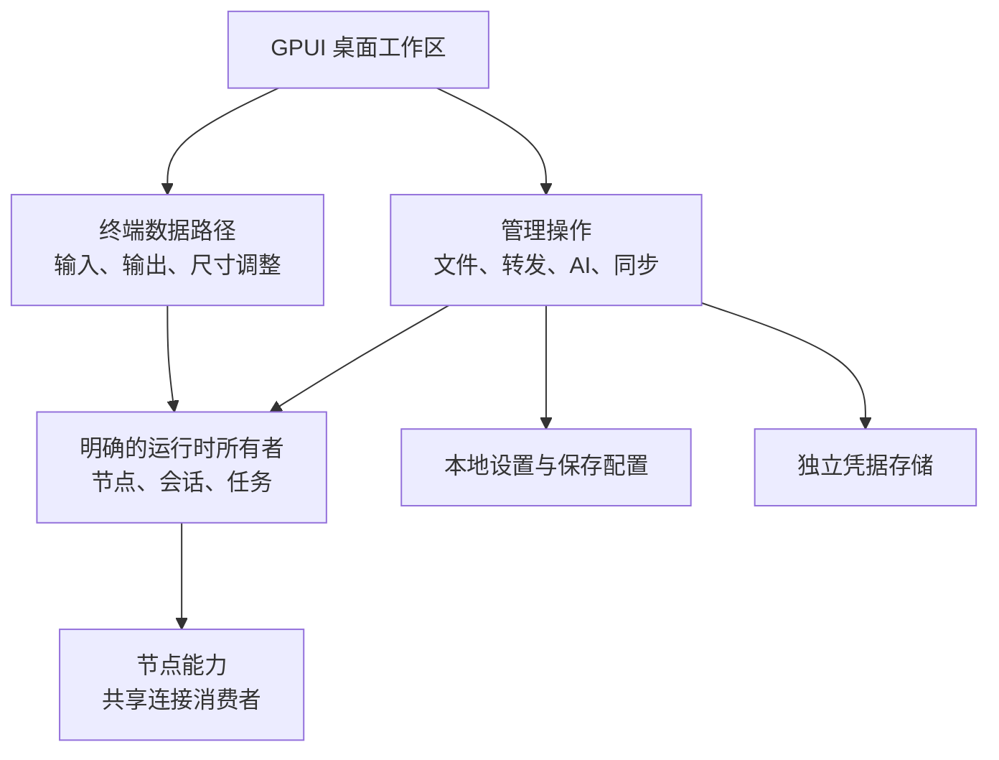

### 核心原则

1. **桌面应用优先** - GPUI 桌面应用是主要用户界面，CLI 是自动化和诊断伴侣工具。
2. **终端响应优先** - 终端输入、输出、尺寸变化和渲染属于延迟敏感热路径。
3. **节点优先的远端工作区** - 远端工作流以稳定 SSH 节点为锚点，不以临时终端面板为锚点。
4. **默认共享连接** - 终端、SFTP、转发和 IDE 可以共享节点注册表连接；AI 与插件通过经过校验的能力句柄、快照或钩子使用节点能力，不成为物理连接消费者。
5. **生命周期归属明确** - 保存配置、在线节点、终端会话、SFTP 会话、转发、编辑器缓冲区和标签页分别有不同所有者。
6. **本地优先状态** - SSH、SFTP、本地终端、设置、插件和 AI 供应商配置不依赖 OxideTerm 云账号。
7. **凭据边界清晰** - 导航元数据、设置、AI 提示词、日志、支持包和插件标签不是凭据存储。
8. **减少用户可见耦合** - 用户界面不应要求用户理解内部传输句柄。

### 为什么选择 Rust + GPUI

| 关注点 | Native Rust/GPUI 方向 |
|---|---|
| 用户体验 | 在一个桌面工作区中统一终端、文件、转发、IDE、AI、设置和插件 |
| 后端所有权 | 核心规则和模型位于 Rust 领域 crate；`oxideterm-gpui-app` 持有协调 Entity、订阅和最终运行时关闭逻辑，而不是把它们当作临时界面状态 |
| 终端路径 | 终端输入输出与重型管理任务隔离 |
| 安全性 | SSH、SFTP、转发、持久化、凭据和 AI 边界都有明确 Rust 领域 |
| 可移植性 | 桌面包可以携带应用资源、agent 二进制、图标和 CLI 伴侣工具 |
| 可维护性 | crate 按责任拆分，而不是按屏幕或文件大小拆分 |

---

## 整体架构概览

总览区分应用编排、可复用的运行时领域、持久状态和外部资源。粗箭头表示生命周期管理或持有句柄，实线表示调用或数据流，虚线表示限定范围的访问或元数据交付。句柄可以指向共享资源，不表示独占所有权。

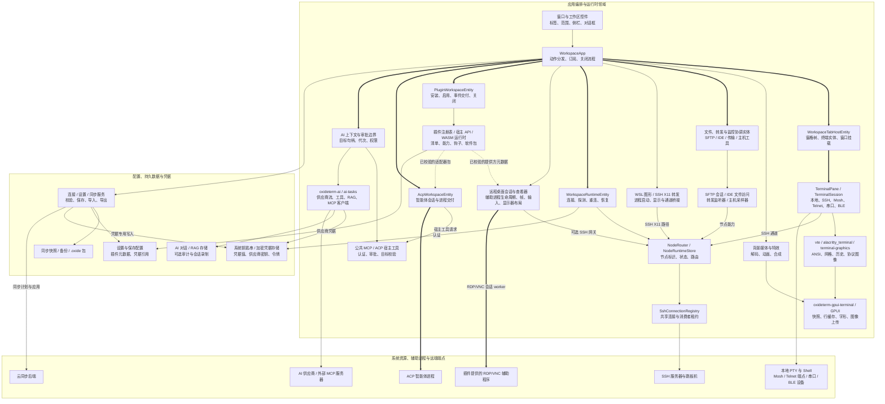

### 系统上下文

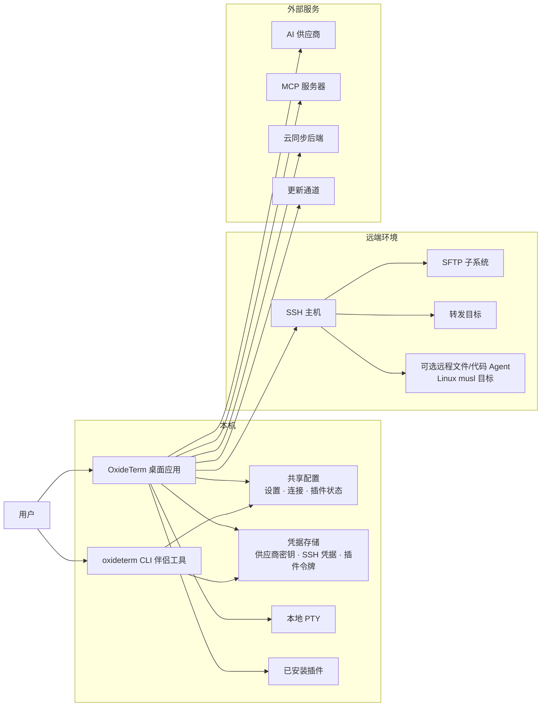

### 用户侧摘要

应用是围绕稳定远端节点构建的桌面工作区。标签页和面板是视图；保存连接是配置；SSH 节点是在线或正在重连的运行时对象；终端会话、SFTP 会话、IDE 工作区和转发直接消费节点能力，AI 目标和插件页面则通过经过校验的能力句柄、宿主快照或终端钩子使用节点能力。

这种分离解释了常见行为：

- 关闭终端标签页不会删除保存连接。
- 面板关闭后，节点仍可能显示在连接监控中。
- SFTP 和 IDE 可以在重连后恢复，因为它们绑定到节点，而不是只绑定到终端面板。
- AI 工具运行命令或读取文件前必须选择明确目标。
- CLI 伴侣工具可以检查同一套状态，但不是主要交互界面。

---

## 双平面架构

原生应用将终端数据路径与结构化控制操作分离，二者在同一 Rust 进程中协作。

### 数据平面

数据平面处理高频终端活动：

```text
终端输入
  -> 终端运行时
  -> 本地 PTY 或 SSH shell 通道
  -> 终端输出
  -> 终端渲染器
```

特征：

- 低延迟。
- 事件频率高。
- 不依赖云同步或备份。
- 普通输入不需要用户确认流程。
- 渲染和输入焦点属于终端页面。

### 控制平面

控制平面处理结构化管理操作：

```text
用户操作或已批准 AI 工具
  -> 工作区命令
  -> 领域运行时
  -> 持久化 / 连接 / 文件 / 同步操作
  -> 结果、通知或恢复建议
```

示例：

- 创建保存连接。
- 打开 SSH 节点。
- 启动 SFTP。
- 创建转发。
- 检查进程、Docker、服务、tmux、软件包、日志、端口和文件系统等主机工具。
- 打开 IDE 工作区。
- 打开图形/VNC 会话。
- 确认终端文件传输提示。
- 修改设置。
- 管理提权凭据。
- 执行云同步操作。
- 执行已批准 AI 工具。
- 生成支持包。

### 持久化平面

持久化平面保存长期状态：

- 设置。
- 保存连接。
- 转发规则。
- 插件状态。
- 提权凭据元数据。
- AI 对话和摘要。
- 云同步快照。
- 备份。
- 便携运行时元数据。

包含凭据的数据必须进入凭据感知存储，而不是普通 JSON 或文本字段。对于提权辅助，持久作用域元数据可以随设置或保存连接保存，但凭据值本身属于凭据存储。

### 平面交互

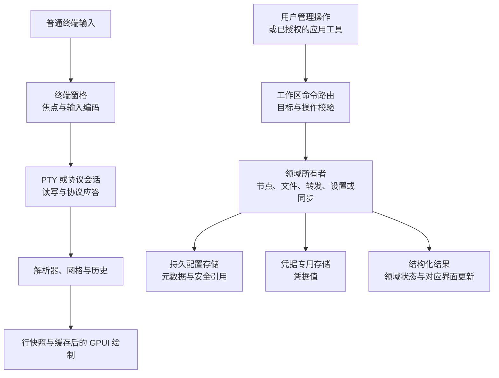

两条输入路径相互独立：普通输入不经过管理操作审批。管理结果更新对应页面，并非都写入终端。持久化是控制操作使用的存储边界，不是每帧终端绘制的一环。

实现参考：[workspace](../../../crates/oxideterm-gpui-app/src/workspace.rs), [terminal_entity](../../../crates/oxideterm-gpui-app/src/workspace/terminal_entity.rs).

---

## Native 工作区分层

### 第一层：GPUI 应用外壳

主要由 `oxideterm-gpui-app` 承担；它既是 GPUI 页面层，也是长期应用实体的协调器。

职责：

- 创建桌面窗口。
- 渲染活动栏、标签页、面板树、对话框和设置页面。
- 将用户操作路由到领域 crate。
- 区分界面状态和持久领域状态，同时持有运行时实体句柄、订阅、任务投递和最终关闭所有权。
- 提供应用级通知和命令面板动作。

代表模块：

```text
crates/oxideterm-gpui-app/src/workspace.rs
crates/oxideterm-gpui-app/src/workspace/tabs/
crates/oxideterm-gpui-app/src/workspace/pane_tree.rs
crates/oxideterm-gpui-app/src/workspace/sidebar/
crates/oxideterm-gpui-app/src/workspace/settings/
crates/oxideterm-gpui-app/src/workspace/knowledge.rs
```

### 分层依赖形状

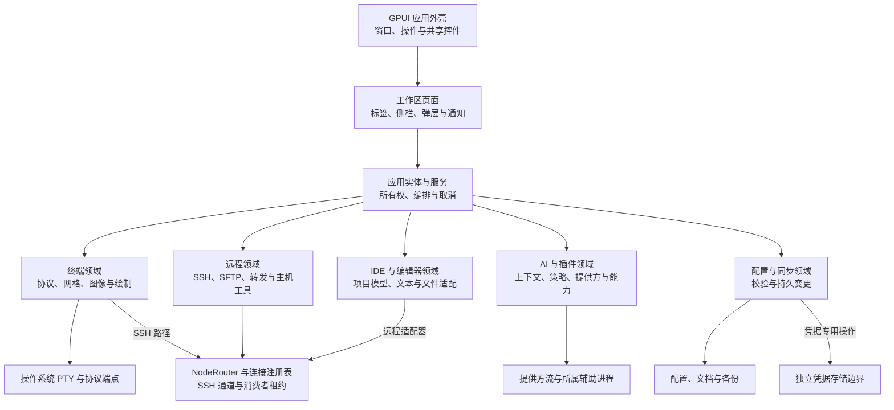

此图是职责分层图，不是完整 Cargo 依赖图。应用所有者把页面接到领域 API，可复用的文本与项目模型不依赖传输。转发监听器、图形辅助进程与采样器的具体运行时所有者见对应章节。保存连接文件属于连接存储，不属于 SSH 传输 crate。

实现参考：[workspace](../../../crates/oxideterm-gpui-app/src/workspace.rs), [lib](../../../crates/oxideterm-ide-core/src/lib.rs), [lib](../../../crates/oxideterm-connections/src/lib.rs).

### 第二层：领域 Crate

领域 crate 持有可复用业务逻辑和协议模型。

示例：

- `oxideterm-ssh`：SSH 配置、连接注册表、节点路由、重连模型。
- `oxideterm-sftp`：SFTP 协议、会话和传输语义。
- `oxideterm-connections`：保存连接存储和校验。
- `oxideterm-forwarding`：转发规则模型。
- `oxideterm-ai`：AI 供应商、上下文窗口、RAG、MCP、orchestrator 工具定义和策略。
- `oxideterm-settings`：设置加载、保存和变更逻辑。
- `oxideterm-cloud-sync`：同步和备份逻辑。
- `oxideterm-plugin-*`：插件清单、协议、注册表和宿主 API 类型。

### 第三层：运行时集成

运行时集成把界面请求连接到活跃资源：

- 本地终端进程。
- SSH shell 通道。
- SFTP 通道。
- 转发监听器或远端转发。
- IDE 文件系统访问。
- 插件宿主生命周期。
- 云同步后端。
- AI 供应商请求。

关键规则是所有权：一个运行时对象应有唯一清晰所有者。应用层可以持有负责协调的
Entity 及其生命周期，而可复用规则仍位于领域 crate；界面视图通过明确句柄、订阅或
快照消费运行时状态。

### 第四层：持久化与凭据存储

持久化状态由桌面应用和 CLI 伴侣工具共享。凭据值不能序列化进普通设置、支持包、AI 上下文或插件标签。

---

## 节点优先运行时模型

### 避免的问题

SFTP、IDE 和转发不应依赖临时终端会话 ID。终端会话可以重建，远端节点才是稳定工作单元。

Native 保留同样的用户侧模型。

### 当前拓扑

```text
保存连接
  -> 节点身份
       -> 节点运行时（`NodeRuntimeStore` + `NodeRouter`）
            -> 共享或独占 SSH 连接句柄
       -> 终端会话
       -> SFTP 会话
       -> 转发规则
       -> IDE 工作区
       -> AI 能力句柄
       -> 插件宿主快照和钩子
```

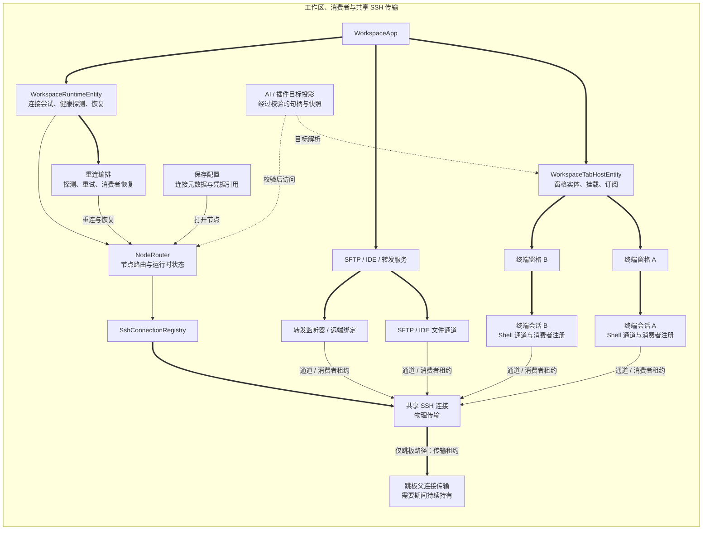

粗箭头标出生命周期持有者，通道与消费者租约箭头标出共享连接的使用关系。关闭一个窗格只移除该终端消费者，SFTP、IDE 和转发保留各自的消费者。重连任务属于工作区运行时，跳板路径在需要期间持有父连接传输。AI 与插件目标投影提供经过校验的访问，不拥有物理 SSH 连接。

### 稳定对象与临时对象

| 对象 | 稳定角色 | 临时实现细节 |
|---|---|---|
| 保存连接 | 用户配置 | 当前传输状态 |
| 节点 | 远端工作区身份 | 当前连接句柄 |
| 终端标签页 | 可见 shell 视图 | 当前 PTY 或通道实例 |
| SFTP 视图 | 节点文件工作流 | 当前 SFTP 通道 |
| IDE 工作区 | 项目和编辑上下文 | 当前文件操作通道 |
| 转发规则 | 期望隧道 | 当前监听器或任务 |
| AI 目标 | 工具侧快照和能力句柄 | 当前目标状态与连接代次 |

### 用户规则

远端操作失败时，先检查节点。不要假设当前聚焦标签页就是整个运行时的所有者。

### 跳板机所有权

跳板机路由有两层相关但不同的所有权：

- `NodeRuntimeStore` 保存逻辑父子节点树。
- `ConnectionRegistry` 保存物理父连接关系；只要子连接依赖父连接，就保留父连接消费者。
- 子连接不能根据相同主机名猜测父节点，而要使用精确的节点和连接身份。
- 显式断开时先释放子树，再释放父连接，避免子节点终端静默拆掉仍被使用的跳板机。

---

## 桌面工作区架构

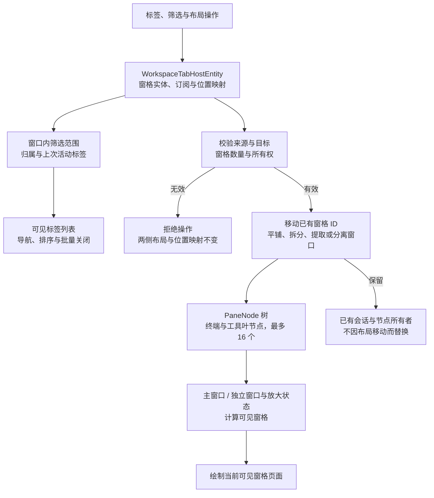

范围筛选改变显示结果，布局操作则在校验后移动已有资源，两者都不隐式重连。混合标签保留所有窗格的归属，不因筛选被拆散。

实现参考：[entity](../../../crates/oxideterm-gpui-app/src/workspace/tabs/entity.rs), [scope](../../../crates/oxideterm-gpui-app/src/workspace/tabs/scope.rs), [split_drop](../../../crates/oxideterm-gpui-app/src/workspace/tabs/split_drop.rs).

### 工作区外壳

工作区外壳拥有可见布局：

- 标签页。
- 面板树。
- 活动栏。
- 侧边栏。
- 命令面板。
- 对话框栈。
- 通知。

它不应拥有低层 SSH 传输或凭据。

### 标签页

标签页是可见页面。一个标签页可以表示：

- 本地终端。
- SSH 终端。
- SFTP。
- IDE 工作区。
- 设置。
- 文件管理器。
- 插件管理器。
- 连接监控。
- 云同步。
- 知识库工作区。

标签页是可关闭视图，不是保存连接或凭据的长期真源。

标签范围是窗口内的筛选状态，包含全部标签、全局页面、本地终端和具体连接。混合布局合并各窗格的归属，在所有匹配范围中保持完整。范围及上次活动标签只影响展示，不拥有连接，也不跨重启保存。绘制、快捷键导航、排序、批量关闭和滚动定位共用可见标签列表与按内容计算的宽度。

`PaneNode` 表示终端窗格、工具页面和嵌套分组。每个标签页最多容纳 16 个窗格，上限由 `MAX_PANES_PER_TAB` 定义，拆分和合并共用这一限制。宿主先校验来源和目标，再修改布局；拖放被拒绝时，两棵布局树及会话位置保持不变。

`WorkspaceTabHostEntity` 持有终端实体、订阅、窗口挂载关系和会话到窗格的位置映射。平铺操作将 2 至 16 个已有终端窗格放入同一布局，保留窗格 ID、会话和运行时消费者。单窗格放大只改变可见范围，保留原有布局树；提取窗格则将已有窗格移入另一个标签页。这些操作不会重新连接终端传输。

布局限制、校验和所有权变更见[窗格模型](../../../crates/oxideterm-workspace/src/lib.rs)与[标签宿主](../../../crates/oxideterm-gpui-app/src/workspace/tabs/entity.rs)。

### 活动栏

左侧活动栏打开连接管理和全局页面，右侧打开 OxideSens 与各个主机工具，仅在高度不足时显示溢出入口。顶栏负责范围选择、命令面板、禅模式、主题切换和后台任务摘要；全屏保留，禅模式隐藏。

### 知识库工作区

知识库是一级中央标签页，并拥有自己的内部左右分栏。左侧导航负责集合与文档浏览，右侧负责 Markdown 编辑；它不是全局伴随侧边栏面板，也不是设置卡片的堆叠。

源码模式和只读预览共享同一份 Markdown 草稿。`TextEditorView` 负责源码编辑与撤销历史，`oxideterm-gpui-markdown` 负责原生预览渲染，RAG 存储仍是集合、文档版本、分块和搜索索引的持久所有者。应用实体只协调选择、异步加载、自动保存、冲突检测、未保存离开保护和后台索引刷新，不把持久化职责放入 GPUI 渲染树。

知识库设置页面继续负责嵌入和检索行为配置，但不再承担主要文档浏览器或编辑器职责。

### 通知

通知把异步领域事件转为用户可见消息。通知应帮助用户判断下一步检查哪里：连接监控、设置、SFTP、云同步、插件管理器或支持包。

### 知识库草稿与存储

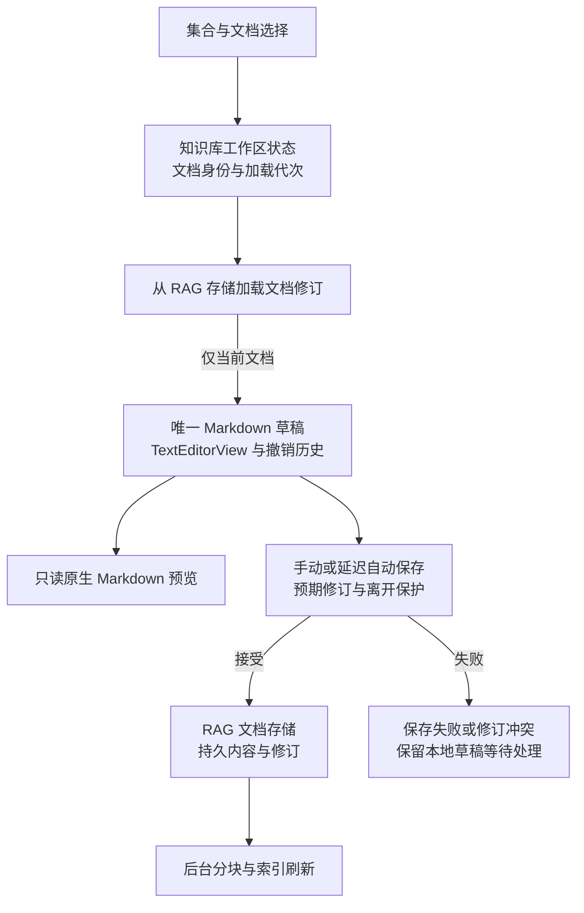

源码与预览使用同一份草稿。切换预览不创建另一份可编辑副本；索引是文档存储之后的派生工作，旧加载结果不能替换新选中的文档。

实现参考：[knowledge](../../../crates/oxideterm-gpui-app/src/workspace/knowledge.rs), [operations](../../../crates/oxideterm-gpui-app/src/workspace/knowledge/operations.rs).


---

## 终端架构

### 本地终端

本地终端标签页运行在当前机器上。在涉及远端主机前，它可以验证渲染器、键盘输入、shell 启动、字体配置和终端设置。

本地终端职责：

- 启动配置的本地 shell。
- 渲染输出。
- 接收键盘输入。
- 处理尺寸变化。
- 应用终端外观设置。
- 应用终端背景和图像设置，但不把它们写进终端缓冲区。
- 检测终端原生文件传输提示和提权提示，但不记录凭据。
- 将本地命令状态与远端 SSH 节点状态分离。

### SSH 终端

SSH 终端标签页附着到在线节点。它是 SSH 连接的消费者，不是连接配置本身。

SSH 终端职责：

- 展示 shell 通道。
- 维护可见屏幕和滚动上下文。
- 发送输入。
- 渲染输出。
- 在批准后向 AI 工具暴露终端观察。
- 报告就绪状态和等待输入提示。
- 复用节点拥有的 SSH 传输，同时把 shell 通道状态保留在面板本地。
- 通过“活跃终端 -> 节点 -> 保存 owner”解析提权凭据作用域，而不是从 host、title 或 prompt 文本启发式反推。

终端会话接口还包含 Telnet、Mosh、串口和 BLE 后端，分别将传输适配为终端输入、输出、尺寸调整和生命周期操作。BLE 使用 GATT 通知与写入通道，共用串口的发送和显示选项，不会为了显示终端文本而创建 SSH 节点。传输专属状态由 `oxideterm-terminal/src/session/` 及对应协议 crate 管理。

### 终端渲染与图像

终端渲染器组合多层状态：

- 终端模拟器的文本网格和滚动历史。
- 光标、选择区、命令标记和行内提示。
- Kitty/Sixel/iTerm2 等终端图像协议。
- 应用级背景图片、视频、生成特效、不透明度和模糊。
- 原生整个窗口透明度，与背景图片不透明度分别应用。
- 右键菜单和命令栏浮层。

终端模拟器管理文本网格和滚动历史。`oxideterm-terminal-graphics` 根据网格事件维护协议图像及其放置状态。背景媒体和应用浮层属于展示状态。

Kitty 图像资源和放置记录区分普通屏幕与备用屏幕。进入备用屏幕时会清理该屏幕上一次使用的 Kitty 资源，保留普通屏幕的图像。屏幕选择、擦除、滚动、历史裁剪和重置分别更新对应的图像状态；Sixel 放置也随网格变化和单元格尺寸调整。渲染器只显示当前屏幕的放置记录，普通切屏并不意味着丢弃所有协议图像。

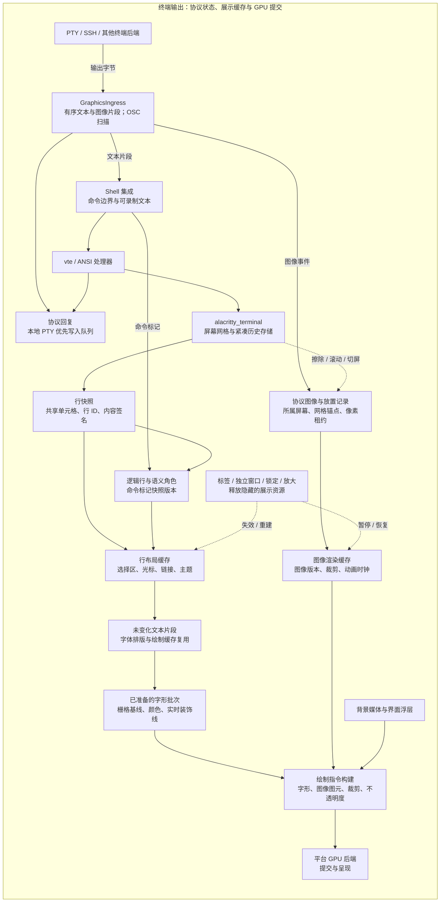

终端绘制经过以下边界：

| 阶段 | 负责模块 | 复用与失效规则 |
|---|---|---|
| 传输输出与协议解析 | `oxideterm-terminal`、`oxideterm-terminal-graphics`、`vte` 和 `alacritty_terminal` | 图像与控制序列按顺序解析，更新文本网格并产生图像事件。OSC 载荷批量扫描在 BEL 或 ESC 处停止，保留存储上限和分块输入状态。 |
| 网格与历史 | `alacritty_terminal` | 可写行使用完整单元格数组。历史行在有收益时采用重复尾部或打包存储；只读遍历不展开压缩行。 |
| 显示快照 | `oxideterm-terminal-model` 和终端运行时 | 行通过 `Arc` 共享单元格数据，并使用稳定行标识及绘制相关签名识别变化。 |
| 行布局与文字排版 | `oxideterm-gpui-terminal` 中的 `TerminalLayoutCache` | 行缓存键包含内容、选择区、光标、主题和高亮状态。行变化后，文本、列位置、单元格数和完整样式一致的片段仍可复用排版与绘制缓存；字号、单元格宽度或行高变化会使片段复用失效。 |
| 语义角色 | 终端逻辑行布局 | 分类依据逻辑行的绝对范围、当前输入状态和不可变命令标记快照。弱引用用于识别快照替换，不延长命令文本的生命周期。 |
| 字形批次与装饰线 | GPUI 的 `LinePaintCache` | 布局、颜色、缩放和渲染器资源有效时复用已准备的字形数据。整段统一的下划线和删除线复用字形，线条按当前样式绘制；局部装饰使用通用绘制路径。 |
| 协议图像显示 | 终端图像缓存和 GPUI 图像资源 | 图像标识、版本和来源裁剪区域决定缓存复用。共享像素租约统计解码内存；有容量限制的显示缓存和可见性共同控制渲染资源的保留。 |

对于共用基线且采用整数纵向栅格化的字形，批次以取整后的设备基线为锚点。纵向滚动时可以直接平移批次，避免重复准备字形，并保持原有栅格位置。带额外纵向排版偏移的字形继续按设备像素相位判断缓存是否有效。颜色在准备阶段完成色相归一化，每次绘制再应用当前不透明度。空白格跳过无用的前景色转换，主题默认背景复用已经转换的颜色。

这些职责分别位于[行布局](../../../crates/oxideterm-gpui-terminal/src/terminal_view/element.rs)、[GPUI 字形绘制](../../../crates/gpui-ce/gpui/src/text_system/line.rs)、[图像缓存](../../../crates/oxideterm-gpui-terminal/src/app/image_cache.rs)和[图像与网格同步](../../../crates/oxideterm-terminal-graphics/src/graphics/grid.rs)中。

### 提权与文件传输辅助

提权提示和 modem 传输是终端相邻辅助能力，不是普通输入文本：

- 提示检测只观察活跃终端输出。
- 凭据提交走专用 secret path，不得经过插件、AI 上下文、日志、录制或 shell history。
- 本地提权凭据作用于本地终端；SSH 提权凭据通过“活跃终端 -> 节点 -> 保存 owner”确定作用域。
- X/Y/ZMODEM 字节级状态由 `oxideterm-modem-transfer` 持有；GPUI 只负责请求文件/目录、显示进度，并把协议响应写回当前 PTY 或通道。
- 检测必须保持保守：除非协议上下文已被证明，普通命令输出和全屏 TUI 重绘都应回放为终端文本。

### 命令栏与右键动作

命令栏和终端右键菜单是工作区控件。它们可以发送文本、粘贴、选择、搜索、触发传输或路由命令，但其状态不应从终端标题或 prompt 文本推断。选择动作作用于终端 snapshot 和渲染坐标；会产生副作用的动作应通过明确的终端/session API 路由。

### 终端所有权规则

关闭终端面板会关闭该面板。不应把它解释为删除保存连接配置。根据运行时状态，SFTP、转发或 IDE 等其他消费者可能仍然需要这个节点，或者需要重连。

---

## SSH 连接注册表与运行时

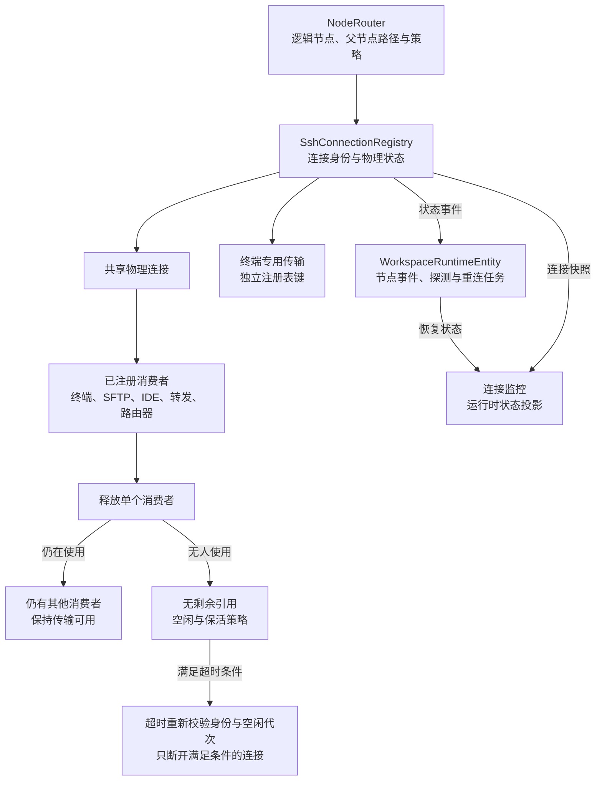

释放路径依据已注册消费者和连接身份，不依据前台标签是否可见。跳板子节点在使用传输期间保留父路径。AI 与插件句柄不属于额外的 ConnectionConsumer 枚举变体。

实现参考：[connection_registry](../../../crates/oxideterm-ssh/src/connection_registry.rs), [runtime_entity](../../../crates/oxideterm-gpui-app/src/workspace/runtime_entity.rs).

SSH 连接池把远端运行时状态和界面标签页分离。

### 职责

- 跟踪活跃、空闲、已失效、正在重连和失败连接。
- 在可能时让多个消费者共享一个连接，也可以按配置为终端创建独占连接。
- 持有物理连接状态、注册表消费者、健康探测和空闲回收。
- 向工作区运行时和监控页面暴露连接快照。
- 将重连调度放在 `WorkspaceRuntimeEntity`，而不是监控页面。

### 消费者模型

```text
共享 SSH 连接
  |-- 终端消费者
  |-- SFTP 消费者
  |-- 转发消费者
  |-- IDE 消费者
  `-- NodeRouter 消费者

独占终端连接
  `-- 拥有独立注册表键和物理传输的终端消费者

AI 和插件通过能力句柄、宿主快照或终端钩子使用能力。它们不是
`ConnectionConsumer` 变体，也不是物理连接所有者。
```

### 监控模型

连接监控读取注册表和工作区运行时状态，应回答：

- 哪些节点在线？
- 哪些节点正在重连？
- 哪些节点失败？
- 哪些注册表消费者已附着？
- 哪些转发或传输需要处理？

### 主机工具模型

连接监控同时承载面向已连接节点的资源类工具。这些工具是节点级视图，不是在终端面板里粘贴的命令。

主机工具覆盖：

- 进程列表和进程动作。
- Docker 容器和日志。
- 服务。
- tmux 会话、窗口和面板。
- 软件包清单。
- 系统日志。
- 监听端口和暴露风险提示。
- 文件系统和磁盘用量。
- 计划任务。
- CPU、内存、磁盘、GPU 和网络指标。

架构规则：

- `oxideterm-connection-monitor` 持有采样命令、解析逻辑、行签名、过滤器、动作命令构造和领域 DTO。
- `oxideterm-gpui-app` 负责渲染监控页面、确认用户动作，并通过所属节点/运行时边界分发命令。
- 资源快照是运行时观察结果，可以刷新、失效或失败，但不会修改保存连接配置。
- `ConnectionRegistry` 持有物理 SSH 状态、健康探测、消费者登记和空闲清理。
- `WorkspaceRuntimeEntity` 调度活动探测、处理节点事件，并启动或取消重连任务。
- `ForwardingRuntimeService` 持有转发监听器和桥接任务。
- 监控页面不拥有 SSH 传输或重连生命周期。
- 重型或重复主机采样不得阻塞终端输入，也不能成为 SSH 连接归属的事实来源。

### 主机工具采样与操作

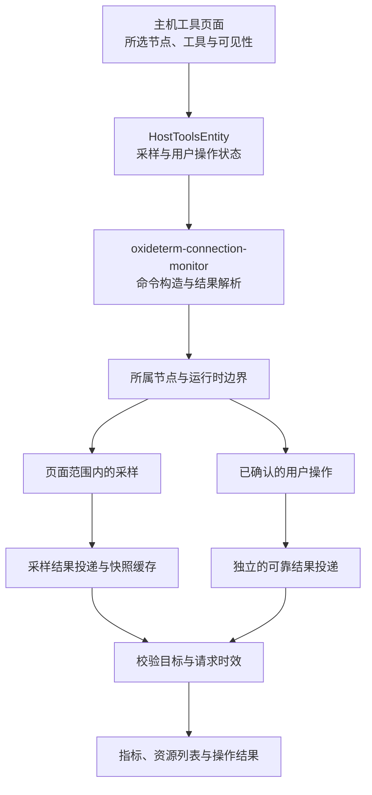

图中区分周期性观测与用户操作结果，采样流量不能拖延操作结果。隐藏页面改变采样活动，不会把 SSH 所有权交给页面。

实现参考：[entity](../../../crates/oxideterm-gpui-app/src/workspace/connection_monitor/entity.rs), [lib](../../../crates/oxideterm-connection-monitor/src/lib.rs).


---

## SFTP 架构

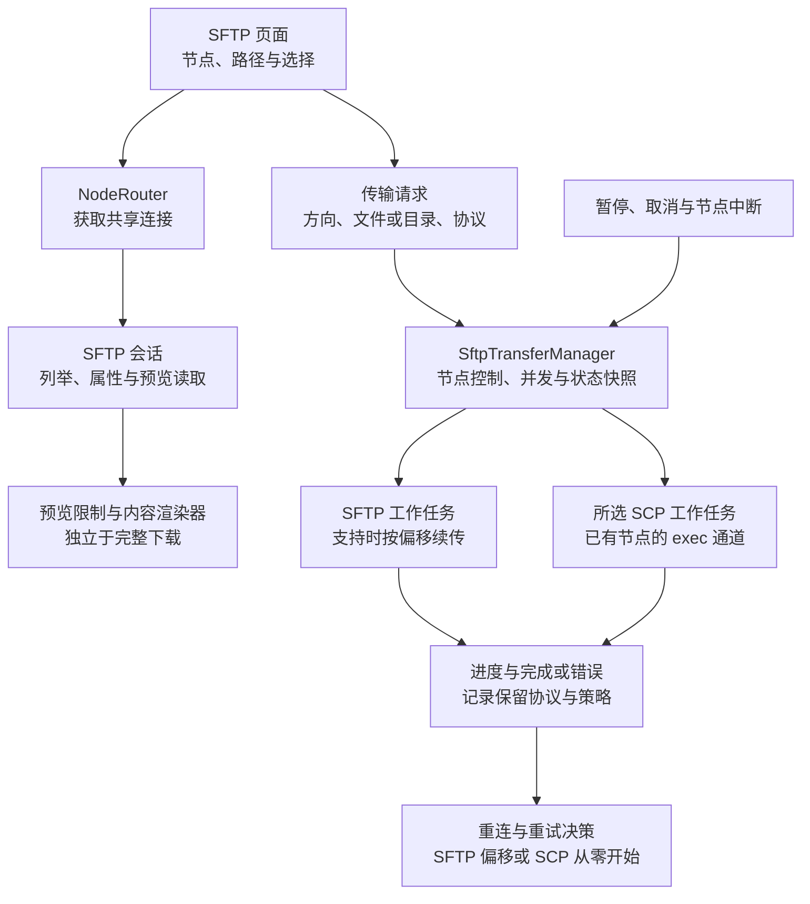

浏览与预览使用 SFTP；为传输选择 SCP 不会产生 SFTP 实现，也不另建 SSH 传输。传输控制与记录属于管理器，不属于当前显示的进度行。

实现参考：[transfer_manager](../../../crates/oxideterm-sftp/src/transfer_manager.rs), [preview](../../../crates/oxideterm-sftp/src/session/preview.rs), [scp](../../../crates/oxideterm-sftp/src/scp.rs).

远端文件传输是节点级能力。SFTP 仍是结构化浏览和首选传输协议；传统 SCP 只用于 SFTP 子系统不可用的已连接 POSIX 主机。两种协议都不应被视为终端面板功能。

### 职责

- 为已连接节点获取 SFTP 能力。
- 列出目录。
- 预览文件。
- 上传和下载文件。
- 在明确请求时写入文件内容。
- 管理传输进度。
- 在支持时于重连后重试或重新获取传输。

SCP 从现有 `NodeRouter` 连接句柄打开执行通道，绝不另建独立 SSH 传输。它遵循节点断开与取消的所有权规则，拒绝不安全的控制记录名称，把下载内容限制在用户选择的本地目标内，并使用生成的同级临时路径替换单文件。能力探测（包括否定结果）只在当前连接代次内缓存。

### 目录传输

目录传输和单文件传输使用不同执行路径。应用必须区分：

- 单文件上传。
- 单文件下载。
- 目录上传。
- 目录下载。
- 后台传输状态。

传输记录会保存所选协议。SFTP 可以从保存的字节偏移重新开始；SCP 只能在当前在线通道内暂停和继续，通道丢失后的失败记录只能从零字节重试，不能把已记录字节数当作续传偏移。

### 安全模型

远端文件写入就是目标主机上的真实写入。覆盖重要文件前，用户应确认路径、目标和备份状态。AI 和插件进行文件写入时应使用明确目标 和审批。

### 目录策略与路径边界

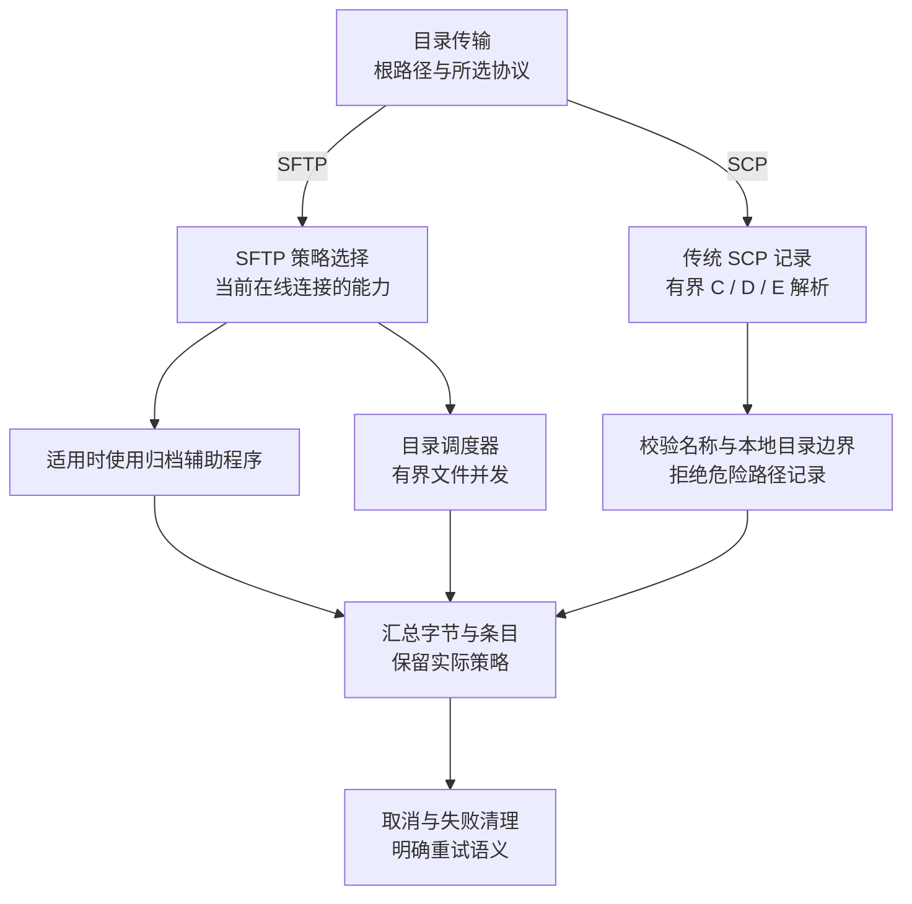

目录策略不能与单文件流式传输混为一谈。能力缓存限定在连接范围内。SCP 写入前校验协议名称与目标目录边界，不把持久记录中的字节数当作续传偏移。

实现参考：[directory_scheduler](../../../crates/oxideterm-sftp/src/session/directory_scheduler.rs), [tar_transfer](../../../crates/oxideterm-sftp/src/tar_transfer.rs), [paths](../../../crates/oxideterm-sftp/src/scp/paths.rs).


---

## IDE 架构

IDE 将项目状态、文本编辑、语法分析和文件访问交给不同的所有者。项目可以从 SSH 节点打开，也可以由终端的当前 Shell 环境转换而来。两个入口共用编辑器页面，但传输与恢复的生命周期不同。

### 职责

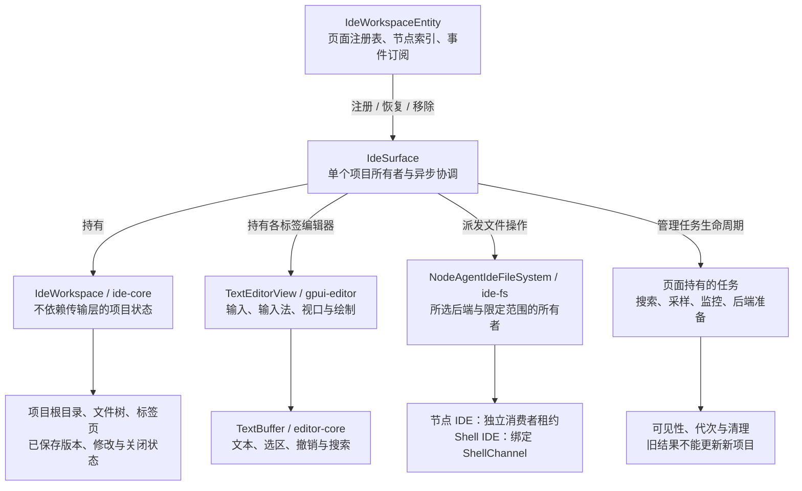

| 层次 | 持有的状态与边界 |
|------|------------------|
| 应用层的 `IdeWorkspaceEntity` | 按标签页和节点注册项目页面，保留订阅与关闭历史，协调重连。它不拥有 SSH 传输。 |
| `oxideterm-gpui-ide` 的 `IdeSurface` | 持有单个项目的核心模型、编辑器视图、文件后端、搜索状态、Markdown 预览与后台任务句柄，将异步结果应用到当前项目。 |
| `oxideterm-ide-core` 的 `IdeWorkspace` | 持有根目录、文件树、编辑器标签元数据、缓冲区快照、已保存版本和未保存关闭决策，不依赖 GPUI、SSH 或 SFTP。 |
| `TextEditorView` 与 `oxideterm-editor-core` | 负责交互中的文本、光标、选区、撤销重做、查找替换、输入法处理和视口绘制。页面在保存、关闭和生成快照前，将当前文本同步到项目模型。 |
| `oxideterm-editor-syntax` | 根据文本快照计算语法元数据，不绘制 GPUI 元素，也不修改编辑器文本。 |
| `oxideterm-ide-fs` | 实现文件操作并持有限定范围的后端资源。节点 IDE 通过 `NodeRouter` 共享连接；终端绑定 IDE 使用选定的 Shell 通道。 |

### 编辑器与语法处理链

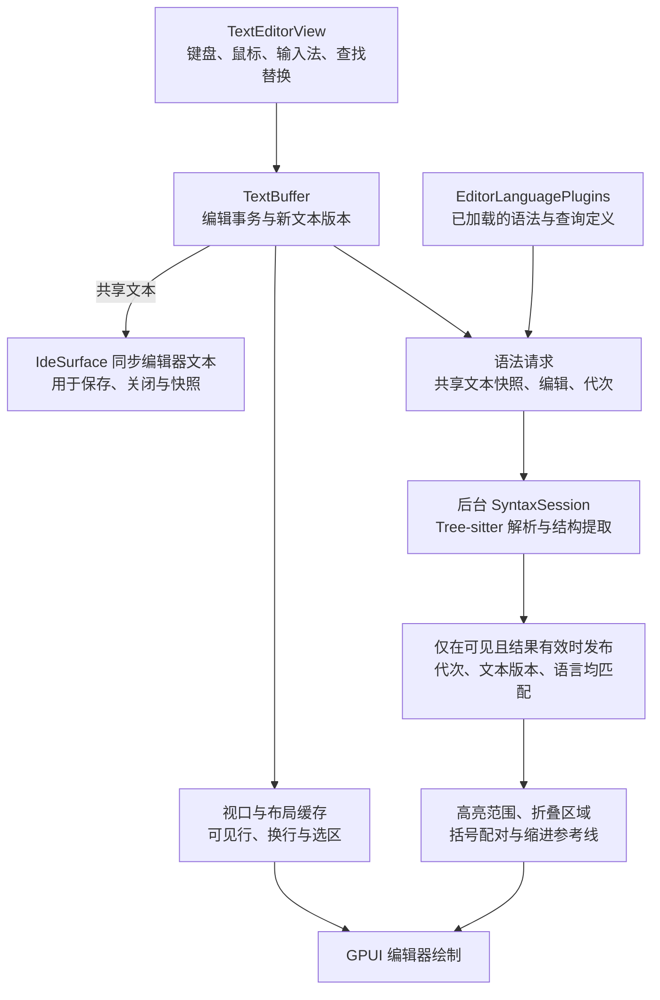

`TextBuffer` 提供带版本的文本快照。编辑器使用语言插件注册表中的语法与查询定义，在后台执行器上调度 Tree-sitter。高亮、折叠、括号配对和缩进参考线以字节范围元数据返回。前台只接受代次、文本版本和语言仍然匹配，且编辑器渲染缓存处于启用状态的结果。

语法任务执行期间，编辑器只保留最新的待处理请求，不并行启动多个解析器。隐藏编辑器会使待处理语法任务失效，并释放派生的语法与布局缓存，同时保留文本缓冲区；重新显示时再请求解析。大文件或缺少语法定义时，文本仍可显示，不要求先获得语法元数据。

IDE 与 SFTP 编辑器复用搜索栏和搜索模型，支持大小写选项、正则表达式、多行输入和捕获组替换。终端搜索使用相同匹配能力，默认单行输入。输入视口统一光标、选区和输入法坐标，各输入框独立保留编辑历史。Markdown 预览由项目页面持有，通过原生 Markdown 渲染器绘制。

### 与 SFTP 的关系

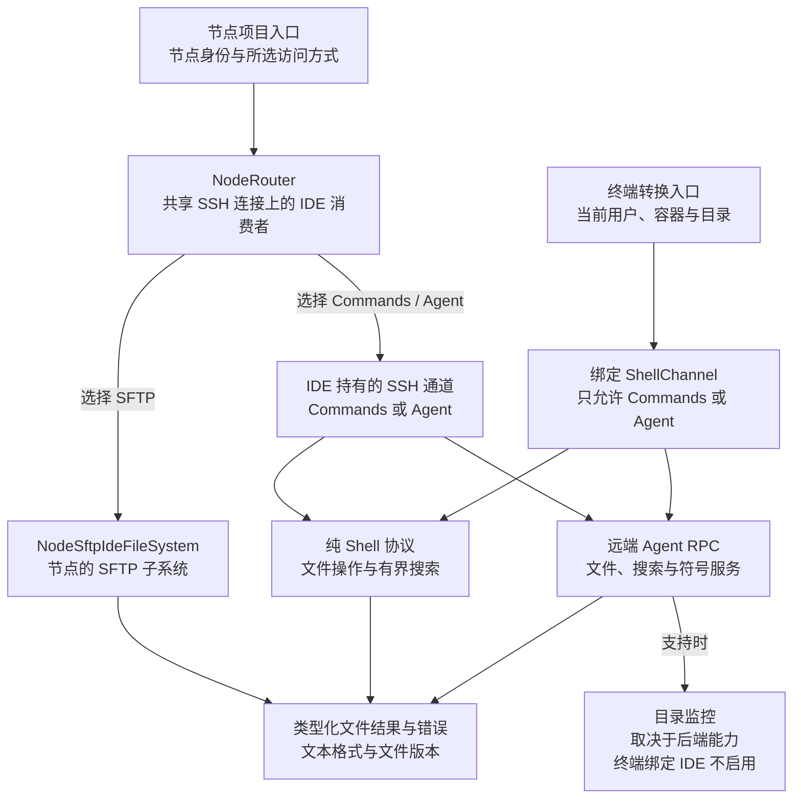

图中展示显式选择的文件后端。SFTP 是文件访问的一种实现，项目状态和编辑缓冲区仍由 IDE 管理。核心层定义同步与异步文件系统合同，覆盖读取、目录列举、版本检查和写入。`LocalIdeFileSystem` 也实现了本地磁盘合同，但此处的项目页面通过 `NodeAgentIdeFileSystem` 装配。

| 访问路径 | 环境与能力 |
|----------|------------|
| 节点 + SFTP | 获取节点的 SFTP 子系统并持有独立 IDE 消费者；关闭无关终端不会释放该消费者。 |
| 节点 + Commands 或 Agent | 通过节点打开 IDE 自己的通道。Commands 提供 Shell 文件操作；Agent 提供 RPC 文件操作与符号服务。 |
| 终端 + Commands 或 Agent | 绑定当前 Shell，保留用户、容器和工作目录，不能替换成节点的 SFTP 或默认 exec 环境。 |

纯 Shell 搜索有执行与结果数量边界，写入保留版本冲突检查和临时文件权限限制。Agent 符号定义请求可以定位文件并打开返回的行列位置。目录监控还取决于后端能力，终端绑定 IDE 不启用此能力。Tree-sitter 语法元数据和 Agent 符号查找是两条独立路径，不构成通用 LSP 客户端。

### 保存、关闭与恢复

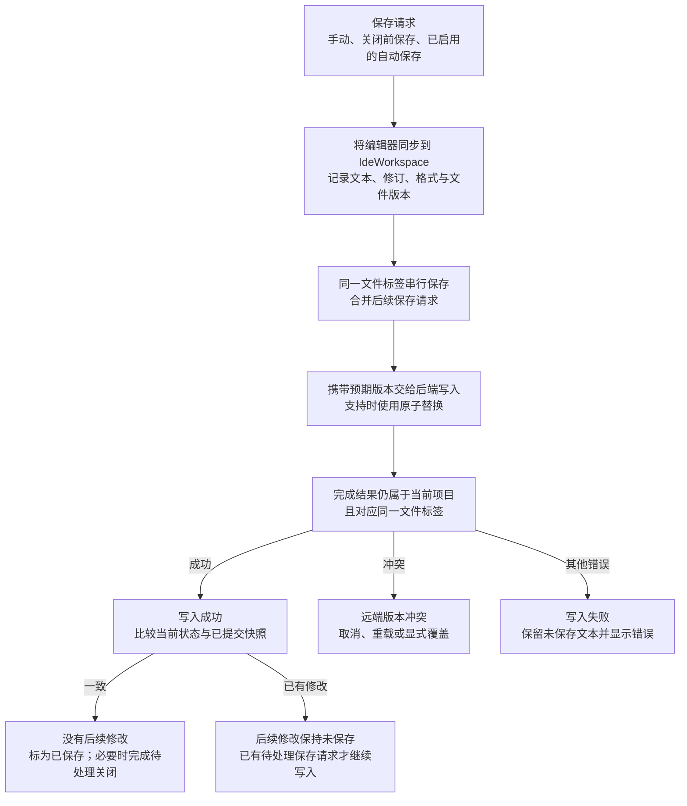

文件内容携带编码、BOM、换行格式，以及用于冲突检查的已保存文件版本。仅当后端声明支持时，页面才选择原子替换。写入成功后记录本次提交的文本与修订；写入期间新增的编辑仍保持未保存状态。同一标签的多次保存请求会串行执行并合并，不并发写入。已启用的自动保存目前在切离有修改的编辑器标签时触发。

| 生命周期事件 | 状态与清理规则 |
|--------------|----------------|
| 关闭未保存文件或离开项目 | 由所有者请求保存、丢弃或取消。保存失败或出现更新的编辑时，不能静默完成待处理关闭。 |
| 隐藏 IDE 页面 | 停止页面采样和目录监控，暂停隐藏编辑器的缓存；保留缓冲区与节点消费者。可见性变化不取消用户已请求的文件操作。 |
| 节点连接中断 | 停止采样与监控，使搜索结果失效，标记项目断连并释放旧后端消费者。重连快照包含项目路径、打开文件、未保存文本和文件格式。 |
| 恢复节点 IDE | 重新绑定所选后端，恢复同一项目。不会替换已经打开的其他项目，也不会恢复快照之后由用户关闭的项目。快照中的未保存文本只回填到干净缓冲区，更新的本地编辑优先。 |
| 终端绑定 IDE | 不进入节点 IDE 重连快照。它的绑定属于来源 Shell；返回终端时仍需经过未保存修改决策。 |
| 释放页面 | 取消后端准备及所持有的采样、监控任务，完成监控清理，只释放本所有者的资源；其他 IDE 或 AI 消费者保留各自的租约。 |

重连快照属于运行时恢复状态，不表示未保存文本已经写入磁盘。代次检查阻止过期的项目、搜索和语法结果应用到替换后的所有者或更新的请求。

实现参考：[应用注册与重连](../../../crates/oxideterm-gpui-app/src/workspace/ide.rs)、[页面生命周期](../../../crates/oxideterm-gpui-ide/src/surface/lifecycle.rs)、[编辑操作与保存完成](../../../crates/oxideterm-gpui-ide/src/surface/editor_actions.rs)、[语法调度](../../../crates/oxideterm-gpui-editor/src/surface/syntax_task.rs)、[文件系统合同](../../../crates/oxideterm-ide-core/src/filesystem.rs)和[后端绑定](../../../crates/oxideterm-ide-fs/src/agent/binding.rs)。

### 用户规则

关闭 IDE 标签页或重连不稳定主机前，先检查未保存缓冲区。恢复过程可以重建访问能力和内存中的项目状态，保存或丢弃编辑仍是独立决策。

---

## 端口转发架构

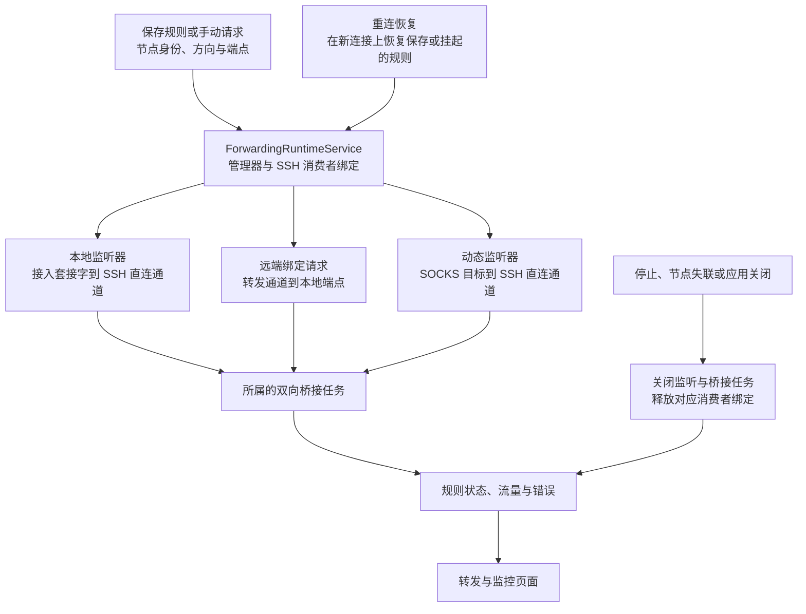

服务独立于界面挂载持有在线监听器。关闭终端或隐藏转发页面不会停止规则。停止已保存规则不会为了清理而连接主机；重连恢复必须使用新的连接身份。

实现参考：[runtime_service](../../../crates/oxideterm-gpui-app/src/workspace/forwards/runtime_service.rs), [reconnect](../../../crates/oxideterm-gpui-app/src/workspace/forwards/reconnect.rs).

端口转发是连接级能力。

### 转发类型

- **Local**：本地端口连接到远端目标。
- **Remote**：远端端口反连到本地目标。
- **Dynamic**：SOCKS 风格动态转发。

### 运行时职责

- 创建监听器或远端转发请求。
- 跟踪运行、失败、停止或挂起状态。
- 将转发附着到所属节点。
- 重连成功后恢复已保存或挂起的转发。
- 端口冲突或连接失败时显示可操作错误。

### 自动启动规则

只有当转发应随所属连接打开而启动时，才使用自动启动。否则应从转发页面手动启动。

---

## 图形与 VNC 会话

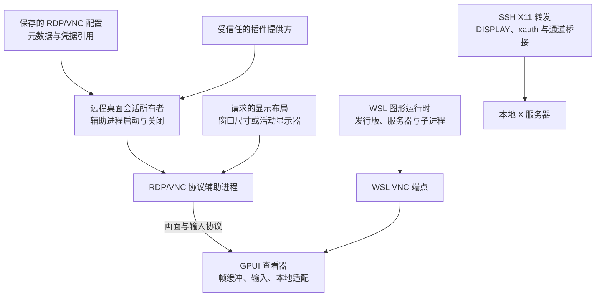

图形会话是视觉运行时页面。即使远端视觉程序由终端或命令启动，它也不属于终端缓冲区。

图形远程功能分为三条相关但独立的路径：

- **WSL 图形**：`oxideterm-wsl-graphics` 拥有 WSL 发行版探测、VNC server 启动、桌面/应用子进程和清理。
- **远程桌面**：`oxideterm-remote-desktop` 和 `oxideterm-gpui-remote-desktop` 负责共享模型、查看器状态与二进制传输。协议引擎在市场仓库的 `plugins/rdp` 和 `plugins/vnc` 中独立分发，通过受信任的插件注册表发现，由远程桌面会话启动。连接表单提示所需插件是否可用；已保存连接、凭据、SSH 网关和原生查看器保持原有行为。
- **SSH X11 转发**：`oxideterm-x11-forwarding` 拥有 DISPLAY、xauth、假 cookie、setup rewrite 和 SSH X11 channel 桥接语义；它不是完整桌面查看器。

### 职责

- 将图形会话与终端标签页分开跟踪。
- 通过图形运行时启动或重连后端图形会话。
- 将 GPUI 查看器连接到后端 framebuffer 来源。
- 把键盘、指针和滚轮输入路由到 viewer worker。
- 将渲染帧保留为查看器状态，而不是终端输出或 scrollback。

### 所有权规则

图形运行时拥有 server/session 进程生命周期。GPUI 查看器拥有客户端连接、当前 framebuffer、指针几何和输入分发。关闭查看器应根据用户选择停止或分离图形会话，但不应重写保存的 SSH 连接配置。

对于 RDP/VNC 会话，`oxideterm-connections` 拥有保存配置元数据和凭据引用，应用 tab/session 拥有 helper 进程生命周期，GPUI 查看器拥有 framebuffer 和输入状态。RDP/VNC 协议代码放在 helper binary 或协议专属 crate 中，而不是放进 `oxideterm-gpui-app`；只有通过节点启动时，SSH 节点才提供 tunnel 或节点上下文。

显示器布局与本地画面适应相互独立。单屏模式可按视口请求分辨率，多屏模式使用活动物理显示器拓扑；窗口调整只改变本地比例，不覆盖远端拓扑。显示器变化和重连需要刷新布局，包括外接屏和笔记本内置屏关闭的情况。

### 帧投递与辅助进程生命周期

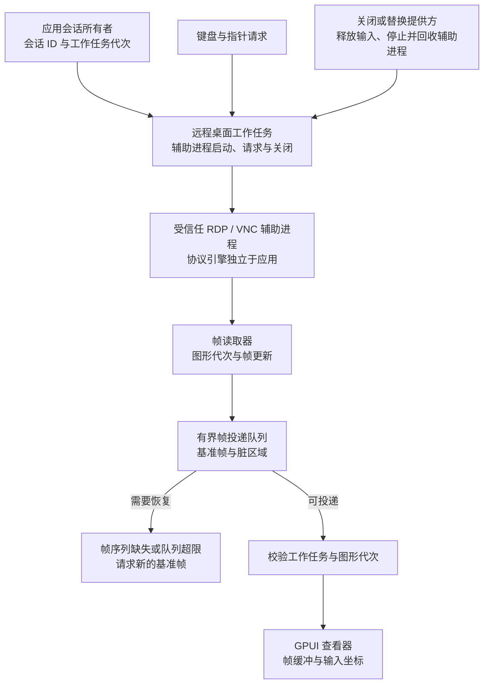

输入派发与帧投递分开处理。新的图形代次等待基准帧，不把旧尺寸增量应用到新帧缓冲。工作任务身份阻止已退役会话更新当前查看器；替换可执行文件前先完成辅助进程回收。

实现参考：[worker](../../../crates/oxideterm-remote-desktop/src/worker.rs), [frame_queue](../../../crates/oxideterm-remote-desktop/src/frame_queue.rs), [remote_desktop](../../../crates/oxideterm-gpui-app/src/workspace/remote_desktop.rs).

### 远端布局与本地适配

```mermaid
%%{init: {"layout": "dagre", "flowchart": {"nodeSpacing": 45, "rankSpacing": 75, "curve": "basis"}}}%%
flowchart TB
    Change["连接、重连与显示器变化"]
    Mode["会话显示模式"]
    Single["单屏<br/>由视口推导远端尺寸"]
    Multi["使用所有本地显示器<br/>活动物理显示器布局"]
    Validate["校验布局与协商能力"]
    Send["去重并调度会话尺寸请求"]
    Remote["辅助进程与远端服务器<br/>新的桌面布局"]
    Window["窗口尺寸变化"]
    Fit["本地查看器适配与输入映射"]

    Change --> Mode
    Mode -->|单屏| Single
    Mode -->|多屏| Multi
    Single --> Validate
    Multi --> Validate
    Validate --> Send
    Send --> Remote
    Window --> Fit
    Window -->|仅单屏模式| Single
```

多屏布局不会被后续视口尺寸请求覆盖。该模式下窗口适配留在本地，活动显示器变化重新走布局路径。尺寸控制与帧投递中的图形代次校验是两个边界。

实现参考：[remote_desktop](../../../crates/oxideterm-gpui-app/src/workspace/remote_desktop.rs), [model](../../../crates/oxideterm-remote-desktop/src/model.rs).


---

## 重连与恢复

```mermaid
%%{init: {"layout": "dagre", "flowchart": {"nodeSpacing": 45, "rankSpacing": 75, "curve": "basis"}}}%%
flowchart TB
    Detect["节点健康与传输事件"]
    Owner["WorkspaceRuntimeEntity<br/>管理受影响节点的重连任务"]
    Snapshot["记录受影响消费者<br/>终端、转发、传输与 IDE"]
    Grace["适用时进行宽限期探测"]
    Recovered["已有传输恢复<br/>刷新观测状态"]
    Connect["重建传输与父路径<br/>有界重试策略"]
    Identity["校验当前任务与连接身份"]
    Restore["恢复消费者资源<br/>终端、转发、传输重试与 IDE"]
    Report["阶段结果与剩余失败<br/>监控与对应通知"]
    Cancel["用户断开、移除或关闭应用"]
    Stop["取消所属连接尝试与探测<br/>拒绝过期完成结果"]
    Capability["AI 与插件资源代次<br/>下次使用时刷新或重新获取"]

    Detect --> Owner
    Owner --> Snapshot
    Snapshot --> Grace
    Grace -->|仍可用| Recovered
    Grace -->|到期或失联| Connect
    Connect -->|连接成功| Identity
    Connect -->|耗尽或失败| Report
    Identity --> Restore
    Recovered --> Report
    Restore --> Report
    Cancel --> Stop
    Identity --> Capability
```

恢复由运行时协调，不由监控页面计时器负责。传输连接成功不表示所有消费者均恢复成功。取消状态与任务身份限制过期工作；AI 和插件能力通过各自运行时边界刷新，不是无条件执行的重连阶段。

实现参考：[runtime_entity](../../../crates/oxideterm-gpui-app/src/workspace/runtime_entity.rs), [nodes_reconnect_helpers](../../../crates/oxideterm-gpui-app/src/workspace/tabs/nodes_reconnect_helpers.rs).

重连是跨多个子系统的工作流，不是单纯终端事件。

### 恢复输入

一次恢复可能需要：

- 节点状态。
- 连接状态。
- 终端面板。
- SFTP 传输。
- 转发规则。
- IDE 工作区。
- 通知和错误。

### 概念管线

```text
检测已失效状态
  -> 快照受影响消费者
  -> 尝试重连
  -> 重建或刷新终端访问
  -> 恢复转发
  -> 恢复或重试传输
  -> 重新打开或刷新 IDE 状态
  -> 更新监控和通知

AI 和插件能力句柄不是直接重连阶段。它们通过运行时边界观察节点或连接
代次变化，并在后续调用中失效、刷新或重新获取资源。
```

### 用户流程

1. 打开连接监控。
2. 找到受影响节点。
3. 重连或等待重连。
4. 刷新 SFTP、IDE、转发或 AI 目标状态。
5. 验证任何写入、传输或命令结果。

---

## 设置与持久化

```mermaid
%%{init: {"layout": "dagre", "flowchart": {"nodeSpacing": 45, "rankSpacing": 75, "curve": "basis"}}}%%
flowchart TB
    Ui["桌面设置草稿"]
    Cli["CLI 设置变更"]
    Model["共享 PersistedSettings 模型"]
    Validate["清理与规范化<br/>校验提示与变化分区"]
    Metadata["配置值与凭据引用"]
    Write["SettingsStore / 共享保存路径<br/>持久原子文件替换"]
    File["磁盘上的设置封装"]
    Apply["桌面应用已加载的变化<br/>主题、终端与领域所有者"]
    Secret["显式凭据输入"]
    Store["凭据专用写入边界<br/>钥匙串或加密存储"]
    Error["校验或持久化失败<br/>报告实际结果"]

    Ui --> Model
    Cli --> Model
    Model --> Validate
    Validate --> Metadata
    Metadata --> Write
    Write -->|已保存| File
    Write -->|失败| Error
    File -->|桌面重载或应用| Apply
    Secret --> Store
    Store -->|仅引用| Metadata
```

共享持久化不表示外部 CLI 变更会立即更新所有挂载视图，桌面仍需加载并应用新状态。凭据值使用独立存储，设置只保留安全元数据或引用。

实现参考：[store](../../../crates/oxideterm-settings/src/store.rs), [normalize](../../../crates/oxideterm-settings/src/normalize.rs), [settings](../../../crates/oxideterm-gpui-app/src/workspace/settings.rs).

设置是持久化应用状态。桌面设置页面是交互式编辑设置的主要入口。

### 设置领域

- 通用应用行为。
- 外观和主题。
- 终端行为。
- 本地终端行为。
- 终端图像、背景图片和传输辅助。
- SSH 行为。
- 提权凭据。
- SFTP 行为。
- IDE 行为。
- AI 供应商和模型设置。
- AI 记忆、工具调用，以及知识库嵌入与检索设置。
- 插件。
- 云同步。
- 便携运行时。
- 快捷键。
- 帮助和更新通道。

### 持久化规则

设置应保存配置，而不是凭据值。凭据字段应写入凭据感知存储。

提权凭据条目需要拆分：标签、提示匹配器、启用状态和保存节点作用域属于配置；密码或等价秘密值只能通过凭据感知边界保存。

### CLI 关系

CLI 伴侣工具是共享持久化模型的脚本和维护入口，覆盖设置、连接、转发、插件、
快捷命令、凭据、便携包、诊断、报告、批处理计划、备份和云同步。除临时 GUI SSH
启动外，它不拥有桌面进程中的在线节点或终端运行时。修改型命令通常使用 dry-run
计划和 `--yes` 确认。探索性或视觉配置应使用桌面设置页面。

---

## 云同步、备份与便携包

```mermaid
%%{init: {"layout": "dagre", "flowchart": {"nodeSpacing": 45, "rankSpacing": 75, "curve": "basis"}}}%%
flowchart TB
    Start["手动或已配置的自动同步<br/>所选范围与方向"]
    Recover["通过当前配置所有者<br/>恢复未完成的本地日志"]
    Prepare["CloudSyncOperationService<br/>操作许可与 PreparedSync"]
    Replica["本地副本与远端发布记录<br/>字段因果历史"]
    Plan["计划摘要与冲突候选"]
    Review["方向与候选选择<br/>首次同步及冲突需审阅"]
    Apply["PreparedSync.apply<br/>合并前重新读取当前所有者"]
    Journal["恢复日志与持久本地变更"]
    Refresh["刷新受影响的运行时投影"]
    Publish["AppliedSync.publish<br/>方向要求时发布远端记录"]
    Outcome["已应用 / 已发布 / 待完成 / 冲突<br/>独立结果字段"]

    Start --> Recover
    Recover --> Prepare
    Prepare --> Replica
    Replica --> Plan
    Plan --> Review
    Review -->|接受的选择| Apply
    Plan -->|满足自动同步条件| Apply
    Apply --> Journal
    Journal --> Refresh
    Journal --> Publish
    Publish --> Outcome
```

这是当前的因果同步路径。本地应用与远端发布是两个步骤。应用时重新读取当前所有者，使网络请求期间的编辑参与合并。自动执行需满足配置条件且预览中没有未解决冲突；待发布或待清理不能被描述为完全成功。

实现参考：[synchronize](../../../crates/oxideterm-cloud-sync/src/operation/synchronize.rs), [recovery](../../../crates/oxideterm-cloud-sync/src/sync_v3/recovery.rs), [causal](../../../crates/oxideterm-gpui-app/src/workspace/cloud_sync/causal.rs).

云同步、备份和 `.oxide` 包作用于持久化状态，不作用于在线终端字节。

### 云同步

云同步将选定本地状态与配置的远端后端对齐。当前模型支持 WebDAV、HTTP JSON、
Dropbox、OneDrive、Google Drive、GitHub Gist、S3 和 Git，并支持按分区选择同步范围。
自动上传、冲突阻止、同步历史和最多五个本地回滚备份由本地状态机管理。UI 与 CLI
共用结构化同步模型；在线节点和终端缓冲区不是同步对象。执行 push、pull、apply 或
冲突解决这类改变方向的操作前，应能检查状态。

### 备份

备份用于保护高影响变更前的状态：

- 批量导入。
- 同步应用。
- 恢复。
- 插件迁移。
- 设置迁移。
- 便携包导入。

### 便携包

`.oxide` 包是加密便携导出，可以包含连接、转发、设置、插件设置、快捷命令和可选便携凭据。

### 审查规则

每次导入、恢复或同步应用都应可预览。分享支持包前应先检查内容。

### 便携导入与回滚

```mermaid
%%{init: {"layout": "dagre", "flowchart": {"nodeSpacing": 45, "rankSpacing": 75, "curve": "basis"}}}%%
flowchart TB
    State["所选持久领域<br/>连接、设置、转发与插件设置"]
    Export["导出选择与凭据包含策略"]
    Bundle["加密 .oxide 包"]
    Backup["本地回滚备份"]
    Import["读取、解密与校验输入"]
    Preview["导入或恢复预览<br/>所选变更与冲突"]
    Confirm["确认所选应用内容"]
    Safety["需要时创建安全备份"]
    Owner["通过所属存储应用<br/>区分普通状态与凭据边界"]
    Result["报告已应用、跳过与失败条目"]

    State --> Export
    Export --> Bundle
    State --> Backup
    Bundle --> Import
    Backup --> Import
    Import --> Preview
    Preview --> Confirm
    Confirm --> Safety
    Safety --> Owner
    Owner --> Result
```

便携包导入与回滚恢复是可审阅的持久状态变更，备份文件与因果同步的恢复日志不同。导出不包含在线终端字节流，也不重建正在运行的 SSH 传输。

实现参考：[local_file](../../../crates/oxideterm-cloud-sync/src/operation/local_file.rs), [apply](../../../crates/oxideterm-cloud-sync/src/operation/apply.rs).


---

## OxideSens AI 架构

```mermaid
%%{init: {"layout": "dagre", "flowchart": {"nodeSpacing": 45, "rankSpacing": 75, "curve": "basis"}}}%%
flowchart TB
    Turn["对话与用户请求"]
    Context["上下文组装<br/>历史、所选资源、RAG 与脱敏"]
    Skills["技能目录与按需资源<br/>指令本身不授予能力"]
    Native["原生提供方请求<br/>模型协议与支持的推理字段"]
    Acp["AcpWorkspaceEntity<br/>代理进程、会话与配置"]
    Stream["原生流式响应与工具轮次"]
    Events["ACP 会话事件与宿主请求"]
    Delivery["对话与轮次路由校验"]
    Transcript["助手文本、用量与工具结果"]
    Tools["应用工具边界<br/>策略、审批与在线目标校验"]
    Cancel["取消或会话关闭<br/>所属流或 ACP 进程生命周期"]

    Turn --> Context
    Skills --> Context
    Context --> Native
    Context --> Acp
    Native --> Stream
    Acp --> Events
    Stream --> Delivery
    Events --> Delivery
    Delivery --> Transcript
    Stream --> Tools
    Events --> Tools
    Cancel --> Native
    Cancel --> Acp
```

原生提供方请求与 ACP 会话共用界面和应用工具边界，不共用一套协议或进程所有者。ACP 推理选项属于会话配置。投递仍须匹配对话与轮次；取消后到达的响应不构成执行操作的授权。

实现参考：[acp_workspace](../../../crates/oxideterm-gpui-app/src/workspace/acp_workspace.rs), [core](../../../crates/oxideterm-gpui-app/src/workspace/sidebar/ai/actions/stream/core.rs).

OxideSens 是理解工作区上下文的助手。它使用已配置供应商和本地应用上下文，不需要 OxideTerm 账号。

Agent Skills 是用于可重复工作流的受限说明层。AI 运行时会发现 `SKILL.md` 目录，只在需要时加载完整说明和资源，并把已加载技能的内容哈希记录到对话元数据中。加载技能不会授予运行时权限；终端、文件、凭据、网络等动作仍必须经过现有能力和批准检查。

聊天界面还会根据当前模型解析服务商适配的推理级别。已知模型会依据能力数据规范化；
已知供应商的未知模型使用该供应商的请求格式，未知供应商才会被视为不支持。

OxideSens 有两条执行后端。原生供应商后端直接流式调用配置的模型协议；ACP 后端通过
独立的 agent 进程、ACP session、模型选择和 session 配置运行。两者共享应用上下文、
策略和界面，但传输、工具注入、推理配置和生命周期不同。ACP 不使用原生供应商的
`reasoning_effort` 字段；相关选项属于 ACP session 配置。

### 上下文来源

- 对话历史。
- 当前终端上下文。
- 保存连接。
- 在线节点。
- 终端会话。
- SFTP 目标。
- IDE 工作区。
- 设置摘要。
- RAG 知识集合。
- MCP 资源和工具。
- 前序工具结果。

### Orchestrator 工具模型

AI 工具层暴露高层应用工具，而不是任意内部 API。例如：

- 目标发现和选择。
- 连接目标。
- 运行命令。
- 观察终端。
- 发送终端输入。
- 读取资源。
- 写入资源。
- 传输资源。
- 打开应用页面。
- 获取状态。
- 读取或记住偏好。

### 审批模型

AI 动作按风险分类：

- 只读。
- 交互式。
- 执行。
- 写入。
- 破坏性。

写入、终端输入、命令执行、文件修改和破坏性操作应明确且可审查。不要把凭据粘贴进提示词。

### 工具授权与结果流

```mermaid
%%{init: {"layout": "dagre", "flowchart": {"nodeSpacing": 45, "rankSpacing": 75, "curve": "basis"}}}%%
flowchart TB
    Proposal["已解析的应用工具提案"]
    Policy["工具策略<br/>操作类别、参数与意图"]
    Approval["所需审批<br/>具体操作与目标"]
    Resolve["解析在线资源引用<br/>所有者、代次与能力"]
    Reject["拒绝、取消或目标过期<br/>不产生领域副作用"]
    Owner["派发到真实领域所有者<br/>终端、节点、文件、IDE 或设置"]
    Result["结构化结果与安全错误"]
    Record["对话与审计证据<br/>记录结果，不留存凭据载荷"]

    Proposal --> Policy
    Policy -->|拒绝| Reject
    Policy -->|需要审批| Approval
    Policy -->|允许免提示| Resolve
    Approval -->|未获批准| Reject
    Approval -->|已批准| Resolve
    Resolve -->|无效或过期| Reject
    Resolve -->|有效| Owner
    Owner --> Result
    Result --> Record
    Reject --> Record
```

审批与能力校验回答不同问题。允许尝试操作不表示旧目标引用仍然有效。拒绝或过期引用会终止执行分支，但对话仍可记录这一结果。

实现参考：[policy](../../../crates/oxideterm-ai/src/policy.rs), [registry](../../../crates/oxideterm-ai/src/runtime_context/registry.rs), [capability](../../../crates/oxideterm-ai/src/runtime_context/capability.rs).


---

## 插件架构

```mermaid
%%{init: {"layout": "dagre", "flowchart": {"nodeSpacing": 45, "rankSpacing": 75, "curve": "basis"}}}%%
flowchart TB
    Package["已安装包与清单"]
    Registry["插件注册表<br/>宿主与平台兼容性、信任状态"]
    Gate["已启用且兼容的能力"]
    Blocked["阻止激活<br/>保留文件、设置与启用偏好"]
    Runtime["普通插件运行时<br/>限定范围的宿主 API 与界面贡献"]
    Grammar["语言包<br/>语法、查询与编辑器刷新"]
    Helper["辅助进程提供方解析"]
    Desktop["远程桌面会话所有者<br/>RDP / VNC 二进制协议"]
    Mosh["Mosh 会话所有者<br/>终端传输协议"]
    Acp["ACP 工作区所有者<br/>直接 ACP 标准输入输出会话"]
    Retire["禁用、更新或移除<br/>替换前退役运行时并回收辅助进程"]

    Package --> Registry
    Registry -->|不兼容或不受信任| Blocked
    Registry -->|允许激活| Gate
    Gate --> Runtime
    Gate --> Grammar
    Gate --> Helper
    Helper --> Desktop
    Helper --> Mosh
    Helper --> Acp
    Runtime --> Retire
    Helper --> Retire
```

分支表达执行所有权，并非普通插件管理器的几个别名。语言资源由编辑器消费，协议辅助进程由各领域所有者启动和回收。兼容性检查同时覆盖已安装包与市场版本选择。

实现参考：[compatibility](../../../crates/oxideterm-plugin-registry/src/compatibility.rs), [plugin_entity](../../../crates/oxideterm-gpui-app/src/workspace/plugin_entity.rs), [plugin](../../../crates/oxideterm-editor-syntax/src/plugin.rs).

插件通过清单声明能力，并通过宿主提供的页面扩展应用。

### 组成部分

- 插件清单。
- 插件注册表。
- 插件宿主 API。
- 插件设置。
- 插件凭据。
- 插件界面页面。
- 插件生命周期事件。

### 边界规则

- 插件设置不是插件凭据。
- 插件界面应使用宿主提供的 API。
- 插件错误应与主工作区隔离。
- 启用插件前应检查插件权限。
- 插件默认不应拿到无关应用内部状态。

### 宿主调用与激活生命周期

```mermaid
%%{init: {"layout": "dagre", "flowchart": {"nodeSpacing": 45, "rankSpacing": 75, "curve": "basis"}}}%%
flowchart TB
    Instance["插件运行时实例<br/>插件 ID 与激活代次"]
    Call["宿主 API 请求与订阅"]
    Gate["声明能力与当前实例校验"]
    Denied["拒绝或已退役请求<br/>返回限定范围的错误"]
    Snapshot["读取限定范围的宿主快照"]
    Mutation["变更请求<br/>目标检查与必要确认"]
    Owner["应用领域所有者"]
    Delivery["携带代次的结果投递"]
    Ui["插件页面与操作结果"]
    Storage["插件设置元数据"]
    Secrets["独立插件凭据边界"]

    Instance --> Call
    Call --> Gate
    Gate -->|无效| Denied
    Gate -->|读取| Snapshot
    Gate -->|变更| Mutation
    Mutation --> Owner
    Owner --> Delivery
    Snapshot --> Delivery
    Delivery -->|当前代次| Ui
    Owner --> Storage
    Owner --> Secrets
```

宿主快照不授予对应用的无限访问。调用受能力范围限制，已退役实例的过期结果会被拒绝，设置与凭据分开存储。可见插件面板不是 SSH 传输所有者。

实现参考：[host_api_snapshot](../../../crates/oxideterm-gpui-app/src/workspace/plugin_lifecycle/host_api_snapshot.rs), [plugin_entity](../../../crates/oxideterm-gpui-app/src/workspace/plugin_entity.rs), [lib](../../../crates/oxideterm-plugin-host-api/src/lib.rs).


---

## CLI 伴侣工具边界

```mermaid
%%{init: {"layout": "dagre", "flowchart": {"nodeSpacing": 45, "rankSpacing": 75, "curve": "basis"}}}%%
flowchart TB
    Cli["oxideterm CLI<br/>已解析命令与结构化参数"]
    Manage["持久状态管理"]
    Plan["校验与试运行计划<br/>必要时确认"]
    Store["共享领域存储<br/>设置、配置、备份与同步"]
    Secrets["凭据输入与解析<br/>仅使用凭据专用存储"]
    Open["connections open / ssh<br/>保存配置或临时 GUI 启动"]
    Desktop["桌面启动与运行时所有者<br/>认证与会话生命周期"]
    Bridge["mcp bridge<br/>标准输入输出到已认证回环端点"]
    Policy["应用 MCP 策略<br/>客户端工具范围、审批与目标"]
    Result["结构化输出与退出状态<br/>不输出原始凭据值"]

    Cli --> Manage
    Manage --> Plan
    Plan --> Store
    Secrets --> Store
    Cli --> Open
    Open --> Desktop
    Cli --> Bridge
    Bridge --> Policy
    Policy --> Desktop
    Store --> Result
    Desktop --> Result
```

管理命令操作持久存储；GUI 启动与 MCP 调用通过明确边界访问桌面持有的在线资源。CLI 存储写入成功不代表远程会话已连接。凭据输入与诊断输出遵循不同的信息披露规则。

实现参考：[main](../../../crates/oxideterm-cli/src/main.rs), [public_mcp](../../../crates/oxideterm-gpui-app/src/workspace/public_mcp.rs).

`oxideterm` CLI 伴侣工具与桌面应用共享配置和数据路径，但不是主要交互界面。

CLI 适合：

- 无界面诊断。
- CI 校验。
- 脚本化设置变更。
- 连接导出或校验。
- 备份和恢复自动化。
- 云同步自动化。
- 支持包生成。
- 便携包校验。

大部分管理命令直接访问持久化存储。`connections open` 解析已保存 SSH 配置并通过桌面打开，`ssh` 打开临时桌面终端，`mcp bridge` 将标准输入输出客户端连接到运行中应用的认证回环端点。这些入口沿用桌面运行时与凭据所有者，不另建 SSH 会话注册表。

---

## 安全设计

```mermaid
%%{init: {"layout": "dagre", "flowchart": {"nodeSpacing": 45, "rankSpacing": 75, "curve": "basis"}}}%%
flowchart TB
    Input["凭据输入<br/>密码、密钥、令牌"]
    SecretBoundary["凭据专用处理<br/>受限生命周期与访问控制"]
    Use["已授权的认证或协议用途"]
    Vault["钥匙串或加密凭据存储"]
    Metadata["普通设置<br/>元数据与凭据引用"]
    Output["对外上下文与诊断信息"]
    Redact["脱敏与范围检查"]
    Dest["AI 提示、日志、支持包<br/>插件消息、CLI JSON、同步快照"]

    Input --> SecretBoundary
    SecretBoundary --> Use
    SecretBoundary --> Vault
    Metadata -->|按需解析引用| SecretBoundary
    Output --> Redact
    Redact --> Dest
```

### 凭据类别

- SSH 密码。
- 私钥口令。
- 云同步 token。
- AI 供应商密钥。
- 插件 token。
- 便携包密码。
- 来自环境变量的凭据。

### 存储规则

- 导航元数据不是凭据存储。
- 凭据字段应使用系统钥匙串支持或凭据感知存储。
- CLI 写入凭据时应优先使用 stdin 或环境变量。
- 支持包应包含提示和状态，不包含原始值。
- AI 上下文离开应用边界前应脱敏。

### 输出边界

以下位置都应视为输出边界：

- AI 提示词。
- 工具调用载荷。
- 日志。
- 支持包。
- 插件消息。
- 云同步快照。
- CLI JSON 输出。

---

## 性能设计

```mermaid
%%{init: {"layout": "dagre", "flowchart": {"nodeSpacing": 45, "rankSpacing": 75, "curve": "basis"}}}%%
flowchart TB
    Session["协议运行时<br/>解析并维护当前终端状态"]
    Visibility["宿主计算可见性<br/>标签、窗口、锁定与窗格放大"]
    Hidden["隐藏显示层<br/>释放行、字形与显示图像缓存"]
    Retained["保留会话、协议图像像素<br/>与动画时钟"]
    Snapshot["可见快照<br/>共享行内容与变化状态"]
    Layout["行、样式与度量缓存键"]
    Reuse["复用有效布局与字形批次<br/>包含装饰线元数据"]
    Rebuild["重建失效行与文本段"]
    Scene["构建场景并提交 GPU 绘制"]
    Background["其他领域工作<br/>I/O、同步、AI 与采样"]
    Budget["所属后台任务与有界界面投递"]

    Session --> Snapshot
    Visibility -->|隐藏| Hidden
    Hidden --> Retained
    Visibility -->|可见| Snapshot
    Snapshot --> Layout
    Layout -->|缓存命中| Reuse
    Layout -->|失效| Rebuild
    Reuse --> Scene
    Rebuild --> Scene
    Background --> Budget
```

这些是不同的耗时环节：解析、快照生成、排版、场景构建与呈现。缓存复用取决于内容、样式与度量；可见性控制显示资源，不控制传输所有权。CPU 微基准不能证明整个窗口的延迟或跨平台收益。

实现参考：[lib](../../../crates/oxideterm-gpui-terminal/src/lib.rs), [delivery](../../../crates/oxideterm-gpui-app/src/workspace/delivery.rs), [performance-and-benchmarking](../../../docs/development/performance-and-benchmarking.md).

### 终端响应

终端热路径应避免：

- 阻塞磁盘 I/O。
- 云同步工作。
- 备份生成。
- 大型插件扫描。
- 长时间 AI 总结。
- 重型设置序列化。

标签宿主根据当前标签、独立窗口、工作区锁定状态和窗格放大状态决定渲染缓存是否可见。终端隐藏时释放行布局、保留的字形批次和已准备的显示图像；终端会话、协议像素和动画时钟仍由运行时或窗格持有。再次显示时，展示资源根据当前状态重建。隐藏窗格不会断开共享 SSH 节点。

上述渲染路径由各支持平台共用。性能测量区分解析、快照生成、行布局、绘制指令构建和 GPU 呈现；CPU 基准结果不能直接代表输入到显示的延迟，也不能外推到其他平台。成对测试、结果和保留或撤回的实验见[性能与基准测试](../../development/performance-and-benchmarking.md)。

### 虚拟化视图

文件、传输、连接、插件条目或日志这类大型列表应在适合时使用稳定行高和虚拟化。

### 后台工作

长时间操作应显示进度，并避免阻塞主工作区：

- SFTP 传输。
- X/Y/ZMODEM 传输。
- 主机资源采样。
- 图形/VNC 帧更新。
- 云同步。
- 备份。
- AI 供应商调用。
- 插件加载。
- 远端文件预览。

---

## 详细模块结构

本节把用户可见架构映射到 Native 模块布局。这里不逐个解释所有文件，而是说明每类行为的归属，避免把界面、运行时和持久化状态混在一起。

```mermaid
%%{init: {"layout": "dagre", "flowchart": {"nodeSpacing": 45, "rankSpacing": 75, "curve": "basis"}}}%%
flowchart TB
    App["workspace.rs<br/>应用组装与操作路由"]
    Layout["tabs / pane_tree / window registry<br/>页面位置与布局所有权"]
    Runtime["runtime_entity / 节点流程<br/>连接、探测与重连"]
    Remote["sftp / ide / forwards / connection_monitor<br/>各领域界面与协调"]
    Extension["AI / ACP / public MCP / 插件实体<br/>限定请求与所属投递"]
    Persist["settings / cloud_sync / knowledge<br/>配置与文档协调"]
    Term["terminal_entity / 终端窗格<br/>终端与调制解调传输 crate"]
    Graphics["graphics / remote_desktop<br/>会话辅助进程与查看器所有者"]
    Core["领域 crate<br/>ssh、sftp、forwarding、ide-core / ide-fs"]
    Capability["宿主 API 与运行时能力校验"]
    Stores["所属存储<br/>连接、设置、RAG、同步与凭据"]

    App --> Layout
    App --> Runtime
    App --> Remote
    App --> Extension
    App --> Persist
    Layout --> Term
    Layout --> Graphics
    Runtime --> Core
    Remote --> Core
    Extension --> Capability
    Persist --> Stores
```

此图用于定位实现职责。下表列出具体文件，子系统图解释通道获取、变更与清理。指向领域模块组的连线不表示每个界面模块都能直接打开传输。

实现参考：[workspace](../../../crates/oxideterm-gpui-app/src/workspace.rs), [runtime_entity](../../../crates/oxideterm-gpui-app/src/workspace/runtime_entity.rs), [entity](../../../crates/oxideterm-gpui-app/src/workspace/tabs/entity.rs).

### GPUI 工作区模块

| 模块 | 职责 | 用户可见结果 |
|---|---|---|
| `workspace.rs` 与 `workspace/root/*` | 组合顶层工作区并构造应用服务；长期节点和重连所有权位于 `workspace/runtime_entity.rs` 与领域 crate | 应用进入统一桌面工作区，同时不会让根视图成为所有传输的所有者 |
| `workspace/tabs/*` | 创建、选择、渲染和重连绑定到标签页的视图 | 终端、SFTP、IDE 和工具页可以独立打开、关闭和恢复 |
| `workspace/pane_tree.rs` | 持有分屏面板布局状态 | 用户可以调整工作区布局，而不改变节点或会话归属 |
| `workspace/sidebar/*` | 渲染活动导航、保存会话、AI 侧边栏和侧边栏状态 | 活动页面变化时，导航仍保持稳定 |
| `workspace/session_manager/*` | 管理保存连接、导入导出对话框、连接树和表格视图 | 用户可以创建、编辑、导入、导出和整理连接记录 |
| `workspace/new_connection/*` | 持有连接表单、SSH 连接流程、主机密钥对话框和键盘交互认证对话框 | 首次连接是桌面引导流程，而不是只靠 CLI |
| `workspace/connection_monitor/*` | 跟踪连接池状态、节点健康、拓扑、资源指标、主机工具和生命周期动作 | 用户可以看到已连接节点、资源状态、主机实体、重连状态和可操作失败 |
| `workspace/sftp/*` | 渲染远端文件浏览、对话框、预览、冲突和传输动作 | SFTP 是节点级文件管理器，不是终端附属功能 |
| `workspace/file_manager/*` | 渲染本地文件浏览、书签、预览对话框和外部打开动作 | 本地文件工作流与远端文件使用一致的桌面模式 |
| `workspace/graphics.rs` 与 `workspace/graphics_vnc.rs` | 渲染图形会话、连接 VNC viewer，并路由指针/键盘输入 | 远端视觉工作流是独立应用页面，不是终端 scrollback |
| `workspace/remote_desktop/*` | 解析远程桌面目标、打开查看器标签页，并把 provider/helper 生命周期接入工作区 | RDP/VNC 会话复用标签页外壳，同时把协议工作留在应用 crate 之外 |
| `workspace/runtime_entity.rs` | 持有长期节点订阅、重连 worker、运行时关闭和终端消费者登记 | 关闭终端消费者不会意外关闭共享节点或传输 |
| `workspace/ide.rs` 与 IDE crate | 打开文件夹、路由文件操作、管理编辑器状态 | 远端编辑体现为工作区，而不是裸 SFTP 操作 |
| `workspace/forwards/*` | 渲染转发表单、规则、状态和动作 | 端口转发可见、可恢复、可从桌面应用管理 |
| `workspace/settings/*` | 渲染终端、外观、AI、SFTP、IDE、提权凭据、便携运行时、更新和快捷键设置页 | 配置以应用为主入口，并通过共享设置模型持久化 |
| `workspace/cloud_sync/*` | 渲染同步状态、确认流程和备份动作 | 云同步与备份操作显式展示，尽量可预演和可恢复 |
| `workspace/plugin_entity.rs`、`plugin_manager.rs`、`plugin_lifecycle/*`、`plugin_ui.rs` | 协调插件发现、生命周期、宿主 API 快照、设置、凭据和界面调用 | 插件可以扩展应用页面，但不拥有核心运行时状态 |
| `workspace/sidebar/ai/*` | 渲染 AI 对话、模型选择、流式输出、上下文、Agent Skills、工具事件和对话记录状态 | OxideSens 是集成在工作区内的助手，并有明确工具边界 |
| `workspace/acp_workspace.rs` 与 `oxideterm-acp-*` 集成 | 协调 ACP agent 配置、session、模型选项和 ACP 主机工具桥接，并与原生供应商路径并列 | ACP session 有独立的 agent/session 生命周期，不应被当作普通供应商流 |
| `workspace/terminal_context_actions.rs` | 构建选择、搜索、传输和命令路由等终端右键动作 | 终端动作使用统一应用菜单风格，同时仍通过明确 session API 分发 |
| `workspace/quick_commands*` 与 `terminal_command_bar/*` | 存储快捷命令、命令行补全来源和发送器控件 | 重复终端动作可以变成可复用的桌面控件 |
| `workspace/terminal_command_sender.rs` 与 `terminal_command_bar/sender.rs` | `TerminalCommandSenderEntity` 管理定时、重复、多目标终端输入、目标快照、取消和进度 | 任务不依赖根视图轮询，也不会创建 SSH 连接；Entity 仍由 `WorkspaceApp` 协调，并使用已经存在的终端目标 |
| `workspace/local_terminal_background.rs` 与 `workspace/root/background.rs` | 解析应用和终端背景图片渲染 | 背景图片属于视觉设置，不是终端缓冲区内容 |
| `workspace/notification_center.rs` | 收集并渲染可操作的应用通知 | 后台失败和恢复动作不会阻塞终端输入，但仍然可见 |
| `workspace/onboarding/*` | 渲染首次启动设置和设置状态 | 用户可以从主应用完成配置，而不是从 CLI 文档开始 |

### SSH 领域模块

| 模块 | 职责 | 架构边界 |
|---|---|---|
| `oxideterm-ssh/src/config.rs` | 定义 SSH 连接配置和面向校验的类型 | 保存元数据与在线传输句柄分离 |
| `connection_registry.rs` | 跟踪可复用 SSH 连接和连接池身份 | 多个消费者可以共享节点，而不是各自持有 socket |
| `router.rs` 与 `router/node_router.rs` | 把工作路由到节点，并强制节点身份 | 用户动作面向节点，而不是偶然存在的终端标签页 |
| `router/runtime_store.rs` | 保存进程内节点状态并导出拓扑快照 | 由 `WorkspaceApp` helper 写入快照；运行时句柄、终端端点和在线身份重新构建，不会被序列化 |
| `router/events.rs` | 发布节点和连接事件 | 界面和工具可以接收状态变化，而不是直接轮询每个领域 |
| `reconnect.rs` | 描述重连策略和重试行为 | 断线尽可能变成可恢复生命周期事件 |
| `monitor.rs` | 把底层状态转换为监控页面使用的健康状态 | 连接监控能展示健康状态，但不暴露传输内部细节 |
| `host_key.rs` | 处理主机密钥校验语义 | 信任决策保持显式且可审计 |
| `transport/auth.rs` | 处理密码、密钥、agent 和键盘交互认证路径 | 凭据收集与普通界面状态隔离 |
| `transport/client.rs`, `connection.rs`, `handler.rs`, `output.rs` | 打开 SSH 客户端、通道、处理器和输出流 | 终端与文件消费者共享传输行为，但各自保留视图状态 |
| `transport/paths.rs`, `signers.rs` | 解析 SSH 路径和签名辅助逻辑 | 密钥材料和路径解析留在传输层 |

### 连接监控与主机工具模块

| 模块 | 职责 | 架构边界 |
|---|---|---|
| `oxideterm-connection-monitor/src/profiler.rs` | 持有采样节奏、shell 初始化、超时限制和 profiler 状态 | 采样是运行时观察，不是保存连接数据 |
| `metrics.rs`, `summary.rs`, `stats.rs` | 解析指标并构建紧凑监控行 | UI 行来自结构化快照，而不是原始命令文本 |
| `process.rs` | 过滤、排序、展示进程，并构建进程动作 | 进程动作是明确主机工具命令，不是终端按键 |
| `docker.rs`, `service.rs`, `tmux.rs` | 建模主机管理器及其动作 | 管理器专属解析留在监控领域 |
| `package.rs`, `log.rs`, `port.rs`, `filesystem.rs`, `scheduled_task.rs` | 采样软件包清单、日志、端口、文件系统和计划任务 | 资源工具可以独立失败，但不改变 SSH 节点归属 |

### SFTP 领域模块

| 模块 | 职责 | 架构边界 |
|---|---|---|
| `oxideterm-sftp/src/session.rs` | 持有高层 SFTP 会话行为 | 文件浏览绑定到节点级会话 |
| `session/basic.rs` | 提供基础会话操作 | 简单操作使用一致的会话入口 |
| `session/file_ops.rs` | 实现读取、写入、重命名、删除和元数据操作 | 会改变远端文件的操作不放在界面渲染代码中 |
| `session/preview.rs` 与 `preview_helpers.rs` | 为文本、媒体和不支持内容构建安全预览 | 预览逻辑与传输逻辑分离 |
| `session/transfers.rs` | 把会话连接到上传下载操作 | 传输复用节点和会话状态，而不是执行终端命令 |
| `transfer_manager.rs` | 跟踪传输队列、状态、进度和取消 | 用户可以查看并取消长时间文件操作 |
| `progress.rs` | 表示进度事件和字节数 | 界面进度来自结构化数据，而不是解析文本 |
| `retry.rs` | 集中处理重试决策 | 可恢复网络失败不需要每个界面临时处理 |
| `tar_transfer.rs` | 在合适时通过归档路径处理目录传输 | 目录上传下载可以保持结构和进度语义 |
| `path_utils.rs` | 规范化并校验远端路径 | SFTP 和 IDE 的远端路径行为保持一致 |
| `types.rs` 与 `error.rs` | 定义通用 SFTP 数据类型和错误 | 界面可以展示准确错误，而不依赖实现细节 |

### AI 领域模块

| 模块 | 职责 | 架构边界 |
|---|---|---|
| `chat.rs` 与 `types.rs` | 定义对话和消息类型 | 界面对话记录基于结构化记录 |
| `context_window.rs` | 决定哪些内容可以进入模型上下文 | token 预算集中处理，而不是散落在侧边栏里 |
| `context_sanitizer.rs` | 在模型或工具边界前脱敏敏感值 | AI 上下文属于输出边界 |
| `key_store.rs` 与 `touch_id.rs` | 存储和解锁供应商密钥 | 供应商凭据不进入普通设置文本 |
| `providers/*` 与 `streaming/*` | 发现模型、选择供应商、构造请求、解析流式响应 | 供应商差异隐藏在统一流式语义后面 |
| `reasoning.rs` | 根据供应商和已知模型能力规范化推理级别 | 不输出不支持的供应商格式；ACP 使用 session 选项 |
| `acp/*` | 持有 ACP 传输、agent 生命周期、session 配置和协议状态 | ACP 是独立于原生模型供应商的执行后端 |
| `orchestrator.rs` | 定义 orchestrator 工具名称、schema 和分发契约 | 面向模型的工具定义保持稳定 |
| `policy.rs` | 决定哪些工具动作需要批准或拒绝 | 危险或会改变状态的动作不能只因模型要求就执行 |
| `persistence.rs` | 存储对话和 AI 持久状态 | 在启用时，长对话可跨应用重启保留 |
| `profiles.rs` 与 `settings.rs` | 管理 AI 配置档和设置 | 模型/供应商选择是用户配置，不是硬编码默认值 |
| `rag/*` | 持久化、切分、嵌入、索引和搜索知识文档 | 检索和持久文档状态属于领域服务，不属于工作区渲染逻辑 |
| `mcp/*` | 管理 MCP 注册表、进程启动和协议类型 | 外部工具服务器与核心应用状态隔离 |
| `references.rs`, `slash.rs`, `suggestions.rs` | 提供引用、斜杠命令和建议 | 助手输入辅助与供应商传输分离 |

### 持久化、设置、插件与同步模块

| 区域 | Native 所有者 | 说明 |
|---|---|---|
| 设置 | `oxideterm-settings`, `oxideterm-settings-model`, `oxideterm-gpui-settings-view` | 设置通过共享模型加载和保存，再由 GPUI 页面渲染 |
| 保存连接 | `oxideterm-connections`, 会话管理器模块 | 连接记录是持久对象；活跃节点是运行时对象 |
| 转发 | `oxideterm-forwarding`, 应用转发模块 | 规则是配置；监听器是运行时状态 |
| 提权凭据 | 设置提权页面、终端提权提示、凭据感知存储 | 作用域和提示匹配器是配置；secret 值留在普通设置之外 |
| 终端 modem 传输 | `oxideterm-modem-transfer`, `oxideterm-gpui-terminal` modem worker | 协议状态属于终端运行时；文件选择和进度属于 UI |
| 图形会话 | `oxideterm-wsl-graphics`, `oxideterm-remote-desktop`, `oxideterm-gpui-remote-desktop`, 市场仓库的 `plugins/rdp`、`plugins/vnc`, 应用图形/远程桌面模块 | WSL 生命周期、远程协议 helper、viewer framebuffer 和终端缓冲区各自归属清晰 |
| 插件 | `oxideterm-plugin-*`, 插件管理器和生命周期模块 | manifest、设置、宿主 API 调用和插件凭据有各自边界 |
| 云同步 | `oxideterm-cloud-sync`, `oxideterm-gpui-cloud-sync`, 应用云同步模块 | 同步计划、备份创建和应用步骤都是显式控制平面操作 |
| 便携运行时 | `oxideterm-portable-runtime`, 设置中的便携运行时模块 | 便携元数据和加密载荷处理与普通设置页分离 |
| 通知 | `oxideterm-notification-center`, 应用通知模块 | 后台状态以可操作通知呈现 |
| CLI 伴侣工具 | `oxideterm-cli` | CLI 为自动化读取和修改共享状态，但不替代桌面工作流 |

### 为什么这样拆分

这种模块拆分保护四个用户可见不变量：

1. 关闭视图不会销毁底层持久对象。
2. 运行时对象可以恢复，而不需要重写保存配置。
3. 后台操作可以失败，但不应阻塞终端输入。
4. 凭据可以用于认证或供应商访问，但不能变成普通应用文本。

---

## 数据流详解

### 首次启动与本地终端

```text
应用启动
  -> 加载设置
  -> 初始化工作区状态
  -> 渲染引导页或主工作区
  -> 创建本地终端标签页
  -> 连接本地 PTY
  -> 将输出流送入终端渲染器
```

本地终端路径刻意保持很短。它不应等待云同步、插件扫描、AI 供应商发现或远端连接检查。

### 打开保存的 SSH 连接

```text
会话页
  -> 选择保存连接
  -> 加载连接记录
  -> 必要时收集缺失凭据
  -> 必要时校验主机密钥
  -> 打开 SSH 传输
  -> 注册节点运行时
  -> 按请求创建终端/SFTP/IDE/转发消费者
  -> 向连接监控发布健康状态
```

保存连接仍然只是持久元数据。在线节点只会在传输建立成功后创建，或进入可重连状态。

```mermaid
sequenceDiagram
    actor User as 用户
    participant App as 连接流程
    participant Store as 保存配置与凭据边界
    participant Trust as 认证与主机密钥流程
    participant Runtime as 节点运行时与注册表
    participant Surface as 所请求的消费者页面
    User->>App: 打开保存的连接
    App->>Store: 解析元数据与凭据
    Store-->>App: 配置与限定生命周期的凭据交接
    App->>Trust: 认证并校验主机密钥
    alt 取消或失败
        Trust-->>App: 安全错误或取消结果
        App-->>User: 显示结果；不创建就绪消费者
    else 传输建立
        Trust-->>Runtime: 注册已连接传输
        Runtime-->>App: 当前节点与连接身份
        App->>Runtime: 获取所请求的消费者能力
        alt 消费者准备成功
            Runtime-->>Surface: 通道或资源绑定
            Surface-->>User: 就绪页面
        else 消费者准备失败
            Runtime-->>App: 消费者特定错误
            App-->>User: 与节点状态分开报告失败
        end
    end
```

认证失败与消费者准备失败发生在不同边界。某个页面打开失败时，已连接节点仍可能供其他消费者使用。

### 终端输入与输出

本地终端：

```text
键盘输入 -> 终端面板 -> 本地 PTY -> 输出流 -> 渲染器
```

SSH 终端：

```text
键盘输入 -> 终端面板 -> 节点 shell 通道 -> SSH 传输 -> 输出流 -> 渲染器
```

两条路径都经过协议与 ANSI 解析、网格和历史更新、行快照、缓存布局和 GPUI 绘制，生成显示状态。本地 PTY 事件循环将协议回复加入优先于普通输入的写入队列，因此终端查询无需等待界面重绘便可得到响应。Shell 集成向工作区控件和语义着色提供命令标记，搜索则读取终端文本快照。

终端文本不是可靠的结构化 API。需要文件元数据、传输进度、转发状态或工具结果的功能，应使用领域 API，而不是抓取终端输出。

### SFTP 列表与预览

```text
SFTP 页面
  -> 选择节点
  -> 获取该节点的 SFTP 会话
  -> 列出远端路径
  -> 规范化条目
  -> 渲染文件列表
  -> 通过预览逻辑打开选中文件
  -> 展示权限/网络/不支持内容错误
```

预览与下载分离。预览可以限制文件大小、选择渲染器，或拒绝不支持内容，而普通传输仍可使用。

### SFTP 与 SCP 上传下载

```text
用户开始传输
  -> 构造传输请求
  -> 加入传输管理器队列
  -> 按设置或兼容性需要选择 SFTP 或传统 SCP
  -> 通过节点拥有的会话或执行通道传输字节
  -> 发出进度事件
  -> 处理冲突/重试/取消
  -> 更新传输列表和通知中心
```

单文件传输可以直接流式传输。SFTP 目录传输可在能够保持结构和进度语义时使用归档辅助路径；SCP 目录传输使用有大小边界的传统 `C`/`D`/`E` 控制记录，不提供按偏移重启。

```mermaid
sequenceDiagram
    actor User as 用户
    participant UI as 传输页面
    participant Manager as SftpTransferManager
    participant Node as NodeRouter 连接
    participant Worker as 所选协议工作任务
    User->>UI: 上传或下载文件、目录
    UI->>Manager: 注册节点、路径、协议与控制
    Manager->>Node: 获取已有连接能力
    alt 选择 SFTP
        Node-->>Worker: SFTP 会话
    else 选择 SCP
        Node-->>Worker: 同一 SSH 连接上的 exec 通道
    end
    Worker-->>Manager: 进度、策略与条目数
    Manager-->>UI: 结构化传输快照
    alt 用户取消或节点中断
        UI->>Manager: 取消请求；节点事件也可触发中断
        Manager->>Worker: 发送所属控制信号
        Worker-->>Manager: 清理与终止结果
    else 传输结束
        Worker-->>Manager: 完成或错误
    end
    Manager-->>UI: 最终状态与对应协议的重试选项
```

取消与节点中断是不同控制原因。管理器记录工作任务结果；重试必须遵循原协议，不能将 SCP 进度字节数转换为 SFTP 式续传偏移。

### IDE 打开与保存

```text
打开 IDE 工作区
  -> 选择节点和根路径
  -> 通过远端文件 API 加载文件树
  -> 将文件打开到编辑器缓冲区
  -> 在工作区状态中本地编辑
  -> 通过远端写入路径保存
  -> 核对已保存修订；保留后续编辑或报告失败
```

编辑器缓冲区是视图/工作区对象。远端文件是节点上的持久状态。保存动作是两者之间的显式桥梁。

### 创建端口转发

```text
转发表单
  -> 校验本地/远端端口和方向
  -> 将规则绑定到节点或保存连接
  -> 通过转发运行时启动监听器
  -> 发布运行/挂起/失败状态
  -> 在节点健康变化时恢复或挂起
```

转发规则可以持久化，但在线监听器依赖节点健康和本地端口可用性。

### AI 工具调用

```text
用户消息
  -> 构建已脱敏上下文
  -> 选择模型/供应商
  -> 流式接收模型响应
  -> 解析工具请求
  -> 评估策略和目标
  -> 必要时请求用户批准
  -> 通过领域运行时执行
  -> 将结构化结果追加到对话记录
```

AI 工具不会隐式拥有 shell。命令、文件读取、文件写入或设置动作必须解析到允许的目标，并通过策略检查。

```mermaid
sequenceDiagram
    actor User as 用户
    participant AI as AI 轮次所有者
    participant Policy as 工具策略与审批
    participant Targets as 运行时能力注册表
    participant Domain as 领域所有者
    AI->>Policy: 携带参数与目标的工具提案
    opt 需要审批
        Policy->>User: 审阅具体操作
        User-->>Policy: 批准、拒绝或取消
    end
    alt 策略拒绝或未获批准
        Policy-->>AI: 记录拒绝结果
    else 策略允许尝试
        Policy->>Targets: 校验所有者、代次与能力
        alt 句柄缺失、撤销或过期
            Targets-->>AI: 拒绝，不执行领域操作
        else 当前有效且允许的目标
            Targets-->>AI: 已校验资源
            AI->>Domain: 通过所有者执行操作
            Domain-->>AI: 结构化结果或安全错误
        end
    end
    AI-->>User: 对话记录反映实际结果
```

### 云同步应用与备份

因果同步先恢复未完成的本地日志，准备限定范围的计划，并在需要时处理方向或冲突；随后通过当前配置所有者应用变更，按方向决定是否发布。已配置的自动同步可以应用满足条件且无冲突的计划。便携文件导入与备份恢复使用各自的预览和安全备份路径。

```mermaid
sequenceDiagram
    actor User as 用户
    participant UI as 同步控制器
    participant Service as CloudSyncOperationService
    participant Stores as 当前配置所有者
    participant Remote as 远端后端
    UI->>Stores: 恢复未完成的本地日志
    UI->>Service: 准备所选范围与方向
    Service->>Remote: 读取已发布副本
    Remote-->>Service: 发布记录或获取错误
    Service-->>UI: 准备好的计划、冲突或失败
    alt 准备失败或用户取消
        UI-->>User: 报告结果，不应用变更
    else 已有计划
        opt 需要审阅
            UI->>User: 方向与冲突候选
            User-->>UI: 确认选择
        end
        UI->>Stores: 根据当前所有者的值应用计划
        Stores-->>UI: 记入日志的本地结果或应用失败
        alt 本地应用成功
            UI->>Service: 按方向决定是否发布
            opt 当前方向需要发布
                Service->>Remote: 写入发布记录
                Remote-->>Service: 已发布、待发布或失败
            end
            Service-->>UI: 区分本地与远端结果
        else 本地应用失败
            UI-->>User: 报告失败与恢复状态
        end
    end
```

此时序对应因果同步。便携文件导入与备份恢复使用前述独立的预览、备份、应用路径。自动同步可使用满足条件且无冲突的计划，本地应用与远端发布仍是独立结果。

### 启用插件

启用安装包时重新检查支持的种类、宿主兼容性、信任状态与声明能力。普通插件实例获得限定范围的宿主 API；语言资源刷新编辑器；辅助进程提供方交由领域会话所有者使用。这些分支不会全部启动同一种运行时，也不一定立即启动进程。

```mermaid
sequenceDiagram
    actor User as 用户
    participant UI as 插件管理器
    participant Registry as 插件注册表
    participant Owner as 运行时或领域所有者
    participant Host as 限定范围的宿主边界
    User->>UI: 启用已安装插件
    UI->>Registry: 复核清单、信任与兼容性
    alt 阻止激活
        Registry-->>UI: 原因；保留安装状态
        UI-->>User: 解释能力不可用的原因
    else 允许激活
        Registry-->>UI: 支持的运行时种类与权限
        UI->>Owner: 激活运行时、语言资源或辅助进程提供方
        Owner->>Host: 注册允许的贡献与调用
        Host-->>UI: 能力可用或激活错误
    end
    opt 禁用、更新或移除
        User->>UI: 请求生命周期变化
        UI->>Owner: 退役旧实例及所属工作
        Owner-->>UI: 清理与辅助进程回收完成
        UI->>Registry: 必要时继续变更安装包
    end
```

注册辅助进程提供方不等于启动会话。领域所有者按需启动辅助进程，并在替换安装包前回收它。

---

## 状态机与生命周期

### 保存连接生命周期

| 状态 | 含义 | 常见后续动作 |
|---|---|---|
| 草稿 | 表单数据存在，但尚未持久化 | 保存、测试、丢弃 |
| 已保存 | 持久连接记录存在 | 连接、编辑、导出、删除 |
| 已编辑 | 用户修改了字段，但尚未提交 | 保存变更或还原 |
| 已导入 | 记录来自导入流程 | 检查、保存、连接 |
| 已导出 | 记录被包含在导出操作中 | 本地继续使用或共享导出结果 |
| 已删除 | 持久记录已移除 | 已存在的在线节点可以继续到关闭为止 |

### SSH 节点生命周期

```mermaid
%%{init: {"layout": "dagre", "flowchart": {"nodeSpacing": 45, "rankSpacing": 75, "curve": "basis"}}}%%
flowchart TB
    Saved["仅保存配置"]
    Connecting["连接中"]
    Connected["已连接"]
    Failed["失败<br/>认证、信任或网络"]
    Idle["空闲<br/>最后一个注册引用已释放"]
    Reuse["消费者挂接<br/>连接重新活动"]
    Timeout["满足条件的空闲超时<br/>未启用保活且无新引用"]
    Stale["传输状态过期<br/>来自活动或空闲状态"]
    Probe["适用时进行宽限期探测"]
    Alive["已有传输恢复"]
    Reconnect["重连中<br/>有界尝试与任务身份"]
    Restore["传输已连接<br/>恢复消费者并分别报告结果"]
    Exhausted["重试耗尽<br/>保持失败，等待显式重试"]
    Disconnect["显式断开或取消<br/>作用于在线或重连中的运行时"]
    Closed["已断开<br/>清理运行时，保留保存配置"]

    Saved --> Connecting
    Connecting -->|就绪| Connected
    Connecting -->|失败| Failed
    Connected --> Idle
    Idle -->|新消费者| Reuse
    Idle -->|无人使用| Timeout
    Timeout --> Closed
    Stale --> Probe
    Probe -->|健康| Alive
    Probe -->|需重建| Reconnect
    Reconnect -->|成功| Restore
    Reconnect -->|失败| Exhausted
    Disconnect --> Closed
```

三条路径分别表达打开与空闲所有权、传输恢复、显式销毁。打开、重新挂接和恢复都可能到达已连接阶段；重复标注结果以避免长回边。下表描述用户可见阶段，不等同于注册表原始枚举。

实现参考：[connection_registry](../../../crates/oxideterm-ssh/src/connection_registry.rs), [runtime_entity](../../../crates/oxideterm-gpui-app/src/workspace/runtime_entity.rs).

| 状态 | 含义 | 用户影响 |
|---|---|---|
| 仅保存 | 配置存在，没有在线连接 | 稍后可以连接 |
| 连接中 | 正在打开传输 | 依赖视图等待或显示进度 |
| 已连接 | 节点在线且可用 | 终端、SFTP、IDE、转发和 AI 工具都可选择它 |
| 空闲 | 节点已连接，但没有剩余注册引用 | 连接监控仍可展示它 |
| 已失效 | 最近连接状态已经不能信任 | 消费者应暂停或刷新 |
| 重连中 | 重试策略正在尝试恢复 | 视图不应做破坏性假设 |
| 失败 | 连接尝试或恢复失败 | 需要用户处理 |
| 已断开 | 运行时对象已关闭 | 视图必须分离或要求重连 |

### 终端生命周期

| 状态 | 含义 | 用户影响 |
|---|---|---|
| 已创建 | 面板/标签页存在 | 启动可能仍在进行 |
| 启动中 | PTY 或 SSH 通道正在打开 | 输入可能延迟 |
| 就绪 | 终端可以接受输入 | 正常交互 |
| 忙碌 | 命令正在产生输出 | 终端保持响应，但输出量可能很大 |
| 等待输入 | 进程正在提示输入 | AI 观察和用户控件可以报告该状态 |
| 已关闭 | 通道或 PTY 已结束 | 视图可显示退出状态或关闭 |

### 文件传输生命周期

```mermaid
%%{init: {"layout": "dagre", "flowchart": {"nodeSpacing": 45, "rankSpacing": 75, "curve": "basis"}}}%%
flowchart TB
    Pending["Pending<br/>已注册或已恢复"]
    Active["Active<br/>工作任务传输数据"]
    Completed["Completed<br/>工作任务报告成功"]
    Pause["请求暂停<br/>来自 Pending 或 Active"]
    Paused["Paused<br/>保留在线工作任务"]
    Resume["恢复控制信号<br/>快照回到 Pending"]
    Fault["准备或 I/O 错误、节点中断<br/>来自任一未结束状态"]
    Error["Error<br/>本次尝试结束，保留进度"]
    Retry["请求后发起新尝试<br/>按协议确定开始位置"]
    Cancel["用户取消<br/>来自任一未结束状态"]
    Cancelled["Cancelled<br/>工作任务清理与最终结果"]

    Pending --> Active
    Active --> Completed
    Pause --> Paused
    Paused --> Resume
    Fault --> Error
    Error --> Retry
    Cancel --> Cancelled
```

每列描述 BackgroundTransferState 的一组转换。暂停恢复作用于在线控制，Error 之后的重试则由外层编排另一次尝试。分列保留恢复语义，避免错误和取消连线穿过主路径。

实现参考：[transfer_manager](../../../crates/oxideterm-sftp/src/transfer_manager.rs).

| 状态 | 含义 | 恢复或后续操作 |
|---|---|---|
| `Pending` | 已注册或已恢复，等待工作任务资源 | 工作任务具备条件后开始 |
| `Active` | 工作任务正在传输数据 | 暂停、取消、完成或报告错误 |
| `Paused` | 在线控制已暂停工作任务 | 恢复使快照转为 `Pending`，工作任务随后可重新进入活动状态 |
| `Completed` | 工作任务报告成功 | 检查结果文件或历史 |
| `Error` | 准备、I/O 或节点中断终止了本次尝试 | 按记录的协议与策略重试或重连 |
| `Cancelled` | 取消已完成 | 检查部分输出与清理结果 |

SFTP 在支持时可从已保存偏移重新开始。SCP 可以恢复仍在线的暂停通道，但通道丢失后必须从零字节发起新尝试。重连编排不属于此工作任务状态枚举。


### Modem 传输生命周期

| 状态 | 含义 | 用户影响 |
|---|---|---|
| 已检测 | 终端输出匹配保守协议触发条件 | 用户可能需要选择文件或目录 |
| 等待选择 | UI 正在等待本地路径选择 | 必要时协议字节由传输消费者暂存 |
| 运行中 | worker 正在与 PTY/通道交换协议帧 | 应展示进度、取消和错误 |
| 已完成 | 传输结束，终端状态释放 | 文件结果出现在所选路径 |
| 已取消 | 用户取消或终端关闭 | 协议消费者必须释放终端输出 |
| 失败 | 协议或 I/O 出错 | 用户可以用更明确的命令/路径重试 |

### 转发生命周期

| 状态 | 含义 | 用户影响 |
|---|---|---|
| 已配置 | 规则存在，但没有在线监听器 | 可以启动 |
| 启动中 | 正在打开监听器或远端通道 | 端口可能尚不可用 |
| 运行中 | 转发已激活 | 流量可以通过 |
| 已挂起 | 所属节点不可用或策略暂停 | 规则仍然可见 |
| 已停止 | 监听器被用户或应用关闭 | 可以重新启动 |
| 失败 | 绑定、权限或连接错误 | 用户需要修改规则或恢复节点 |

### 图形会话生命周期

| 状态 | 含义 | 用户影响 |
|---|---|---|
| 可用 | 图形支持可以启动 | 用户可以启动视觉会话 |
| 启动中 | 正在准备 server/session 进程和 VNC 查看器 | 查看器可以显示进度 |
| 活跃 | VNC 帧和输入正在流动 | 用户可以与视觉页面交互 |
| 已断开 | 查看器或后端会话停止 | 用户可以重连或重新启动 |
| 失败 | 依赖、服务端启动或 viewer 连接失败 | 用户应检查依赖或停止会话 |

### IDE 缓冲区生命周期

| 状态 | 含义 | 用户影响 |
|---|---|---|
| 干净 | 缓冲区与最近加载或保存内容一致 | 可以安全关闭 |
| 未保存 | 用户有未保存编辑 | 关闭或切换时可能提示 |
| 保存中 | 写入正在进行 | 界面应避免重复保存 |
| 保存失败 | 写入失败 | 缓冲区保持未保存状态 |
| 冲突 | 远端状态出现非预期变化 | 用户需要选择比较、覆盖或重新加载 |
| 已关闭 | 缓冲区不再可见 | 除非已保存，否则远端文件不变 |

### AI 工具生命周期

```mermaid
%%{init: {"layout": "dagre", "flowchart": {"nodeSpacing": 45, "rankSpacing": 75, "curve": "basis"}}}%%
flowchart TB
    Proposed["已提出<br/>解析操作与参数"]
    Policy["策略已检查"]
    Approval["需要时等待审批"]
    Target["校验目标<br/>所有者、代次与能力"]
    Running["运行中<br/>领域所有者执行"]
    Result["已返回结果<br/>结构化成功结果"]
    Failure["失败<br/>领域执行错误"]
    Denial["策略拒绝、审批拒绝或取消<br/>或目标过期、撤销"]
    Rejected["已拒绝<br/>不执行领域操作"]
    Transcript["记录实际结果"]

    Proposed --> Policy
    Policy -->|需要审批| Approval
    Policy -->|无需提示| Target
    Approval -->|已批准| Target
    Target -->|有效| Running
    Running -->|成功| Result
    Running -->|错误| Failure
    Denial --> Rejected
    Result --> Transcript
    Failure --> Transcript
    Rejected --> Transcript
```

拒绝路径适用于策略、审批和目标校验阶段，不通向运行状态。具体分支顺序见前面的工具调用时序图；审批不会使已撤销的资源句柄重新有效。

实现参考：[policy](../../../crates/oxideterm-ai/src/policy.rs), [registry](../../../crates/oxideterm-ai/src/runtime_context/registry.rs).

| 状态 | 含义 | 用户影响 |
|---|---|---|
| 已提出 | 模型请求工具 | 尚无副作用 |
| 已检查策略 | 工具已与策略和目标状态比较 | 可以继续、拒绝或要求批准 |
| 校验目标 | 解析当前所有者、代次与所需能力 | 执行前拒绝过期或撤销的引用 |
| 等待批准 | 需要用户决定 | 执行暂停 |
| 运行中 | 工具正在执行 | 结果应流式展示或汇总 |
| 已返回结果 | 工具完成 | 对话记录保存结构化输出 |
| 已拒绝 | 策略或用户拒绝 | 对话记录保存拒绝原因 |
| 失败 | 执行失败 | 显示错误但不泄漏凭据 |

### 同步与插件生命周期

| 区域 | 状态 | 含义 |
|---|---|---|
| 云同步 | 未配置、准备中、审阅或冲突、应用中、发布中、待清理或待发布、完成、失败 | 准备、本地应用与远端发布具有独立结果；满足条件的自动执行使用同一领域校验 |
| 插件 | 已发现、已安装、已启用、失败、已禁用、已更新、已移除 | 插件可用性与插件运行健康状态分离 |

---

## 所有权与持久化矩阵

```mermaid
%%{init: {"layout": "dagre", "flowchart": {"nodeSpacing": 45, "rankSpacing": 75, "curve": "basis"}}}%%
flowchart TB
    Concept["工作区对象"]
    Config["持久配置<br/>连接配置、设置、规则"]
    Live["在线运行时状态<br/>通道、监听器、查看器"]
    Secret["凭据值"]
    Buffer["未保存编辑器缓冲区"]
    Store["配置存储"]
    Restore["重启或重连后重新打开或重建"]
    Vault["凭据专用存储"]
    Decision["显式保存或丢弃<br/>重连不会保存缓冲区"]

    Concept --> Config
    Concept --> Live
    Concept --> Secret
    Concept --> Buffer
    Config --> Store
    Live --> Restore
    Secret --> Vault
    Buffer --> Decision
```

| 用户概念 | 运行时所有者 | 持久化所有者 | 凭据所有者 | 应用关闭后保留 | 重连后保留 | 用户恢复方式 |
|---|---|---|---|---|---|---|
| 保存连接 | 会话管理器 / 连接存储 | 连接记录 | Keychain 或凭据感知存储 | 是 | 是 | 编辑、删除、导入、导出 |
| SSH 节点 | SSH 路由器 / 注册表 | 在线句柄不持久化 | SSH 认证层 | 否 | 不保留同一个 socket | 重连或重新打开 |
| 终端会话 | 终端面板 / 运行时 | 通常只保留历史或设置 | 默认无 | 通常否 | 只有后端节点恢复并重建通道时才可能恢复 | 重新打开终端 |
| 终端图像放置 | 终端图像状态 | 无 | 无 | 否 | 取决于会话重置；放置记录遵循所属屏幕和网格的生命周期 | 由应用输出重新渲染 |
| 提权凭据 | 设置提权页面 / 终端辅助 | 只保存作用域元数据 | 凭据存储 | 保存时是 | 通过本地或保存节点作用域保留 | 修改作用域、重新输入 secret、禁用辅助 |
| Modem 传输 | 终端运行时 / modem worker | 只落地目标文件 | 默认无 | 否 | 通常取消后重试 | 重试传输或选择其他路径 |
| SFTP 会话 | SFTP 运行时 | 在线句柄不持久化 | SSH 认证层 | 否 | 重连后重新获取 | 刷新或重连 |
| 传输 | 传输管理器 | 按配置保留传输历史 | 默认无 | 只保留部分状态或历史 | 操作支持时可重试 | 重试、取消、清理部分文件 |
| 转发规则 | 转发页面 / 运行时 | 转发配置 | 远端侧使用 SSH 认证层 | 规则保留 | 监听器必须重启 | 重启或修改端口 |
| 主机工具快照 | 连接监控 / profiler | 在线采样不持久化 | SSH 认证层 | 否 | 重连后刷新 | 刷新、重新执行动作或重连节点 |
| 图形会话 | 保存的 RDP/VNC provider 与 helper，或节点图形运行时 / VNC 查看器 | 配置元数据可以持久化；在线 viewer 不持久化 | 根据路径使用 provider 凭据或 SSH/session 启动 | 在线 viewer 否 | 可行时重连 provider/helper 或节点会话 | 重连、停止或重新启动 |
| IDE 工作区 | IDE 页面 / 运行时 | 最近工作区和设置 | 远端侧使用 SSH 认证层 | 最近记录保留 | 重连后重新打开或刷新 | 保存、重新加载、解决冲突 |
| 编辑器缓冲区 | IDE / 编辑器状态 | 只有保存后才写入文件 | 默认无 | 未保存内容取决于恢复策略 | 节点重连不会自动保存 | 保存、重新加载、丢弃 |
| AI 对话 | AI 侧边栏 / 运行时 | AI 持久化 | 供应商密钥存储 | 启用时保留 | 除非工具目标是节点，否则不依赖连接 | 继续、压缩、删除 |
| AI 供应商密钥 | AI 密钥存储 | 凭据存储 | 凭据存储 | 是 | 是 | 重新输入或解锁 |
| 插件设置 | 插件设置存储 | 插件设置文件/存储 | 插件凭据另行存储 | 是 | 通常是 | 重置、禁用插件 |
| 插件凭据 | 插件生命周期凭据边界 | 凭据存储 | 凭据存储 | 是 | 是 | 重新输入、撤销、禁用 |
| 云同步配置 | 同步运行时 / 设置 | 设置和云同步状态 | 凭据存储 | 是 | 取决于网络 | 重新认证或禁用 |
| 便携运行时 | 便携运行时 crate | 便携元数据/载荷 | 便携密钥材料 | 是 | 与连接无关 | 解锁、恢复、重建 |
| 支持包 | 备份/支持流程 | 生成的文件 | 必须排除原始凭据 | 文件保留到删除为止 | 不适用 | 按正确范围重新生成 |

---

## 事件与通知模型

```mermaid
%%{init: {"layout": "dagre", "flowchart": {"nodeSpacing": 45, "rankSpacing": 75, "curve": "basis"}}}%%
flowchart TB
    Node["SSH 注册表与节点事件"]
    Runtime["WorkspaceRuntimeEntity<br/>探测、重连与节点状态"]
    Resource["主机工具采样与操作"]
    Host["HostToolsEntity<br/>独立采样与可靠结果队列"]
    Other["传输、IDE、AI、插件与同步<br/>各有自己的所有者"]
    Domain["各领域订阅与投递<br/>并非全局事件总线"]
    RuntimeUi["运行时投影与监控"]
    HostUi["主机资源投影与操作结果"]
    DomainUi["所属页面与限定范围的输出"]
    Boundary["具体输出边界<br/>严重级别、范围与脱敏"]
    Output["通知、徽标、对话与诊断<br/>仅投递到生产者指定的出口"]

    Node --> Runtime
    Runtime --> RuntimeUi
    Resource --> Host
    Host --> HostUi
    Other --> Domain
    Domain --> DomainUi
    RuntimeUi --> Boundary
    HostUi --> Boundary
    DomainUi --> Boundary
    Boundary --> Output
```

各列是独立投递路径的例子，不是必须经过的统一调度器。每个所有者管理自己的订阅与清理，具体消费者执行输出策略；并非每个事件都产生通知、对话记录或日志。

实现参考：[runtime_entity](../../../crates/oxideterm-gpui-app/src/workspace/runtime_entity.rs), [entity](../../../crates/oxideterm-gpui-app/src/workspace/connection_monitor/entity.rs), [delivery](../../../crates/oxideterm-gpui-app/src/workspace/delivery.rs).

### 事件来源

应用从多个领域实体和任务通道接收结构化事件。当前不存在所有事件必须经过
的单一工作区事件总线。每个实体各自持有订阅、投递唤醒、状态投影和取消规则；
通知严重级别判断与凭据脱敏发生在具体输出边界。

应用会收到以下事件：

- SSH 节点状态变化。
- 终端就绪和进程状态。
- 终端提权提示状态和 modem 传输进度。
- 图形/VNC 连接、帧和断开状态。
- 主机工具采样状态、资源快照和动作结果。
- SFTP 传输进度和冲突。
- 转发启动、停止、挂起和失败。
- IDE 保存、冲突和重新加载结果。
- 插件安装、启用、禁用、设置和宿主 API 失败。
- 云同步预览、应用、冲突和备份结果。
- AI 工具提出、批准、执行结果和策略拒绝。

### 通知规则

通知应可操作且范围明确：

- 通知应指向能解决问题的页面。
- 通知不应包含原始凭据、请求头、token 或终端缓冲区转储。
- 重复事件如果描述同一底层条件，应合并展示。
- 与终端无关的后台通知不应阻塞终端输入。
- 建议生成支持包时，应说明会包含什么、会排除什么。

### 刷新与事件

事件是保持活跃页面更新的主要方式。以下情况仍需要显式刷新：

- 页面在大量状态变化期间处于非活跃状态。
- 应用从睡眠或网络变化中恢复。
- 插件或外部工具改变了持久状态。
- 某个领域报告缓存视图可能已失效。

界面不应成为连接健康、传输状态或持久设置的事实来源。界面只渲染相应领域持有的状态。

### 失效规则

“已失效”表示应用无法证明这个状态仍然是当前状态；它不等于数据被删除或损坏。

- 已失效节点在刷新或重连前，不应接受新的高风险操作。
- 已失效文件列表在破坏性动作前应提供刷新。
- 已失效转发应显示挂起或失败状态，而不是假装流量仍在通过。
- 已失效 AI 目标应要求重新选择目标，或拒绝工具调用。

### 唤醒、预算与过期结果

```mermaid
%%{init: {"layout": "dagre", "flowchart": {"nodeSpacing": 45, "rankSpacing": 75, "curve": "basis"}}}%%
flowchart TB
    Producer["后台生产者"]
    Queue["所有者专属结果通道"]
    Wake["ActiveDeliveryWake<br/>合并唤醒，保留通道内容"]
    Drain["界面投递批次<br/>条目数与耗时预算"]
    Validate["所有者特定身份检查<br/>代次、节点、请求或路径"]
    Apply["应用当前结果并通知"]
    Discard["丢弃过期完成结果"]
    Backlog["仍有积压<br/>安排下一次唤醒"]
    Stop["所有者销毁<br/>停止唤醒与所属工作"]

    Producer --> Queue
    Queue --> Wake
    Wake --> Drain
    Drain --> Validate
    Validate -->|有效| Apply
    Validate -->|过期| Discard
    Drain -->|预算用尽| Backlog
    Backlog --> Wake
    Stop --> Wake
```

有界取出限制每次唤醒的界面工作量，不表示所有底层通道都有容量限制。合并唤醒也不丢弃可靠结果。身份校验由各消费者负责，不同子系统检查的字段不同。

实现参考：[delivery](../../../crates/oxideterm-gpui-app/src/workspace/delivery.rs).


---

## 故障模型

```mermaid
%%{init: {"layout": "dagre", "flowchart": {"nodeSpacing": 45, "rankSpacing": 75, "curve": "basis"}}}%%
flowchart TB
    Symptom["观察到的症状"]
    Locate["检查对应界面与责任子系统"]
    Config["身份、信任、权限或配置问题"]
    Node["节点失效或传输中断"]
    Data["写入冲突或未保存状态"]
    View["视图、缓存或媒体状态过期"]
    Review["核实指纹、凭据与设置"]
    Reconnect["按支持情况重连、恢复或重试"]
    Resolve["解决冲突；显式保存或丢弃"]
    Refresh["刷新或重开受影响页面"]
    Verify["核对操作的实际结果"]

    Symptom --> Locate
    Locate --> Config
    Locate --> Node
    Locate --> Data
    Locate --> View
    Config --> Review
    Node --> Reconnect
    Data --> Resolve
    View --> Refresh
    Review --> Verify
    Reconnect --> Verify
    Resolve --> Verify
    Refresh --> Verify
```

| 现象 | 优先检查页面 | 子系统 | 可能原因 | 恢复动作 |
|---|---|---|---|---|
| 终端标签页关闭，但主机仍显示在线 | 连接监控 | 标签页和节点运行时 | 标签页是视图；节点可以比标签页活得更久 | 如果不再需要，从连接监控关闭节点 |
| 终端打开但不能输入 | 终端标签页 | 终端运行时 | PTY 或通道仍在启动，或就绪失败 | 等待就绪、重新打开终端，或重连节点 |
| 大型操作期间终端输出变慢 | 终端标签页和通知中心 | 数据平面竞争 | 重型后台任务可能正在竞争资源 | 暂停传输/同步，或等待任务完成 |
| TUI 预览退出后留下旧黑块 | 终端标签页 | 终端图形/图片占位 | 全屏应用没有完整清理图片占位或备用屏状态 | 清屏、重新打开终端，或带命令样本提交终端渲染问题 |
| 已保存的终端背景不显示 | 终端或运行时页面 | 终端背景渲染 | 背景未对该页面启用，或图片库选择已失效 | 重新选择图片、检查启用标签页类型，或重新加载页面 |
| 提权密码辅助没有触发 | 终端标签页和提权设置 | 终端辅助 | 未检测到提示，或活跃 session 没有匹配凭据作用域 | 检查活跃终端作用域、提示匹配器和保存凭据 owner |
| 提交了错误的提权密码 | 终端标签页和提权设置 | 凭据作用域解析 | 凭据被绑定到错误的本地或 SSH owner | 停止命令、修改凭据作用域，并在提示重新出现后重试 |
| Modem 传输意外弹出 | 终端标签页 | Modem 协议检测器 | 输出片段像协议前导，但上下文不足 | 取消辅助、继续终端输出，并报告触发样本 |
| Modem 传输卡住 | 传输提示或通知 | Modem 传输引擎 | 对端停止响应、路径选择被取消，或协议协商失败 | 取消或用明确的 `rz`/`sz` 命令和稳定本地路径重试 |
| SSH 连接在密码提示前失败 | 新建连接或会话页 | SSH 传输 | 主机、端口、代理或 DNS 配置错误 | 修改连接设置并重新测试 |
| 主机密钥提示异常出现 | 主机密钥对话框 | SSH 信任边界 | 远端主机密钥变化，或首次连接尚未信任 | 接受前先校验指纹 |
| 键盘交互认证反复出现 | 新建连接对话框 | SSH 认证 | 服务端请求更多答案，或凭据被拒绝 | 重新输入答案、更新保存凭据，或检查服务端认证策略 |
| 节点长时间显示重连中 | 连接监控 | 重连编排器 | 网络不可用，或重试策略仍在运行 | 等待、取消重连，或修改连接详情 |
| 主机工具页面为空或过期 | 连接监控 / 主机工具 | 连接监控采样器 | 节点已失效、采样命令失败，或解析器拒绝输出 | 刷新、重连节点，或检查动作错误 |
| 主机工具动作失败 | 主机工具动作对话框 | 连接监控动作路径 | 权限不足、缺少二进制、节点失效，或命令失败 | 查看确认输出、调整权限，并在在线节点上重试 |
| 节点已连接但 SFTP 打不开 | SFTP 页面 | SFTP 会话 | 服务端不支持 SFTP，或会话获取失败 | 重连、检查服务端 subsystem，或改用终端 |
| 远端文件列表为空或过期 | SFTP 页面 | SFTP 列表/缓存 | 路径变化、权限不足，或缓存视图已失效 | 刷新路径、返回上级目录，或检查权限 |
| SFTP 上传卡住 | 传输列表 | 传输管理器 | 网络中断、远端磁盘压力，或节点已挂起 | 恢复/重试、重连节点，或取消部分传输 |
| 目录传输很慢 | 传输列表 | SFTP 传输策略 | 小文件很多，或归档辅助路径回退 | 等待完成，或拆分目录 |
| 文件预览被拒绝 | 预览对话框 | SFTP 预览 | 文件过大、二进制、不支持，或权限不足 | 下载/外部打开，或使用终端工具 |
| 转发处于挂起状态 | 转发页面和连接监控 | 转发运行时 | 所属节点已失效或断开 | 重连节点或停止转发 |
| 转发启动失败 | 转发页面 | 转发运行时 | 本地端口被占用、权限不足，或远端绑定失败 | 修改端口、关闭冲突进程，或修改方向 |
| 运行中的转发没有流量 | 转发页面和终端/网络工具 | 转发运行时 | 远端端点不可用，或规则指向错误主机/端口 | 从远端主机测试端点并修改规则 |
| VNC 查看器空白或断开 | 图形 / VNC 页面 | 图形会话运行时 | 查看器无法连接转发端点，或后端会话停止 | 重连查看器、重启图形会话，或检查依赖 |
| IDE 工作区打开但文件树缺失 | IDE 工作区 | IDE 文件系统 | 根路径错误、权限阻止列表，或缓存已失效 | 刷新文件树，或打开其他根路径 |
| IDE 保存失败 | IDE 工作区和连接监控 | IDE 写入路径 | 节点断开、权限不足、冲突，或远端文件已变化 | 重连、解决冲突，或另存为其他路径 |
| 重连后仍有未保存编辑 | IDE 工作区 | 编辑器缓冲区 | 重连只恢复节点访问，不会自动写入文件 | 重连后显式保存 |
| AI 想在保存主机上运行命令 | AI 审批和会话页 | AI 目标选择 | 保存配置不是在线 shell 目标 | 先连接主机，或选择其他活跃目标 |
| AI 工具被拒绝 | AI 侧边栏 | AI 策略 | 工具危险、缺少批准，或目标不允许 | 按提示批准、缩小目标，或提出更安全请求 |
| AI 上下文缺少最近终端输出 | AI 侧边栏 | 上下文窗口 | token 预算或脱敏移除了内容 | 显式附加所需上下文，或缩小任务 |
| AI 供应商调用失败 | AI 设置和 AI 侧边栏 | 供应商传输 | 密钥缺失、模型无效、额度不足或网络失败 | 更新供应商设置并重试 |
| 插件设置变更后界面未更新 | 插件管理器和受影响页面 | 插件生命周期 | 页面需要刷新，或插件事件未触发重新渲染 | 刷新页面、禁用/启用插件，或重启应用 |
| 插件启用失败 | 插件管理器 | 插件注册表/生命周期 | manifest 无效、权限不足、依赖缺失，或凭据不可用 | 查看插件详情、更新设置，或移除插件 |
| 出现云同步冲突 | 云同步 | 同步计划器 | 本地和远端持久状态各自发生变化 | 查看预览，选择本地/远端解决方式，再应用 |
| 备份生成失败 | 云同步或备份对话框 | 备份运行时 | 目标位置不可用、权限不足，或凭据脱敏失败 | 选择其他位置，或缩小所选数据 |
| 便携运行时无法解锁 | 便携设置 | 便携运行时 | 口令错误、密钥材料缺失，或载荷损坏 | 重新输入口令、从备份恢复，或重建便携数据 |
| CLI 报告与应用视图不同 | CLI 和应用页面 | 共享状态边界 | CLI 读取持久状态，而应用还持有在线运行时状态 | 刷新应用状态，或与连接监控对照 |
| 支持包缺少预期数据 | 支持包对话框 | 输出边界 | 凭据脱敏或选择范围排除了该数据 | 使用正确范围重新生成，同时仍排除原始凭据 |

---

## Native Crate 对照

此图按职责归类，不枚举全部 Cargo 依赖。除 `vte` 和 `alacritty_terminal` 外，图中的简写省略 `oxideterm-` 前缀；完整名称见表格。

```mermaid
%%{init: {"layout": "dagre", "flowchart": {"nodeSpacing": 45, "rankSpacing": 75, "curve": "basis"}}}%%
flowchart TB
    App["oxideterm-gpui-app<br/>工作区装配"]
    SharedUI["gpui-ui / gpui-platform<br/>workspace / theme"]
    TerminalUI["oxideterm-gpui-terminal"]
    Terminal["terminal / terminal-model / terminal-*<br/>vte / alacritty_terminal"]
    Remote["ssh / sftp / forwarding<br/>connection-monitor / topology"]
    Editor["gpui-ide / gpui-editor / gpui-markdown<br/>ide-core / ide-fs / editor-*"]
    Graphics["gpui-remote-desktop / remote-desktop<br/>wsl-graphics / 市场辅助程序"]
    AI["ai / ai-tasks / skills<br/>acp-host-tools / public-mcp"]
    Plugin["plugin-manifest / plugin-registry<br/>plugin-host-api / plugin-wasm-runtime"]
    Durable["connections / settings / secret-store<br/>cloud-sync / portable-runtime"]
    CLI["oxideterm-cli"]

    App --> SharedUI
    App --> TerminalUI
    TerminalUI --> Terminal
    App --> Remote
    App --> Editor
    App --> Graphics
    App --> AI
    App --> Plugin
    App --> Durable
    CLI --> Durable
```

| 区域 | Crates |
|---|---|
| 桌面外壳和工作区衔接 | `oxideterm-gpui-app`, `oxideterm-workspace` |
| 共享 GPUI 组件和平台辅助 | `oxideterm-gpui-ui`, `oxideterm-gpui-platform`, `oxideterm-theme` |
| 终端渲染和终端领域 | `oxideterm-gpui-terminal`, `oxideterm-terminal`, `oxideterm-terminal-*` |
| 终端解析、网格与历史 | 工作区维护的 `vte`、`alacritty_terminal` 分支；显示快照位于 `oxideterm-terminal-model` |
| BLE 终端传输 | `oxideterm-ble`、`oxideterm-terminal/src/session/ble.rs` |
| 终端 modem 传输 | `oxideterm-modem-transfer`, 终端 modem worker 集成 |
| SSH、节点路由、重连 | `oxideterm-ssh`, `oxideterm-topology`, `oxideterm-session-adapter` |
| 主机工具和连接监控 | `oxideterm-connection-monitor`, 应用连接监控页面 |
| SFTP 与传输 | `oxideterm-sftp` |
| 保存连接 | `oxideterm-connections` |
| 转发 | `oxideterm-forwarding`, 应用转发页面 |
| 图形和远程桌面会话 | `oxideterm-wsl-graphics`, `oxideterm-remote-desktop`, `oxideterm-gpui-remote-desktop`, 市场仓库的 `plugins/rdp`、`plugins/vnc`, 应用图形/远程桌面页面 |
| IDE 和编辑器 | `oxideterm-gpui-ide`, `oxideterm-gpui-editor`, `oxideterm-ide-core`, `oxideterm-ide-fs`, `oxideterm-editor-*` |
| 知识库工作区与 Markdown | `oxideterm-ai` RAG 领域、`oxideterm-gpui-markdown`、`oxideterm-gpui-editor`、`workspace/knowledge.rs` |
| 设置和提权凭据 | `oxideterm-settings`, `oxideterm-settings-model`, `oxideterm-gpui-settings-view`, 应用凭据感知边界 |
| AI、RAG、MCP、推理和工具策略 | `oxideterm-ai`, `oxideterm-ai-tasks`, `oxideterm-skills`, 应用 AI 侧边栏 |
| ACP 智能体会话和主机工具 | `oxideterm-acp-host-tools`、`workspace/acp_workspace.rs`、`workspace/acp_plugins.rs`；Codex 和 Claude Code 适配器在插件仓库中独立打包 |
| 插件 | `oxideterm-plugin-manifest`, `oxideterm-plugin-registry`, `oxideterm-plugin-host-api`, `oxideterm-plugin-wasm-runtime`, 应用插件 Entity |
| 云同步和便携运行时 | `oxideterm-cloud-sync`, `oxideterm-gpui-cloud-sync`, `oxideterm-portable-runtime` |
| 通知与更新 | `oxideterm-notification-center`, `oxideterm-update` |
| CLI 伴侣工具 | `oxideterm-cli` |
